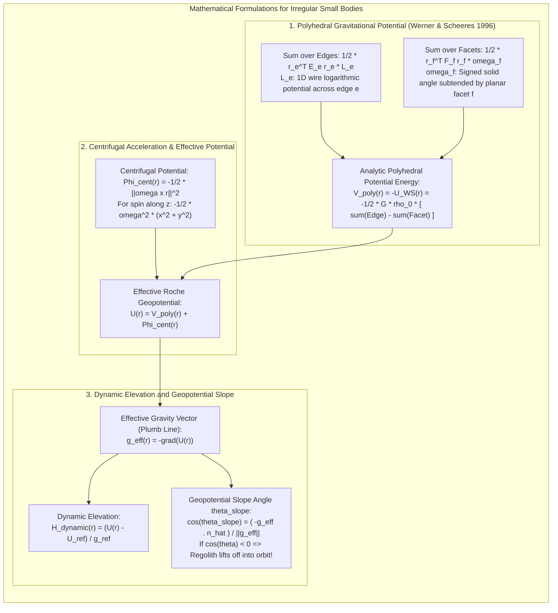

# Chapter 31: Planetary and Extraterrestrial DEMs (Moon, Mars, Asteroids, and Ocean Worlds)

*How mapping worlds without oceans, without GNSS, and sometimes without spherical symmetry forged modern photogrammetry and laser altimetry.*

---

## 31.5 Mathematical Foundations of Small-Body Geopotential and Polyhedral Elevation

On irregular, rapidly rotating asteroids and comets, geometric radius ($r$) bears no physical relationship to the flow of loose regolith or the stability of landing spacecraft. Defining elevation on an asteroid requires solving the **Werner-Scheeres polyhedral gravitational potential** and combining it with the centrifugal acceleration to evaluate the **Effective Roche Geopotential** and **Dynamic Elevation**.

---

### 31.5.1 The Werner-Scheeres Polyhedral Gravitational Formulation

In classical geodesy, gravitational potential is computed using point-mass approximations or spherical harmonics. But inside the Brillouin sphere of an irregular body, spherical harmonics diverge. 

In a landmark paper, Robert A. Werner and Daniel J. Scheeres (1996) derived the exact, closed-form analytic solution for the gravitational potential $V(\mathbf{r})$ of an arbitrary homogeneous polyhedral solid bounded by planar triangular facets.

#### 1. Geometric Mesh and Dyad Definitions
Let the asteroid volume $\mathcal{B} \subset \mathbb{R}^3$ be bounded by a closed, oriented 2-manifold triangular mesh consisting of:
* $V$ vertices $\mathbf{v}_i \in \mathbb{R}^3$ in the body-fixed principal-axis coordinate frame.
* $F$ planar triangular facets $f$, each with vertices $(\mathbf{v}_{f,1}, \mathbf{v}_{f,2}, \mathbf{v}_{f,3})$ ordered counterclockwise around the **outward unit normal vector** $\hat{\mathbf{n}}_f$, and relative displacement vector $\mathbf{r}_f = \mathbf{v}_{f,1} - \mathbf{r}$ from the evaluation point $\mathbf{r}$ to any point on facet $f$.
* $E$ undirected topological edges $e$ ($E = \frac{3}{2}F$ for a closed triangle mesh), each shared by two adjacent facets $f_1$ and $f_2$, with length $l_e = \|\mathbf{p}_2 - \mathbf{p}_1\|$, relative vector $\mathbf{r}_e = \mathbf{p}_1 - \mathbf{r}$, and in-plane outward edge normals $\hat{\mathbf{n}}_{e,f_k} = \hat{\mathbf{t}}_{e,f_k} \times \hat{\mathbf{n}}_{f_k}$ (pointing outward from the interior of facet $f_k$ perpendicular to directed edge tangent $\hat{\mathbf{t}}_{e,f_k}$).

#### 2. Closed-Form Analytic Potential and Sign Convention
Under constant bulk mass density $\rho_0$, Werner & Scheeres (1996) reduced the 3D volume integral $U_{\text{WS}}(\mathbf{r}) = +G\rho_0 \iiint_{\mathcal{B}} \|\mathbf{r} - \mathbf{r}'\|^{-1}\,dV' > 0$ via Gauss's divergence theorem and Green's theorem into an exact sum over edges and facets. Adopting the astrodynamic **potential-energy convention** $V_{\text{poly}}(\mathbf{r}) = -U_{\text{WS}}(\mathbf{r}) < 0$ (matching Section 31.3.3 so that physical mass flows toward lower potential $U$ along $-\nabla U$):

$$V_{\text{poly}}(\mathbf{r}) = -U_{\text{WS}}(\mathbf{r}) = -\frac{1}{2} G \rho_0 \left[ \sum_{e \in E} \big(\mathbf{r}_e^\top \mathbf{E}_e \mathbf{r}_e\big)\, L_e(\mathbf{r}) - \sum_{f \in F} \big(\mathbf{r}_f^\top \mathbf{F}_f \mathbf{r}_f\big)\, \omega_f(\mathbf{r}) \right]$$

where:
* $G = 6.67430 \times 10^{-11}\text{ m}^3\cdot\text{kg}^{-1}\cdot\text{s}^{-2}$ is the Newtonian gravitational constant.
* $\mathbf{F}_f = \hat{\mathbf{n}}_f \hat{\mathbf{n}}_f^\top$ is the symmetric $3\times 3$ facet normal projection dyad.
* $\mathbf{E}_e = \hat{\mathbf{n}}_{f_1} \hat{\mathbf{n}}_{e, f_1}^\top + \hat{\mathbf{n}}_{f_2} \hat{\mathbf{n}}_{e, f_2}^\top$ is the symmetric $3\times 3$ edge dyad coupling the two facets meeting along edge $e$ (where $\hat{\mathbf{t}}_{e, f_2} = -\hat{\mathbf{t}}_{e, f_1}$ because the shared edge $e$ is traversed in opposite counterclockwise orientations around $f_1$ and $f_2$, ensuring $\mathbf{E}_e = \mathbf{E}_e^\top$ and $\text{tr}(\mathbf{E}_e) = 0$).
* $L_e(\mathbf{r})$ is the dimensionless 1D logarithmic wire factor of edge $e$ with endpoints $\mathbf{p}_1, \mathbf{p}_2$ at distances $r_1 = \|\mathbf{p}_1 - \mathbf{r}\|$ and $r_2 = \|\mathbf{p}_2 - \mathbf{r}\|$:
  $$L_e(\mathbf{r}) = \ln\left( \frac{r_1 + r_2 + l_e}{r_1 + r_2 - l_e} \right)$$
* $\omega_f(\mathbf{r}) \in (-2\pi, +2\pi)$ is the **signed solid angle** subtended by triangular facet $f$ from $\mathbf{r}$, evaluated without inverse-cosine loss of precision via the van Oosterom & Strackee (1983) two-argument arctangent formula with $\mathbf{q}_k = \mathbf{v}_{f,k} - \mathbf{r}$ and $q_k = \|\mathbf{q}_k\|$:
  $$\omega_f(\mathbf{r}) = 2\,\text{atan2}\Big( \mathbf{q}_1 \cdot (\mathbf{q}_2 \times \mathbf{q}_3), \; q_1 q_2 q_3 + (\mathbf{q}_1 \cdot \mathbf{q}_2)q_3 + (\mathbf{q}_2 \cdot \mathbf{q}_3)q_1 + (\mathbf{q}_3 \cdot \mathbf{q}_1)q_2 \Big)$$
  Notice the built-in topological check: $\sum_{f \in F} \omega_f(\mathbf{r})$ equals $0$ strictly outside $\mathcal{B}$, $2\pi$ on any smooth facet interior, and $+4\pi$ strictly inside $\mathcal{B}$, satisfying Poisson's equation $\nabla^2 V_{\text{poly}}(\mathbf{r}) = G\rho_0 \sum_{f \in F} \omega_f(\mathbf{r}) = +4\pi G \rho_0\,\mathbb{I}_{\mathcal{B}}(\mathbf{r})$.

> [!WARNING]
> **Geodetic Potential ($+U_{\text{WS}}$) vs. Astrodynamic Potential Energy ($V_{\text{poly}} = -U_{\text{WS}}$) Sign Trap**
> Physical geodesy (Chapter 3) and Werner & Scheeres (1996) define gravitational potential *positively* ($W = U_{\text{WS}} + \frac{1}{2}\omega^2(x^2+y^2) > 0$, so inward gravity is $+\nabla W$ and geopotential numbers decrease upward as $C = W_0 - W$). Small-body astrodynamics (Scheeres, 2012; Barnouin et al., 2019) defines geopotential *energy* negatively ($U = -U_{\text{WS}} - \frac{1}{2}\omega^2(x^2+y^2) < 0$, so inward gravity is $-\nabla U$ and dynamic height increases upward as $H_{\text{dynamic}} = (U - U_{\text{ref}})/g_{\text{ref}}$). Never add $+U_{\text{WS}}$ to $-\frac{1}{2}\omega^2(x^2+y^2)$ without matching signs—doing so makes gravity and centrifugal force point in the same direction!

#### 3. Exact Gravitational Acceleration and Gravity-Gradient Tensor
Differentiating $V_{\text{poly}}(\mathbf{r})$ with respect to $\mathbf{r}$ ($\partial \mathbf{r}_f / \partial \mathbf{r} = -\mathbf{I}_3$, while derivatives of $L_e$ and $\omega_f$ cancel identically across closed loops) yields the inward gravitational acceleration $\mathbf{g}_{\text{grav}}(\mathbf{r})$ and gravity-gradient Hessian $\nabla \mathbf{g}_{\text{grav}}(\mathbf{r})$:

$$\mathbf{g}_{\text{grav}}(\mathbf{r}) = -\nabla V_{\text{poly}}(\mathbf{r}) = +\nabla U_{\text{WS}}(\mathbf{r}) = -G \rho_0 \left[ \sum_{e \in E} \mathbf{E}_e \mathbf{r}_e \, L_e(\mathbf{r}) - \sum_{f \in F} \mathbf{F}_f \mathbf{r}_f \, \omega_f(\mathbf{r}) \right]$$

$$\nabla \mathbf{g}_{\text{grav}}(\mathbf{r}) = -\nabla\nabla^\top V_{\text{poly}}(\mathbf{r}) = +G \rho_0 \left[ \sum_{e \in E} \mathbf{E}_e \, L_e(\mathbf{r}) - \sum_{f \in F} \mathbf{F}_f \, \omega_f(\mathbf{r}) \right]$$

---

### 31.5.2 Centrifugal Potential and the Effective Roche Geopotential

Small bodies rotate rapidly. Let the body rotate with constant angular velocity vector $\boldsymbol{\omega}$ aligned with the body-fixed $+z$ principal axis of inertia:
$$\boldsymbol{\omega} = \begin{pmatrix} 0 \\ 0 \\ \omega \end{pmatrix}$$

The centrifugal acceleration acting on a unit mass at position $\mathbf{r} = (x, y, z)^T$ is:
$$\mathbf{a}_{\text{cent}}(\mathbf{r}) = -\boldsymbol{\omega} \times (\boldsymbol{\omega} \times \mathbf{r}) = \omega^2 \begin{pmatrix} x \\ y \\ 0 \end{pmatrix}$$

The corresponding **centrifugal scalar potential $\Phi_{\text{cent}}(\mathbf{r})$** is:
$$\Phi_{\text{cent}}(\mathbf{r}) = -\frac{1}{2} \|\boldsymbol{\omega} \times \mathbf{r}\|^2 = -\frac{1}{2} \omega^2 \big( x^2 + y^2 \big)$$

The **Effective Roche Geopotential $U(\mathbf{r})$** in the body-fixed frame is the sum:
$$U(\mathbf{r}) = V_{\text{poly}}(\mathbf{r}) + \Phi_{\text{cent}}(\mathbf{r})$$

$$U(\mathbf{r}) = V_{\text{poly}}(\mathbf{r}) - \frac{1}{2} \omega^2 \big( x^2 + y^2 \big)$$

The **Effective Gravity Vector $\mathbf{g}_{\text{eff}}(\mathbf{r})$** (the direction of a physical plumb line) is:
$$\mathbf{g}_{\text{eff}}(\mathbf{r}) = -\nabla U(\mathbf{r}) = \mathbf{g}_{\text{grav}}(\mathbf{r}) + \omega^2 \begin{pmatrix} x \\ y \\ 0 \end{pmatrix}$$

---

### 31.5.3 Dynamic Elevation and Surface Slope Stability

#### 1. Dynamic Elevation ($H_{\text{dynamic}}$)
Let $U_{\text{ref}}$ be a chosen reference geopotential level (typically the potential of the minimum energy surface or equatorial ridge), and let $g_{\text{ref}}$ be a nominal reference gravity value ($g_{\text{ref}} = \|\mathbf{g}_{\text{eff}}(\mathbf{r}_{\text{ref}})\|$).

The **Dynamic Elevation** of any surface facet $j$ is:

$$H_{\text{dynamic}}(\mathbf{r}_j) = \frac{U(\mathbf{r}_j) - U_{\text{ref}}}{g_{\text{ref}}}$$

* **Physical Axiom:** Regolith, dust particles, and boulders accelerate strictly along $-\nabla U$. A particle placed on the surface will always roll toward regions of **lower dynamic elevation**.

#### 2. Geopotential Slope Angle ($\theta_{\text{slope}}$)
The physical tilt of a triangular terrain facet $f$ relative to local gravity is governed by the angle between the **inward effective gravity vector ($-\mathbf{g}_{\text{eff}}$)** and the **geometric outward unit normal $\hat{\mathbf{n}}_f$**:

$$\cos\theta_{\text{slope}} = \frac{-\mathbf{g}_{\text{eff}}(\mathbf{r}_f) \cdot \hat{\mathbf{n}}_f}{\|\mathbf{g}_{\text{eff}}(\mathbf{r}_f)\|}$$

$$\theta_{\text{slope}} = \arccos\left( \frac{-\mathbf{g}_{\text{eff}}(\mathbf{r}_f) \cdot \hat{\mathbf{n}}_f}{\|\mathbf{g}_{\text{eff}}(\mathbf{r}_f)\|} \right)$$

* **The Slope Stability Regimes:**
  * **Stable Regolith ($\theta_{\text{slope}} < 30^\circ\text{–}35^\circ$):** The facet slope is below the angle of repose for loose granular material. Boulders and regolith rest stably on the facet.
  * **Avalanche Regolith ($35^\circ < \theta_{\text{slope}} < 90^\circ$):** The slope exceeds the friction angle; loose regolith avalanches down the geopotential gradient toward regional geopotential lows.
  * **Centrifugal Lofting / Mass Shedding ($\theta_{\text{slope}} > 90^\circ$):** 
    $$\cos\theta_{\text{slope}} < 0 \iff -\mathbf{g}_{\text{eff}} \cdot \hat{\mathbf{n}}_f < 0 \iff \mathbf{g}_{\text{eff}} \cdot \hat{\mathbf{n}}_f > 0$$
    Centrifugal acceleration exceeds gravitational attraction! Effective gravity points **outward into space**. Loose dust and gravel cannot rest on the surface; they detach and are launched into heliocentric or orbital trajectory (**rotational fission**).

---

### 31.5.4 Worked Numerical Example: Roche Geopotential and Dynamic Elevation on Asteroid (101955) Bennu

Consider carbonaceous rubble-pile asteroid **(101955) Bennu** as characterized by OSIRIS-REx (Barnouin et al., 2019): bulk mass $M = 7.329 \times 10^{10}\text{ kg}$ ($GM = 4.892\text{ m}^3\cdot\text{s}^{-2}$), mean bulk density $\rho_0 = 1,190\text{ kg}\cdot\text{m}^{-3}$, sidereal rotation period $P_{\text{rot}} = 4.296057\text{ hr} = 15,465.8\text{ s}$ ($\omega = \frac{2\pi}{P_{\text{rot}}} = 4.0626 \times 10^{-4}\text{ rad}\cdot\text{s}^{-1}$), equatorial ridge radius $r_{\text{eq}} \approx 282.5\text{ m}$, and polar radius $r_{\text{pole}} \approx 249.4\text{ m}$ (geometric summit-to-pole difference $r_{\text{eq}} - r_{\text{pole}} = +33.1\text{ m}$).

1. **Polar vs. Equatorial Effective Gravity:**
   Approximating the external potential to leading oblate order ($V = -\frac{GM}{r}[1 - J_2(R_0/r)^2 P_2(\sin\varphi_c)]$, with $P_2(1) = +1$, $P_2(0) = -\frac{1}{2}$, and $J_2 \approx 0.0175$ over reference radius $R_0 = 246\text{ m}$):
   * At the **North Pole** ($x = y = 0, z = +249.4\text{ m}$, $\sin\varphi_c = +1$, where $\Phi_{\text{cent}} = 0$):
     $$g_{\text{eff,pole}} \approx \frac{GM}{r_{\text{pole}}^2}\left(1 - 3 J_2\frac{R_0^2}{r_{\text{pole}}^2}\right) \approx \frac{4.892}{(249.4)^2}(0.9489) = \mathbf{7.46 \times 10^{-5}\text{ m}\cdot\text{s}^{-2}} \quad (7.6\,\mu g_\oplus)$$
     $$U_{\text{pole}} \approx -\frac{GM}{r_{\text{pole}}}\left(1 - J_2\frac{R_0^2}{r_{\text{pole}}^2}\right) \approx -\frac{4.892}{249.4}(0.9830) = \mathbf{-0.01928\text{ m}^2\cdot\text{s}^{-2}}$$
   * At the **Equatorial Ridge** ($\sqrt{x^2+y^2} = 282.5\text{ m}, z = 0, \sin\varphi_c = 0$), outward centrifugal acceleration $\omega^2 r_{\text{eq}} = (4.0626 \times 10^{-4})^2 (282.5) = \mathbf{4.66 \times 10^{-5}\text{ m}\cdot\text{s}^{-2}}$ cancels nearly $75\%$ of inward Newtonian attraction ($g_{\text{grav,eq}} = \frac{GM}{r_{\text{eq}}^2}[1 + \frac{3}{2}J_2\frac{R_0^2}{r_{\text{eq}}^2}] \approx 6.25 \times 10^{-5}\text{ m}\cdot\text{s}^{-2}$):
     $$g_{\text{eff,eq}} = g_{\text{grav,eq}} - \omega^2 r_{\text{eq}} \approx 6.25 \times 10^{-5} - 4.66 \times 10^{-5} = \mathbf{1.59 \times 10^{-5}\text{ m}\cdot\text{s}^{-2}} \quad (1.6\,\mu g_\oplus)$$
     $$U_{\text{eq}} \approx -\frac{GM}{r_{\text{eq}}}\left(1 + \frac{1}{2}J_2\frac{R_0^2}{r_{\text{eq}}^2}\right) - \frac{1}{2}\omega^2 r_{\text{eq}}^2 \approx -0.01743 - 0.00659 = \mathbf{-0.02402\text{ m}^2\cdot\text{s}^{-2}}$$

2. **Dynamic Elevation Inversion and Critical Spin Limit:**
   Adopting the equatorial ridge as the zero-elevation reference ($U_{\text{ref}} = U_{\text{eq}} = -0.02402\text{ m}^2\cdot\text{s}^{-2}$) with mean reference gravity $g_{\text{ref}} = 6.0 \times 10^{-5}\text{ m}\cdot\text{s}^{-2}$:
   $$H_{\text{dynamic}}(\text{Pole}) = \frac{U_{\text{pole}} - U_{\text{eq}}}{g_{\text{ref}}} = \frac{-0.01928 - (-0.02402)}{6.0 \times 10^{-5}} = \mathbf{+79.0\text{ m}}$$
   Even though Bennu's poles sit $33.1\text{ m}$ *closer* to the center of mass than its equatorial bulge, the poles stand roughly **$79\text{ m}$ dynamically uphill** above the equator—explaining why YORP-driven spin-up triggers regolith landslides migrating toward the equator and why cohesionless rubble piles break up near the spherical critical spin-barrier period $P_{\text{crit}} = \sqrt{\frac{3\pi}{G\rho_0}} = \sqrt{\frac{3\pi}{6.6743\times 10^{-11} \times 1190}} = \mathbf{3.03\text{ hours}}$.
