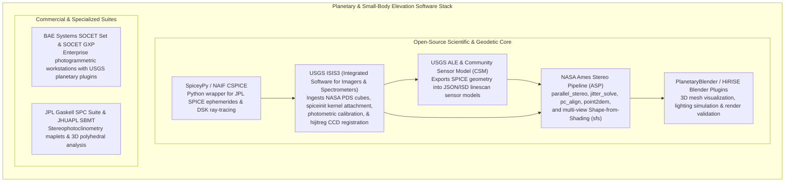

# Chapter 31: Planetary and Extraterrestrial DEMs (Moon, Mars, Asteroids, and Ocean Worlds)

*How mapping worlds without oceans, without GNSS, and sometimes without spherical symmetry forged modern photogrammetry and laser altimetry.*

---

## 31.6 Software Ecosystem

Planetary elevation modeling requires specialized software toolchains capable of interfacing with deep-space observation geometry, handling extreme line-scan camera optical distortions, and solving multi-view photoclinometry on irregular bodies. This section reviews the primary open-source engines developed by NASA and the USGS, alongside specialized commercial photogrammetric workstations.



---

### 31.6.1 Open-Source Planetary Processing Engines

#### 1. USGS ISIS3 (Integrated Software for Imagers and Spectrometers)
Maintained by the USGS Astrogeology Science Center in Flagstaff, Arizona, **ISIS3** (and its modern modular successor ISIS) is the foundational cartographic software for planetary science:
* **PDS Ingestion:** Converts raw NASA Planetary Data System (PDS) archive files from over 40 space missions (Mariner, Viking, Voyager, Galileo, Cassini, MRO, LRO, MESSENGER) into native ISIS `.cub` multi-band raster cubes.
* **`spiceinit`:** The critical step in planetary mapping. Reads the spacecraft clock timestamp from image headers, queries the SPICE kernel repository, and attaches the exact orbital trajectory (`SPK`), spacecraft pointing quaternions (`CK`), and planetary orientation (`PCK`) directly into the image cube header.
* **Radiometric Calibration:** Applies flat-fielding, dark-current subtraction, and empirical photometric normalization (e.g., McEwen lunar photometric correction).

#### 2. USGS ALE (Abstraction Layer for Ephemerides) and Community Sensor Model (CSM)
Historically, camera geometry was locked inside heavy monolithic ISIS `.cub` binaries. **USGS ALE** (`ale`) decouples observation geometry from pixel rasters by querying SPICE kernels (or embedded ISIS labels) and exporting lightweight JSON **Image Support Data (ISD)** files consumed by the **USGS Community Sensor Model (`usgscsm`)** library:
* Enables identical linescan, push-frame, and SAR rigorous sensor models to run seamlessly inside NASA ASP, SOCET GXP, and Python notebooks without duplicating gigabyte-scale `.cub` files.
* Supports high-frequency quaternion and position state-vector updates written directly back to `.adjusted_state.json` by `bundle_adjust` and `jitter_solve`.

#### 3. NASA Ames Stereo Pipeline (ASP) End-to-End CLI Workflow
Developed by the Intelligent Robotics Group (IRG) at NASA Ames Research Center (Beyer et al., 2018; Alexandrov & Beyer, 2018), **ASP** provides an open-source, HPC-ready command-line suite bridging raw PDS/ISIS imagery to co-registered sub-meter DEMs:
* **`bundle_adjust` & `jitter_solve`:** Refines rigid extrinsic camera poses (`bundle_adjust`) and continuous linescan attitude/position splines (`jitter_solve`) using dense disparity tie-points and altimetric reference constraints.
* **`parallel_stereo` & `point2dem`:** Executes tile-parallel correlation (`--stereo-algorithm asp_mgm` More Global Matching or `asp_bm`), 3D ray triangulation, outlier filtering, and orthometric/planetocentric GeoTIFF gridding (`point2dem --r-mars` or explicit PROJ WKT2 strings).
* **`pc_align` & `sfs`:** Co-registers photogrammetric point clouds to MOLA/LOLA laser shots via point-to-plane ICP (`pc_align --max-displacement`), followed by multi-view Shape-from-Shading (`sfs`) for single-pixel refinement in polar shadows.

```bash
# End-to-end ISIS3 + USGS CSM + NASA ASP workflow for LROC NAC lunar polar DEM
# 1. Ingest PDS EDRs, calibrate radiometrically, and attach SPICE + CSM ISD models
lronac2isis from=M11001L.IMG to=left.raw.cub
lronac2isis from=M11002R.IMG to=right.raw.cub
spiceinit from=left.raw.cub shape=ellipsoid web=false
spiceinit from=right.raw.cub shape=ellipsoid web=false
lronaccal from=left.raw.cub to=left.cal.cub
lronaccal from=right.raw.cub to=right.cal.cub

# 2. Initial stereo pass + linescan jitter_solve anchored to LOLA polar DEM
parallel_stereo --stereo-algorithm asp_mgm left.cal.cub right.cal.cub stereo_init/run
jitter_solve left.cal.cub right.cal.cub --match-files-prefix stereo_init/run \
    --num-lines-per-orientation 500 --heights-from-dem lola_south_pole_20m.tif \
    --heights-from-dem-uncertainty 2.0 -o jitter_opt/run

# 3. Final stereo, ICP co-registration to LOLA shots, 1-m DEM gridding, and SfS
parallel_stereo --stereo-algorithm asp_mgm left.cal.cub right.cal.cub \
    --bundle-adjust-prefix jitter_opt/run stereo_clean/run
# Denser stereo cloud first (reference) and sparse LOLA track second (source),
# saving inversely transformed dense cloud aligned onto LOLA:
pc_align --max-displacement 30.0 stereo_clean/run-PC.tif lola_shots.csv \
    -o aligned/run --save-inv-transformed-reference-points
point2dem aligned/run-trans_reference.tif --tr 1.0 \
    --t_srs "IAU_2015:30135" -o dem_1m/run
sfs -i dem_1m/run-DEM.tif left.cal.cub right.cal.cub multi_az_3.cal.cub \
    --bundle-adjust-prefix jitter_opt/run --reflectance-type 1 \
    --smoothness-weight 0.08 --initial-dem-constraint-weight 0.001 -o sfs_1m/run
```

#### 4. Blender Planetary Plugins and 3D Mesh Inspection
For mission PR, rover traverse lighting previews, and visual forensic inspection of artifacts (such as sub-pixel CCD seams or washboard jitter), planetary cartographers use **Blender** (`gis-history`) equipped with open-source plugins such as the **HiRISE DTM Importer** and **PlanetaryBlender**:
* Directly imports PDS4/PDS3 `.IMG` elevation rasters and Wavefront `.obj` / NAIF `DSK` asteroid polyhedral meshes at true metric scale, draping orthoimagery under physically accurate collimated solar ray-tracing to validate cast shadows against actual orbital photographs.

#### 5. `SpiceyPy`: Python Interface to NASA NAIF SPICE
Developed by Andrew Annex, `SpiceyPy` wraps JPL's C-language `CSPICE` toolkit—supporting both triaxial ellipsoids (`NEAR POINT/ELLIPSOID`) and full 3D topographic/polyhedral meshes (`DSK/UNPRIORITIZED`):

```python
"""
Planetary observation geometry calculation using SpiceyPy.
Demonstrates loading SPICE kernels and computing sub-spacecraft ground track,
sub-solar coordinates (observed from MGS), and local illumination angles on Mars.
"""

import spiceypy as spice
import numpy as np


def calculate_mars_observation_geometry(utc_time_str: str, metakernel_path: str) -> None:
    """
    Computes sub-spacecraft coordinates and illumination angles on Mars using SPICE.

    Args:
        utc_time_str: UTC observation timestamp (e.g., "2003-08-27T09:51:13").
        metakernel_path: Path to SPICE metakernel (.tm) listing LSK, PCK, SPK, CK, DSK.
    """
    spice.furnsh(metakernel_path)

    try:
        # 1. Convert UTC string to Ephemeris Time (TDB seconds past J2000 epoch)
        et = spice.str2et(utc_time_str)
        print(f"Ephemeris Time (ET): {et:.3f} s past J2000 TDB")

        # 2. Compute Sub-Spacecraft Point on Mars (use "DSK/UNPRIORITIZED" if DSK loaded)
        spoint_sc, trgepc, srfvec_sc = spice.subpnt(
            method="NEAR POINT/ELLIPSOID",
            target="MARS",
            et=et,
            fixref="IAU_MARS",
            abcorr="LT+S",
            obsrvr="MGS",
        )

        # Convert body-fixed Cartesian (km) to planetocentric radius, lon, lat
        radius_sc, lon_sc_rad, lat_sc_rad = spice.reclat(spoint_sc)
        lon_sc_deg = np.degrees(lon_sc_rad) % 360.0  # East-positive [0, 360)
        lat_sc_deg = np.degrees(lat_sc_rad)

        # Also compute planetographic coordinates using Mars radii from PCK
        _, radii = spice.bodvrd("MARS", "RADII", 3)
        flattening = (radii[0] - radii[2]) / radii[0]
        lon_pg_rad, lat_pg_rad, alt_pg_km = spice.recpgr(
            body="MARS", rectan=spoint_sc, re=radii[0], f=flattening
        )

        # 3. Compute Sub-Solar Point on Mars as seen from observer MGS at epoch et
        spoint_sun, _, _ = spice.subslr(
            method="NEAR POINT/ELLIPSOID",
            target="MARS",
            et=et,
            fixref="IAU_MARS",
            abcorr="LT+S",
            obsrvr="MGS",
        )
        _, lon_sun_rad, lat_sun_rad = spice.reclat(spoint_sun)

        # 4. Compute Phase, Solar Incidence, and Emission Angles at Sub-Spacecraft Point
        _, _, phase, solar_inc, emission = spice.ilumin(
            method="ELLIPSOID",
            target="MARS",
            et=et,
            fixref="IAU_MARS",
            abcorr="LT+S",
            obsrvr="MGS",
            spoint=spoint_sc,
        )

        print("\n--- Planetary Geodesy Report (IAU_MARS Frame) ---")
        print(f"Planetocentric Sub-SC:   Lat {lat_sc_deg:.4f}° N, Lon {lon_sc_deg:.4f}° E")
        print(f"Planetographic Sub-SC:   Lat {np.degrees(lat_pg_rad):.4f}° N, Alt {alt_pg_km*1e3:.1f} m")
        print(f"Areocentric Radius:      {radius_sc:.3f} km (Obs range: {np.linalg.norm(srfvec_sc):.1f} km)")
        print(f"Sub-Solar Point:         Lat {np.degrees(lat_sun_rad):.4f}° N, Lon {np.degrees(lon_sun_rad)%360:.4f}° E")
        print(f"Incidence / Emission / Phase: {np.degrees(solar_inc):.2f}° / {np.degrees(emission):.2f}° / {np.degrees(phase):.2f}°")

    finally:
        # Always unload kernels to prevent state leakage across pipeline workers
        spice.kclear()
```

---

### 31.6.2 Commercial and Specialized Workstations

#### 1. BAE Systems SOCET Set and SOCET GXP
Deployed extensively at the USGS Astrogeology Science Center, the University of Arizona HiRISE Operations Center, and planetary landing-site certification boards:
* Integrates open-source USGS CSM (`usgscsm`) camera plugins with hardware-accelerated active-shutter 3D stereo monitors (`NGATE` / `ASM` automatic terrain extraction plus interactive stereo editing).
* Enables human photogrammetrists to manually edit stereo blunders over featureless Martian dust mantles or boulder shadows where automated correlation degrades, producing the gold-standard $1\text{ m}$ HiRISE DTMs archived on the NASA PDS.

#### 2. JPL Gaskell SPC Suite and JHUAPL Small Body Mapping Tool (SBMT)
* **Gaskell SPC Suite:** Specialized Fortran/C photogrammetric-photoclinometric workstation suite developed by Robert Gaskell (JPL / Planetary Science Institute) to construct landmark networks, $99\times 99$ local maplets, and watertight polyhedral `.icq`/`.obj` shape models for irregular asteroids and comets.
* **Small Body Mapping Tool (SBMT):** Openly distributed Java/VTK 3D visualization and analysis platform built by the Johns Hopkins University Applied Physics Laboratory (JHUAPL), allowing mission scientists to drape spacecraft images, OLA lidar tracks, Werner-Scheeres dynamic elevations, and geopotential slope maps directly onto multi-million-facet asteroid meshes.

---

### 31.6.3 Interoperability with GDAL, PROJ (`IAU_2015`), and PDS4 Archives

Modern planetary DEM products published to the NASA **Planetary Data System (PDS4)** use strict XML schema sidecars alongside uncompressed binary arrays or Cloud-Optimized GeoTIFFs (COGs). Beginning with PROJ 8.2+ and GDAL 3.4+, planetary cartographers no longer need brittle custom `+a=... +b=...` strings that drop body names; `proj.db` natively ships the **`IAU_2015` coordinate reference registry**:
* `IAU_2015:49900` (Mars 2015 planetocentric geographic 2D, East-positive) vs. `IAU_2015:49901` (Mars 2015 planetographic, West-positive)—allowing `gdalinfo` and `projinfo` to flag coordinate-system mismatches automatically before reprojection.
* Python's `pds4_tools` and `rasterio` read PDS4 label offsets, scaling factors (`scaling_factor`, `value_offset`), and `Special_Constants` (`missing_constant`) directly into `xarray` arrays for seamless downstream terrain analysis.

| Software / Library | License | Primary Role in Planetary DEM Pipeline | Supported Target Geometry |
| :--- | :--- | :--- | :--- |
| **NAIF `CSPICE` / `SpiceyPy`** | Open (Public Domain / MIT) | Ephemeris, attitude, clock, and light-time ray-tracing | Ellipsoids & Type-2 3D `DSK` meshes |
| **USGS `ISIS3` & `ALE` / `usgscsm`** | Open (Public Domain / CC0) | PDS radiometric calibration, `spiceinit`, CSM ISD export | Spherical / oblate planets & moons |
| **NASA Ames Stereo Pipeline (`ASP`)** | Open (Apache 2.0) | `parallel_stereo`, `jitter_solve`, `pc_align`, `sfs` | 2.5D planetary & polar DEMs |
| **BAE `SOCET Set` / `SOCET GXP`** | Commercial | Interactive 3D stereo editing & certified landing-site DTMs | 2.5D planetary DTMs (via USGS CSM) |
| **Gaskell `SPC` & JHUAPL `SBMT`** | Institutional / Open Binary | Landmark maplets, photoclinometry, Roche-potential meshes | Arbitrary 3D polyhedral small bodies |
