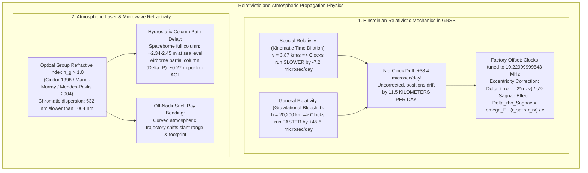

# Chapter 32: Hardware Timing, Synchronization, Leap Seconds, and Relativistic/Atmospheric Physics

*Why every range and position sensor is fundamentally a clock—and how microsecond timing bugs, leap seconds, and atmospheric refraction corrupt DEMs.*

---

## 32.3 Relativistic and Atmospheric Propagation Physics

High-accuracy digital elevation models are vulnerable to fundamental relativistic and atmospheric phenomena. When a satellite laser altimeter fires a pulse from space or a GNSS receiver calculates an RTK elevation fix, the signal traverses relativistic gravitational gradients and variable atmospheric refractivity. 

If Einstein's General Relativity is omitted from satellite clocks, global positioning errors compound by more than $11\text{ kilometers per day}$. Similarly, if atmospheric group refractivity delay is omitted, spaceborne laser altimeter elevations (ICESat-2, GEDI) are biased low by over $2.4\text{ meters}$ and airborne LiDAR swaths are depressed by $0.25\text{–}1.2\text{ meters}$ depending on flight altitude. This section derives the relativistic clock/frame corrections and atmospheric propagation physics that govern geodetic elevation.

---

### 32.3.1 Relativistic Physics in Satellite Positioning

Every georeferenced elevation model depends on Global Navigation Satellite Systems (GPS, GLONASS, Galileo, BeiDou) to locate the aircraft, drone, or satellite in three-dimensional space. GNSS cannot function under classical Newtonian mechanics; it is an operational application of Albert Einstein's **Special and General Theories of Relativity**.

#### 1. The Twin Relativistic Clock Effects
A GNSS satellite orbits Earth at an altitude of $h \approx 20,200\text{ km}$ with an orbital speed of $v \approx 3.874\text{ km/s}$:
1. **Special Relativity (Kinematic Time Dilation):**
   Under Special Relativity (Einstein 1905), a clock in motion relative to an observer runs slower than a stationary clock. The fractional frequency shift is:
   $$\frac{\Delta f_{\text{SR}}}{f_0} = -\frac{v^2}{2 c^2} \approx -\frac{(3874\text{ m/s})^2}{2 (2.9979 \times 10^8\text{ m/s})^2} \approx -8.349 \times 10^{-11}$$
   Over a 24-hour day, moving satellite clocks **lose approximately $7.2\text{ microseconds}$** relative to ground clocks:
   $$\Delta t_{\text{SR}} = -8.349 \times 10^{-11} \times 86,400\text{ s} \approx -7.21\,\mu\text{s/day}$$
2. **General Relativity (Gravitational Blueshift):**
   Under General Relativity (Einstein 1915), clocks tick faster in weaker gravitational potentials. Because a GPS satellite orbits high above Earth's gravitational well, its potential $\Phi_{\text{sat}} = -\frac{GM_E}{R_{\text{sat}}}$ is significantly higher (less negative) than the surface potential $\Phi_{\text{ground}} = -\frac{GM_E}{R_E}$:
   $$\frac{\Delta f_{\text{GR}}}{f_0} = \frac{\Delta \Phi}{c^2} = \frac{GM_E}{c^2} \left( \frac{1}{R_E} - \frac{1}{R_{\text{sat}}} \right) \approx +5.284 \times 10^{-10}$$
   Over 24 hours, the weaker gravity causes satellite clocks to **gain approximately $45.6\text{ microseconds}$**:
   $$\Delta t_{\text{GR}} = +5.284 \times 10^{-10} \times 86,400\text{ s} \approx +45.65\,\mu\text{s/day}$$

#### 2. The Net Daily Drift: 11.5 Kilometers
Combining the two relativistic effects:
$$\Delta t_{\text{net}} = \Delta t_{\text{GR}} + \Delta t_{\text{SR}} = +45.65\,\mu\text{s} - 7.21\,\mu\text{s} = \mathbf{+38.44\text{ microseconds per day}}$$
* **The Catastrophic Consequence:** If uncorrected, this $38.44\,\mu\text{s}$ daily clock drift multiplied by the speed of light would cause pseudorange measurements to drift by:
  $$\Delta \rho = c \cdot \Delta t_{\text{net}} \approx (2.9979 \times 10^8\text{ m/s}) \times (38.44 \times 10^{-6}\text{ s}) \approx \mathbf{11,524\text{ meters per day!}}$$
  The entire global positioning system would fail within two minutes of operation.
* **The Hardware Factory Frequency Offset:**
  To cancel this drift, satellite manufacturers intentionally detune the master atomic clock oscillators prior to launch:
  $$f_{\text{satellite}} = 10.23\text{ MHz} \times \big( 1 - 4.4647 \times 10^{-10} \big) = \mathbf{10.22999999543\text{ MHz}}$$
  When the satellite reaches orbit, gravitational blueshift and time dilation shift the apparent frequency up to **exactly $10.23000000000\text{ MHz}$** as observed from the surface of Earth.

#### 3. Orbital Eccentricity Relativistic Correction ($\Delta t_{\text{rel}}$)
Because real orbits are slightly elliptical ($e \ne 0$), satellite speed and altitude oscillate between perigee and apogee ([notation-and-symbols.md](../00-front-matter/notation-and-symbols.md), Section 4.3):
$$\Delta t_{\text{rel}} = -\frac{2 \sqrt{G M_\oplus a}}{c_0^2} e \sin E = -\frac{2 (\mathbf{X}^s \cdot \mathbf{V}^s)}{c_0^2}$$
where $\mathbf{X}^s$ and $\mathbf{V}^s$ are the satellite position and velocity vectors, $e$ is eccentricity, and $E$ is eccentric anomaly. This introduces an oscillating correction of up to **$\pm 70\text{ nanoseconds}$ ($\pm 21\text{ meters}$)** that must be computed dynamically inside GNSS receiver firmware.

#### 4. The Sagnac Effect
During the time it takes for a GNSS signal to travel from satellite to receiver ($\tau \approx 0.07\text{ seconds}$), the Earth rotates beneath the signal by an angle $\omega_\oplus \tau$. In the Earth-Centered Earth-Fixed (ECEF) rotating frame, this path length difference—the **Sagnac Effect**—must be corrected:
$$\Delta \rho_{\text{Sagnac}} = \frac{\boldsymbol{\omega}_\oplus \cdot (\mathbf{X}^s \times \mathbf{X}_r)}{c_0} = \frac{\omega_\oplus}{c_0}\big(X^s Y_r - Y^s X_r\big)$$
where $\mathbf{X}_r = [X_r, Y_r, Z_r]^\top$ is receiver ECEF position. The Sagnac range correction reaches up to **$\pm 30\text{ meters}$**, directly corrupting horizontal and vertical elevation coordinates if omitted.

---

### 32.3.2 Atmospheric Group Refractivity Delay for LiDAR and Altimetry

In vacuum, electromagnetic waves travel at $c_0 = 299,792,458\text{ m/s}$. When an airborne laser scanner, spaceborne altimeter (ICESat-2), or radar altimeter (CryoSat-2) fires a pulse through the atmosphere, the wave travels through air where the **group refractive index $n_g > 1.0$**.

#### 1. The Physics of Atmospheric Slowdown
The group velocity of a laser pulse of wavelength $\lambda$ in air is:
$$v_g = \frac{c_0}{n_g(P, T, e, \lambda)}$$
Because $v_g < c_0$, the pulse requires more time to travel to the ground and back than if the atmosphere were a vacuum. If an elevation processor converts two-way travel time $\Delta t$ to range using $c_0$, the calculated range is **artificially too long**, causing the reconstructed ground elevation to be **artificially too low**.

#### 2. The Ciddor (1996) Group Refractivity Formula
Standardized by the International Association of Geodesy (IAG), the group refractivity $N_g = (n_g - 1) \times 10^6$ for optical lasers is computed as a function of atmospheric pressure $P$ ($\text{hPa}$), temperature $T$ ($\text{K}$), and water vapor partial pressure $e$ ($\text{hPa}$):

$$N_g = \left( \frac{\rho_{\text{dry}}}{\rho_{\text{dry, std}}} \right) N_{\text{dry, std}} + \left( \frac{\rho_{\text{water}}}{\rho_{\text{water, std}}} \right) N_{\text{water, std}}$$

#### 3. Spaceborne Full-Column vs. Airborne Partial-Column Delay ($\Delta R_{\text{atm}}$)
Integrating group refractivity $N_g(z) = (n_g(z) - 1)\times 10^6$ along the slant optical path between ground elevation $z_0$ (barometric pressure $P_0$) and sensor altitude $H$ (ambient pressure $P(H)$) at off-nadir angle $\theta$:

$$\Delta R_{\text{atm}} = 10^{-6} \int_{z_0}^H N_g(z) \sec\theta(z) \, dz + \Delta R_{\text{bend}}(\theta)$$

Applying the hydrostatic balance ($dP = -\rho_{\text{air}} g\,dz$) reveals a critical physical distinction between **microwave GNSS**, **spaceborne laser altimetry**, and **airborne LiDAR**:

1. **Optical vs. Microwave Water-Vapor Dispersion:**
   In microwave GNSS and radar altimetry ($1\text{–}36\text{ GHz}$; Saastamoinen, 1972; Davis et al., 1985), the zenith hydrostatic delay is $\text{ZHD}_{\text{radio}} \approx 0.0022768\,P_0 \approx 2.307\text{ m}$ at sea level ($P_0 = 1013.25\text{ hPa}$), accompanied by a **large, highly variable positive wet delay** ($\text{ZWD}_{\text{radio}} \approx +5\text{ to }+35\text{ cm}$) caused by the permanent rotational dipole of $\text{H}_2\text{O}$ molecules. At **optical laser frequencies** ($280\text{–}560\text{ THz}$; Marini & Murray, 1973; Mendes & Pavlis, 2004), water molecules cannot reorient with the rapidly oscillating electric field! Consequently, the optical non-hydrostatic wet correction is **tiny** ($+0.1\text{ to }+0.5\text{ cm}$, only $\approx +1.6\text{ mm}$ per $10\text{ hPa}$ of water-vapor partial pressure at $532\text{ nm}$), whereas chromatic electronic dispersion makes green $532\text{ nm}$ pulses ($N_{g,\text{std}} \approx 289.7\text{ ppm}$) travel measurably slower than $1064\text{ nm}$ NIR pulses ($N_{g,\text{std}} \approx 276.7\text{ ppm}$).
2. **Spaceborne Laser Altimetry ($P(H) = 0$):**
   For orbital sensors above the neutral atmosphere (ICESat-2 ATLAS at $532\text{ nm}$, Neumann et al., 2019; ISS GEDI at $1064\text{ nm}$), the pulse traverses the **entire atmospheric mass column** ($P_0 - 0 = P_0$). At sea level ($P_0 = 1013.25\text{ hPa}$), the one-way nadir atmospheric range delay is **$\Delta R_{\text{atm}} \approx 2.45\text{ m}$ at $532\text{ nm}$** and **$\approx 2.34\text{ m}$ at $1064\text{ nm}$** (roughly approximated in first-order geodetic budgets by $\Delta R_{\text{atm}} \approx \frac{0.00231\text{–}0.00242}{\cos\theta}P_0$).
3. **Airborne and High-Altitude LiDAR ($P(H) > 0$):**
   An aircraft flying at altitude $H$ within the troposphere only traverses the air column *below* its belly, so the hydrostatic delay scales with the **differential pressure drop $\Delta P = P(z_0) - P(H)$**:
   $$\Delta R_{\text{airborne}}(\theta) \approx c_{\text{opt}}(\lambda)\,\frac{P(z_0) - P(H)}{\cos\theta}$$
   For a low-altitude mapping aircraft at $H_{\text{agl}} = 1,000\text{ m}$ ($\Delta P \approx 114.5\text{ hPa}$), $\Delta R_{\text{airborne}} \approx \mathbf{0.27\text{ m}}$ ($27\text{ cm}$ at nadir, $31\text{ cm}$ at $\theta = 30^\circ$)—nearly **three times larger** than the USGS 3DEP QL1/QL2 vertical RMSE ceiling ($10\text{ cm}$)! For high-altitude Geiger/single-photon sensors at $H_{\text{agl}} = 4,000\text{–}9,000\text{ m}$, $\Delta R_{\text{airborne}}$ reaches **$0.95\text{ to }1.70\text{ m}$**, and scan-angle variation ($\sec 30^\circ - 1 = 0.1547$) warps every swath upward at its edges ("atmospheric smile") by $4\text{–}26\text{ cm}$ if omitted!

#### 4. Off-Nadir Atmospheric Ray Bending
Because refractive index $n(z)$ increases exponentially toward the ground, an off-nadir laser or radar ray bends continuously downward along a concave curve governed by Bouguer's spherical Snell invariant $r\,n(r)\sin\theta(r) = \text{const}$. At off-nadir angle $\theta$, the cumulative angular deflection is $\Delta\theta_{\text{bend}} \approx (n_0 - 1)\tan\theta$ ($\approx 160\,\mu\text{rad}$ or $33''$ at $\theta = 30^\circ$ from space, displacing an ICESat-2 off-pointing footprint horizontally by $\sim 0.7\text{ m}$ across the troposphere). Both range delay and ray-bending must be applied before transforming slant range into 3D ECEF ground coordinates.
