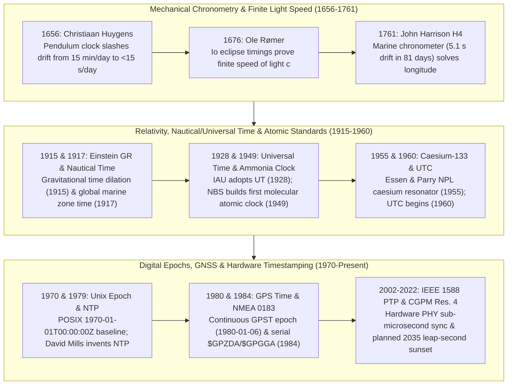

# Chapter 32: Hardware Timing, Synchronization, Leap Seconds, and Relativistic/Atmospheric Physics

*Why every range and position sensor is fundamentally a clock—and how microsecond timing bugs, leap seconds, and atmospheric refraction corrupt DEMs.*

---

## 32.4 Historical Evolution: From Marine Chronometers to Atomic Clocks and PTP

The history of spatial elevation modeling is inextricably bound to the history of horology and timekeeping. Long before satellites, the ability to determine longitude and chart coastal hazards depended on mechanical spring escapements. Today, microsecond timing protocols dictate whether a million-point-per-second LiDAR cloud resolves the crown of a road or projects a phantom double-surface.

The milestones below, anchored in the `schwehr/gis-history` repository, trace the lineage of timekeeping and synchronization from 17th-century pendulum clocks to modern hardware timestamping.

---

### 32.4.1 The Mechanical and Optical Dawn: 1656 to 1761

#### 1656: Christiaan Huygens and the Pendulum Clock
Dutch polymath Christiaan Huygens invented the **pendulum clock** (patented 1657). By harnessing the harmonic motion of a swinging pendulum, Huygens slashed daily timekeeping drift from roughly $15\text{ minutes per day}$ (in pre-existing verge-and-foliot clocks) to less than **$15\text{ seconds per day}$**. For the first time, scientists had a reliable laboratory instrument to measure rapid physical intervals.

#### 1676: Ole Rømer and the Finite Speed of Light
At the Royal Observatory in Paris, Danish astronomer Ole Rømer observed the orbital eclipses of Jupiter's moon Io:
* Rømer noticed that when Earth was traveling away from Jupiter, Io's eclipses occurred systematically later than predicted; when Earth was moving toward Jupiter, they occurred earlier.
* Rømer correctly deduced that light does not travel instantaneously; it has a **finite velocity**. Christiaan Huygens calculated Rømer's data to yield a speed of light of $\sim 220,000\text{ km/s}$. This discovery established the physical foundation of all distance-from-time remote sensing.

#### 1761: John Harrison and the H4 Marine Chronometer
Following the Scilly naval disaster of 1707 (in which four British warships wrecked on rocks with the loss of over 1,400 sailors due to navigational error), the British Parliament passed the **Longitude Act of 1714**, offering a $\pounds 20,000$ prize for determining longitude at sea.
* Self-taught Yorkshire carpenter and clockmaker **John Harrison** spent four decades developing marine timekeepers that could withstand the violent pitching, humidity, and temperature swings of a sailing ship.
* In 1761, Harrison's **H4 marine chronometer** was tested aboard HMS *Deptford* on a voyage to Jamaica. After 81 days at sea, H4 had drifted by only **$5.1\text{ seconds}$**, enabling navigators to calculate longitude to within $1.25\text{ nautical miles}$. Harrison's invention allowed James Cook and the British Admiralty to survey and chart the coasts of the Pacific with true geodetic accuracy.

---

### 32.4.2 Relativity, Nautical Time, and the Atomic Era: 1915 to 1960

#### 1915: Albert Einstein's General Relativity
In November 1915, Albert Einstein published the field equations of **General Relativity** (`gis-history`), proving that gravity arises from the curvature of four-dimensional spacetime ($ds^2 = g_{\mu\nu}dx^\mu dx^\nu$) and predicting gravitational redshift/time dilation: clocks deeper in a gravitational potential well tick more slowly than clocks at high altitude. Six decades later—verified experimentally during the 1977 Navigation Technology Satellite 2 (NTS-2) cesium clock launch—Einstein's metric equations became mandatory production code inside every GNSS receiver and satellite altimeter on Earth (Ashby, 2003).

#### 1917 and 1928: Nautical Time Zones and Universal Time (UT)
Prior to World War I, ships at sea reset local apparent ship's clocks arbitrarily at noon sights, creating dangerous logbook ambiguities whenever naval fleets or hydrographic survey vessels exchanged wireless radio time signals across oceans. In **1917**, the Anglo-French Conference on Time-Keeping at Sea established the standardized **Nautical Time** zone system (`gis-history`) dividing the globe into $15^\circ$ longitudinal bands (`Z` for Greenwich $\pm 7.5^\circ$, `A`–`M` East, `N`–`Y` West—the origin of the ISO 8601 `"Z"` *"Zulu"* suffix on every UTC geospatial timestamp!). In **1928**, the International Astronomical Union (IAU) formally introduced the designation **Universal Time (UT)** (`gis-history`) to replace ambiguous civil vs. astronomical definitions of Greenwich Mean Time (where astronomers prior to 1925 had started GMT days at noon rather than midnight!).

#### 1949 and 1955: From the Ammonia Clock to the Caesium-133 Resonator
In **1949**, physicist Harold Lyons and colleagues at the US National Bureau of Standards (NBS, now NIST) built the world's first **atomic clock** (`gis-history`), stabilizing a quartz crystal oscillator against the $23.87\text{ GHz}$ microwave inversion absorption line of ammonia ($\text{NH}_3$) molecules. While ammonia suffered from Doppler collision broadening, **Louis Essen and Jack Parry** at the UK National Physical Laboratory (NPL) achieved a quantum leap in June **1955** (`gis-history`; Essen & Parry, 1955) by constructing the first operational **Caesium-133 atomic beam standard** (soon commercialized in 1956 as the National Company *Atomichron*). Locking frequency to the $9,192,631,770\text{ Hz}$ ground-state hyperfine transition of $^{133}\text{Cs}$ enabled the 13th CGPM (1967) to sever the SI second from Earth's erratic rotation.

#### 1960 (and 1972): Coordinated Universal Time (UTC) and Leap Seconds
To bridge invariant atomic clocks with variable Earth rotation required for celestial and marine navigation, radio observatories began coordinating time broadcasts in **1960** (`gis-history`), culminating in the modern **UTC** system implemented on January 1, 1972 (starting at $\text{TAI} - \text{UTC} = 10\text{ s}$) with integer $1\text{-second}$ leap adjustments managed later by the IERS (McCarthy & Seidelmann, 2009).

---

### 32.4.3 Digital Epochs, GNSS Rollovers, and Hardware Synchronization: 1970 to Present

#### 1970: Unix Time Epoch
Engineers Ken Thompson and Dennis Ritchie at Bell Labs anchored **Unix Time** (`gis-history`) to `1970-01-01T00:00:00Z`. Early 32-bit Unix implementations stored ticks at $60\text{ Hz}$ before standardizing on signed 32-bit integer seconds (giving rise to the `2038-01-19T03:14:07Z` Y2K38 overflow hazard in legacy embedded sonar/GNSS loggers that have not migrated to 64-bit `time_t`).

#### 1979: David L. Mills and the Network Time Protocol (NTP)
At COMSAT and the University of Delaware, Dr. David L. Mills pioneered internet clock synchronization in **1979** (`gis-history`), formalizing **NTP** (Mills, 1991) with Marzullo intersection outlier rejection, clock-drift phase-locked loops, and hierarchical Stratum servers over UDP port 123.

#### 1980 and 1984: GPS Time, 1024-Week Rollovers, and NMEA 0183
On **January 6, 1980**, the US Navstar **GPS Time** scale commenced ticking monotonically without leap seconds (aligned with UTC at $\text{TAI} - \text{UTC} = 19\text{ s}$). Because legacy GPS L1 C/A navigation messages allocated only a **10-bit unsigned integer** ($0\text{–}1023$) for the GPS Week Number, unpatched GNSS timing receivers suffered catastrophic $19.7\text{-year}$ calendar resets during the August 21, 1999 and April 6, 2019 **GPS Week Number Rollovers** (modernized L2C/L5 CNAV messages expand this to 13 bits, spanning $157\text{ years}$). In **1984**, the National Marine Electronics Association published **NMEA 0183** (`gis-history`), standardizing `$GPGGA` and `$GPZDA` serial ASCII timing frames across hydrographic vessels worldwide.

#### 2002–Present: IEEE 1588 PTP, White Rabbit, and the 2035 Leap-Second Horizon
In **2002** (revised in **2008** as IEEE 1588v2 and **2019** as IEEE 1588-2019, incorporating CERN's sub-nanosecond synchronous-Ethernet **White Rabbit** High Accuracy profile), hardware PHY timestamping transformed mobile mapping payloads by delivering $<100\text{ ns}$ multi-sensor synchronization over standard switched Ethernet. In November **2022**, the 27th CGPM passed Resolution 4 to eliminate discontinuous leap seconds in UTC by **2035**, promising to end future step increases beyond the current $18\text{-second}$ GPST–UTC gap while preserving eternal traceability to TAI.

---

### 32.4.4 Evolution of Atmospheric Laser Ranging Models: 1969 to 2018

Parallel to atomic clock synchronization, millimeter-level elevation ranging forced geodesists to replace vacuum optics with dispersive atmospheric thermodynamics:
* **1969–1973 (Lunar & Satellite Laser Ranging):** Following the placement of corner-cube laser retroreflector arrays on the Moon by Apollo 11, 14, and 15 (and Soviet Lunokhod rovers), NASA Goddard engineers John Marini and Charles Murray (**1973**) formulated the first closed-form spherical-shell laser refraction delay and ray-bending model (`NASA-TM-X-70555`), enabling centimeter-level crustal deformation tracking from ground observatories.
* **1996–2004 (Ciddor & Mendes–Pavlis Standards):** Philip Ciddor (**1996**) unified visible and near-infrared dry-air and water-vapor phase/group refractivity equations across $300\text{–}1690\text{ nm}$, which V. B. Mendes and E. C. Pavlis (**2004**) integrated hydrostatically to replace Marini–Murray as the International Laser Ranging Service (ILRS) and IERS standard.
* **2003–2018 (ICESat GLAS to ICESat-2 ATLAS):** Launching in **2003** (`gis-history`) and **2018** (`gis-history`; Neumann et al., 2019), NASA's spaceborne laser altimeters combined ultrastable oscillators, GPS-disciplined picosecond event timers, relativistic stellar aberration, and dynamic ERA5/MERRA-2 barometric column integration to geolocate individual $532\text{ nm}$ photons from $500\text{ km}$ altitude to $<3\text{ cm}$ radial accuracy.
