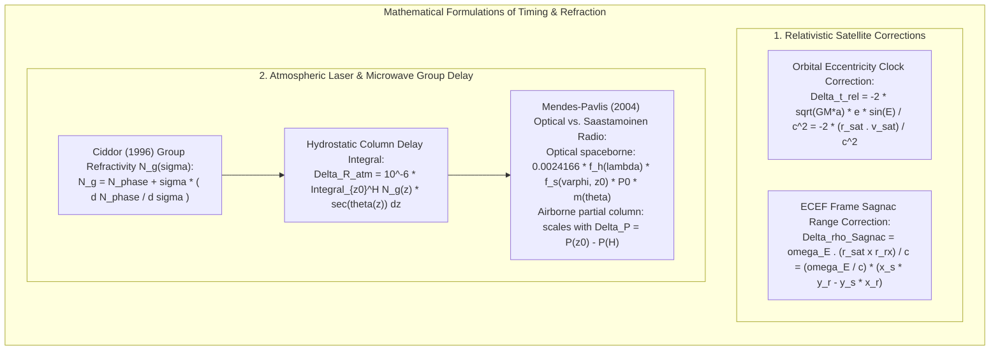

# Chapter 32: Hardware Timing, Synchronization, Leap Seconds, and Relativistic/Atmospheric Physics

*Why every range and position sensor is fundamentally a clock—and how microsecond timing bugs, leap seconds, and atmospheric refraction corrupt DEMs.*

---

## 32.5 Mathematical Foundations of Relativistic Timing and Atmospheric Delay

Precise geodetic positioning and laser ranging cannot be modeled with pure Euclidean geometry. This section derives the exact equations governing satellite orbital relativistic time corrections, the Earth-rotation Sagnac range effect, and the Ciddor atmospheric group refractivity integral for airborne and spaceborne laser altimetry.

---

### 32.5.1 Relativistic Clock Corrections in Satellite Positioning

A GNSS satellite clock is subject to continuous gravitational blueshift and special relativistic time dilation. While the constant component is canceled by the factory frequency preset ($10.22999999543\text{ MHz}$), periodic variations arise from orbital eccentricity.

#### 1. Exact Derivation of the Eccentricity Relativistic Correction ($\Delta t_{\text{rel}}$)
In an elliptical Keplerian orbit around Earth ($GM_\oplus = 3.986004418 \times 10^{14}\text{ m}^3\cdot\text{s}^{-2}$), satellite speed $v$ and geocentric radius $r$ oscillate between perigee and apogee according to the vis-viva and eccentric-anomaly relations:
$$r(E) = a (1 - e \cos E), \qquad v^2 = G M_\oplus \left( \frac{2}{r} - \frac{1}{a} \right)$$
where $a$ is the orbital semi-major axis, $e$ is eccentricity, and $E$ is the eccentric anomaly.

In an Earth-centered inertial metric (Ashby, 2003), the proper time $\tau$ ticked by the satellite's onboard atomic clock relative to geocentric coordinate time $t$ (referenced to the rotating geoid potential $\Phi_0 = -W_0 \approx -6.2637 \times 10^7\text{ m}^2\cdot\text{s}^{-2} < 0$, where $\Phi_0 / c_0^2 \approx -6.9693 \times 10^{-10}$ and orbital gravitational potential $\Phi(r) = -\frac{G M_\oplus}{r} < 0$) satisfies:
$$\frac{d\tau - dt}{dt} = \frac{\Phi(r) - \Phi_0}{c_0^2} - \frac{v^2}{2 c_0^2} = -\frac{G M_\oplus}{c_0^2 r} - \frac{G M_\oplus}{2 c_0^2}\left(\frac{2}{r} - \frac{1}{a}\right) - \frac{\Phi_0}{c_0^2}$$

Grouping the $1/r$ and $1/a$ terms separates the constant secular rate offset from the periodic orbital eccentricity term:
$$\frac{d\tau - dt}{dt} = \underbrace{\left( -\frac{3 G M_\oplus}{2 a c_0^2} - \frac{\Phi_0}{c_0^2} \right)}_{\text{Secular drift } (+4.4647\times 10^{-10}, \text{ factory-compensated})} + \underbrace{\frac{2 G M_\oplus}{c_0^2}\left( \frac{1}{a} - \frac{1}{r} \right)}_{\text{Periodic eccentricity perturbation}}$$

Differentiating Kepler's equation $M = E - e \sin E = \sqrt{G M_\oplus / a^3}\,(t - t_p)$ gives $dt = \frac{r}{\sqrt{G M_\oplus / a}}\,dE$. Integrating the periodic perturbation over $E$ yields the exact proper-time clock offset $\Delta t_{\text{rel}}$:
$$\Delta t_{\text{rel}} = \int \frac{2 G M_\oplus}{c_0^2}\left( \frac{1}{a} - \frac{1}{r} \right) \frac{r}{\sqrt{G M_\oplus / a}}\,dE = \frac{2\sqrt{G M_\oplus a}}{c_0^2} \int \left(\frac{r}{a} - 1\right) dE$$

Substituting $\frac{r}{a} - 1 = -e\cos E$ and integrating from perigee ($E = 0$):
$$\Delta t_{\text{rel}} = \frac{2\sqrt{G M_\oplus a}}{c_0^2} \int (-e\cos E)\,dE = -\frac{2 \sqrt{G M_\oplus a}}{c_0^2}\, e \sin E$$

Using the Keplerian radial-velocity identity $\mathbf{X}^s \cdot \mathbf{V}^s = r \dot{r} = \sqrt{G M_\oplus a}\,e\sin E$, this takes the universal coordinate-free vector form ([notation-and-symbols.md](../00-front-matter/notation-and-symbols.md), Section 4.3):
$$\Delta t_{\text{rel}} = -\frac{2 (\mathbf{X}^s \cdot \mathbf{V}^s)}{c_0^2}, \qquad \Delta\rho_{\text{rel}} = c_0\,\Delta t_{\text{rel}} = -\frac{2 (\mathbf{X}^s \cdot \mathbf{V}^s)}{c_0}$$
* **Magnitude:** For a GPS orbit ($a \approx 26,560\text{ km}$) with $e = 0.01\text{–}0.02$, $\Delta t_{\text{rel}}$ oscillates sinusoidally with an amplitude of **$\pm 23\text{ to }\pm 46\text{ nanoseconds}$** ($\Delta\rho_{\text{rel}} \approx \pm 6.8\text{ to }\pm 13.8\text{ meters}$), augmented at the millimeter-to-centimeter level by the general-relativistic **Shapiro signal propagation delay** $\Delta\rho_{\text{Shapiro}} = \frac{2 G M_\oplus}{c_0^2}\ln\left(\frac{r^s + r_r + \rho_r^s}{r^s + r_r - \rho_r^s}\right) \le 1.9\text{ cm}$.

#### 2. Derivation of the Sagnac Range Correction
Because GNSS coordinates are expressed in the rotating Earth-Centered, Earth-Fixed (ECEF) frame ($\boldsymbol{\omega}_\oplus = [0, 0, \omega_\oplus]^\top$, $\omega_\oplus = 7.292115 \times 10^{-5}\text{ rad}\cdot\text{s}^{-1}$), Earth rotation during the $\tau \approx 67\text{–}86\text{ ms}$ signal flight time displaces the receiver in inertial space by $\boldsymbol{\omega}_\oplus \times \mathbf{X}_r\,\tau$. Evaluating the Lorentz-invariant light-cone condition in rotating ECEF coordinates yields the **Sagnac range correction** (`TOC.md` Section 32.5):
$$\Delta \rho_{\text{Sagnac}} = \frac{2\,\boldsymbol{\omega}_\oplus \cdot \mathbf{A}_{\text{eq}}}{c_0} = \frac{\boldsymbol{\omega}_\oplus \cdot (\mathbf{X}^s \times \mathbf{X}_r)}{c_0} = \frac{\omega_\oplus}{c_0}\big( X^s Y_r - Y^s X_r \big)$$
where $\mathbf{A}_{\text{eq}} = \frac{1}{2}(\mathbf{X}^s \times \mathbf{X}_r)$ is the directed area swept in the equatorial projection by the satellite-to-receiver vector, reaching **$\pm 20\text{ to }\pm 30\text{ meters}$** for low-elevation eastern and western satellites.

---

### 32.5.2 Atmospheric Group Refractivity Delay (Ciddor, Mendes–Pavlis, and Saastamoinen)

In laser altimetry and LiDAR ($532\text{ nm}$, $1064\text{ nm}$, or $1550\text{ nm}$), short optical pulses travel at the **group velocity** $v_g = c_0 / n_g$, whereas microwave GNSS signals ($1.2\text{–}1.6\text{ GHz}$) propagate through a non-dispersive neutral troposphere.

#### 1. Ciddor (1996) Optical Phase and Group Refractivity
Let $\sigma = 1/\lambda$ denote vacuum wavenumber in $\mu\text{m}^{-1}$. Under the IAG-standard **Ciddor (1996)** dispersion equation for dry standard air ($15^\circ\text{C}$, $1013.25\text{ hPa}$, $450\text{ ppm }\text{CO}_2$), phase refractivity $N_{\text{phase,std}}(\sigma) = (n_{\text{as}} - 1) \times 10^6$ (in parts per million) is:

$$N_{\text{phase,std}}(\sigma) = 10^{-2}\left( \frac{k_1}{k_0 - \sigma^2} + \frac{k_3}{k_2 - \sigma^2} \right)$$

with exact constants $k_0 = 238.0185\,\mu\text{m}^{-2}$, $k_1 = 5,792,105\,\mu\text{m}^{-2}$, $k_2 = 57.362\,\mu\text{m}^{-2}$, and $k_3 = 167,917\,\mu\text{m}^{-2}$ *(note the $10^{-2}$ conversion from Ciddor's $10^8$ scaling to parts-per-million $10^6$)*. Applying Rayleigh's group-dispersion operator $N_g(\sigma) = N_{\text{phase}}(\sigma) + \sigma \frac{d N_{\text{phase}}(\sigma)}{d\sigma}$ yields the exact **standard dry-air group refractivity**:

$$N_{g,\text{dry,std}}(\sigma) = 10^{-2}\left[ \frac{k_1(k_0 + \sigma^2)}{(k_0 - \sigma^2)^2} + \frac{k_3(k_2 + \sigma^2)}{(k_2 - \sigma^2)^2} \right]$$

Evaluating this formula reveals substantial chromatic dispersion across common LiDAR wavelengths: $N_{g,\text{dry,std}}(1064\text{ nm}) = \mathbf{276.73\text{ ppm}}$, whereas $N_{g,\text{dry,std}}(532\text{ nm}) = \mathbf{289.76\text{ ppm}}$ ($4.7\%$ higher!). Scaling to ambient dry-air density $\rho_d(P, T, e)$ and water-vapor density $\rho_w(T, e)$ via compressibility $Z(P, T, e)$ gives local group refractivity $N_g(z) = \frac{\rho_d(z)}{\rho_{d,\text{std}}}N_{g,\text{dry,std}}(\sigma) + \frac{\rho_w(z)}{\rho_{w,\text{std}}}N_{g,\text{ws}}(\sigma)$.

#### 2. Closed-Form Zenith and Slant Delay: Optical Laser vs. Microwave GNSS
Integrating $N_g(z)$ along the ray path from target orthometric height $z_0$ (pressure $P_0$, water-vapor partial pressure $e_0$, latitude $\varphi$) to sensor height $H$ (ambient pressure $P(H)$):

$$\Delta R_{\text{atm}} = 10^{-6} \int_{z_0}^H N_g(z) \sec\theta(z) \, dz$$

1. **Optical Spaceborne Laser Altimetry — Mendes & Pavlis (2004) (`FCULzd`):**
   Adopted by IERS Conventions (2010) and NASA ICESat-2 (`ATL03`; Neumann et al., 2019) for spaceborne ranging ($P(H) = 0$), the total zenith optical delay is $d_{\text{atm}}^z = d_h^z + d_{nh}^z$:
   $$d_h^z = 0.002416579\, f_h(\lambda)\, f_s(\varphi, z_0)^{-1}\, P_0, \qquad d_{nh}^z = 10^{-4}\big[5.316 f_{nh}(\lambda) - 3.759 f_h(\lambda)\big]\, f_s(\varphi, z_0)^{-1}\, e_0$$
   where gravity-variation factor $f_s(\varphi, z_0) = 1 - 0.00266\cos(2\varphi) - 2.8\times 10^{-7} z_0$ (with $z_0$ in $\text{m}$), $f_h(\lambda)$ is the normalized Ciddor hydrostatic dispersion factor ($f_h \approx 1.00004$ at $532\text{ nm}$; $f_h \approx 0.95512$ at $1064\text{ nm}$), and $f_{nh}(\lambda) \approx 0.99996$ at $532\text{ nm}$. Notice that at optical frequencies, the non-hydrostatic wet correction $d_{nh}^z$ is **two orders of magnitude smaller than in microwave GNSS** ($\approx +1.6\text{ mm}$ per $10\text{ hPa}$ of $e_0$ at $532\text{ nm}$).
2. **Airborne LiDAR Partial-Column Delay ($P(H) > 0$):**
   For an airborne scanner at altitude $H$ within the atmosphere, hydrostatic integration stops at aircraft static pressure $P(H)$, replacing $P_0$ with the differential column pressure drop $\Delta P = P_0 - P(H)$:
   $$\Delta R_{\text{airborne}}(\theta) \approx 0.0024166\, f_h(\lambda)\, f_s(\varphi, \bar{z})^{-1}\,\big(P_0 - P(H)\big)\,\sec\theta$$
3. **Microwave GNSS & Radar Altimetry — Saastamoinen (1972) / Davis et al. (1985):**
   For GNSS trajectories ($1.2\text{–}1.6\text{ GHz}$) and Ku/Ka-band radar altimeters, permanent $\text{H}_2\text{O}$ dipole rotation adds a large positive wet zenith delay ($\text{ZWD}_{\text{radio}} \approx 5\text{–}35\text{ cm}$) to the hydrostatic delay ($\text{ZHD}_{\text{radio}} \approx 2.31\text{ m}$ at sea level):
   $$T_r^s = m_h(\theta_{\text{el}})\frac{0.0022768\, P_0}{f_s(\varphi, z_0)} + m_w(\theta_{\text{el}})\cdot 0.002277\left(\frac{1255}{T_0} + 0.05\right)e_0$$

#### 3. Worked Numerical Verification Example: Spaceborne ICESat-2 vs. Airborne Topo LiDAR
Suppose a coastal wetland benchmark at $\varphi = 45^\circ\text{ N}$, $z_0 = 0\text{ m}$ ($f_s = 1.000$), $P_0 = 1013.25\text{ hPa}$, $T_0 = 293.15\text{ K}$, $e_0 = 20.0\text{ hPa}$ is surveyed simultaneously by:
* **ICESat-2 ATLAS ($532\text{ nm}$, spaceborne $H = 496\text{ km}$, $P(H) = 0$, off-nadir $\theta = 2^\circ$):**
  $d_h^z = 0.002416579 \times 1.00004 \times 1013.25 = 2.4487\text{ m}$, $d_{nh}^z \approx +0.0031\text{ m}$, and $\Delta R_{\text{ICESat-2}} = 2.4518 \times \sec(2^\circ) = \mathbf{2.453\text{ m}}$.
* **Airborne $1064\text{ nm}$ LiDAR ($H = 1,500\text{ m}$ AGL, aircraft static pressure $P(H) = 845.56\text{ hPa}$, scan edge $\theta = 25^\circ$):**
  Pressure column $\Delta P = 1013.25 - 845.56 = 167.69\text{ hPa}$ gives nadir delay $\Delta R_0 = 0.002416579 \times 0.95512 \times 167.69 = \mathbf{0.387\text{ m}}$, increasing at the $\theta = 25^\circ$ swath edge to $0.387 \times \sec(25^\circ) = \mathbf{0.427\text{ m}}$! Subtracting $\Delta R_{\text{atm}}$ from $R_{\text{raw}} = \frac{1}{2}c_0\Delta t_{\text{measured}}$ removes both the $38.7\text{ cm}$ vertical datum bias and the $4.0\text{ cm}$ cross-track "smile" curvature.

---

### 32.5.3 Separating Time Latency ($\delta t_{\text{lat}}$) from Pitch Boresight ($\delta\theta$) in Field Calibration

In both hydrographic multibeam patch tests (NOAA Field Procedures Manual) and airborne LiDAR strip adjustment (Glennie, 2007), an uncalibrated timestamp latency $\delta t_{\text{lat}}$ between the GNSS/INS navigation stream and the ranging sensor produces an along-track horizontal shift $\Delta x_{\text{along}} = v\,\delta t_{\text{lat}}$ that mimics a static pitch mounting misalignment $\delta\theta$ (which shifts the nadir footprint by $\Delta x_{\text{pitch}} \approx d\,\delta\theta$ in water depth $d$, or $H_{\text{agl}}\,\delta\theta$ in flight). On a seafloor or hillside of along-track slope $\tan\alpha$, running reciprocal lines ($+v$ vs. $-v$) reveals a combined apparent vertical discrepancy $\Delta z_{\text{recip}}$:

$$\Delta z_{\text{recip}}(v, d) = 2\tan\alpha \Big( v\,\delta t_{\text{lat}} + d\,\delta\theta \Big)$$

Because $v\,\delta t_{\text{lat}}$ scales linearly with vessel speed $v$ whereas $d\,\delta\theta$ scales linearly with depth $d$ (and is independent of speed!), surveyors decouple the $2\times 2$ observability rank deficiency by running two reciprocal passes over the same sloped feature at **fast speed $v_{\text{fast}}$** (e.g., $10\text{ knots}$) and **slow speed $v_{\text{slow}}$** (e.g., $4\text{ knots}$) at constant depth $d$:

$$\delta t_{\text{lat}} = \frac{\Delta z_{\text{recip}}(v_{\text{fast}}, d) - \Delta z_{\text{recip}}(v_{\text{slow}}, d)}{2\tan\alpha\,(v_{\text{fast}} - v_{\text{slow}})}$$

With IEEE 1588v2 PTP or hardware TTL event markers properly wired, $\delta t_{\text{lat}}$ solves identically to $0.000 \pm 0.001\text{ s}$; any non-zero estimate ($>5\text{ ms}$) immediately flags a broken PPS trigger, serial `$GPZDA` baud-rate lag, or software buffer bug!
