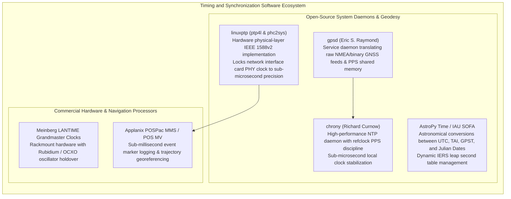

# Chapter 32: Hardware Timing, Synchronization, Leap Seconds, and Relativistic/Atmospheric Physics

*Why every range and position sensor is fundamentally a clock—and how microsecond timing bugs, leap seconds, and atmospheric refraction corrupt DEMs.*

---

## 32.6 Software Ecosystem

Managing microsecond synchronization, discipline clocks, and relativistic astronomical time conversions requires a specialized software stack spanning Linux kernel network drivers, geodetic astronomy libraries, and hardware grandmaster clocks. This section reviews the open-source tools and commercial hardware suites that keep geospatial mapping payloads synchronized.



---

### 32.6.1 Open-Source Linux Daemons and Astronomy Libraries

#### 1. `linuxptp`: Hardware PTP Verification and Grandmaster Locking on Linux
Maintained by Richard Cochran, **`linuxptp`** is the reference open-source implementation of IEEE 1588v2 PTP on Linux:
* Before launching a survey, engineers MUST verify via `ethtool -T` that the host NIC exposes a genuine hardware **PTP Hardware Clock (`SOF_TIMESTAMPING_RAW_HARDWARE`)** rather than falling back silently to software kernel timestamping!
* **`ptp4l`** disciplines the NIC's hardware PHC register directly against the vessel/aircraft GNSS Grandmaster in **TAI**, while **`phc2sys`** transfers TAI from the NIC PHC to Linux `CLOCK_REALTIME` (automatically applying the $37\text{-second}$ TAI-to-UTC offset via `-O -37` or dynamic PTP `UTC_OFFSET` TLV flags) and **`pmc`** queries live nanosecond offset statistics:

```bash
# 1. Verify hardware PHY/MAC timestamping capability (must list HARDWARE-transmit/receive)
ethtool -T eth0

# 2. Lock NIC hardware clock (PHC) on eth0 to GNSS PTP Grandmaster using hardware (-H) stamps
sudo ptp4l -i eth0 -m -s -H

# 3. Discipline Linux system clock from eth0 PHC (-w waits for ptp4l lock; -m prints RMS offset)
sudo phc2sys -s eth0 -c CLOCK_REALTIME -w -m

# 4. Query live master-to-slave nanosecond offset and mean path delay via PTP Management Client
sudo pmc -u -b 0 'GET CURRENT_DATA_SET'
```

#### 2. `gpsd` and `chrony`: Coaxial PPS + Serial `$GPZDA` Discipline
When synchronizing embedded hydrographic or terrestrial field loggers over coaxial PPS + RS-232/RS-422 serial lines (`TOC.md` Section 32.6), **`gpsd`** decodes high-baud NMEA/UBX/SBF serial frames while **`chrony`** (Richard Curnow & Miroslav Lichvar) pairs coarse serial calendar seconds (`SHM 0`) with sub-microsecond kernel GPIO/UART DCD interrupt pulses (`/dev/pps0`):

```text
# /etc/chrony/chrony.conf — Sub-microsecond PPS + serial $GPZDA configuration
# Coarse UTC second numbering from gpsd shared memory (noselect prevents jitter pollution;
# offset 0.065 compensates 65 ms serial transmission delay so $GPZDA binds to the right PPS!)
refclock SHM 0 refid NMEA offset 0.065 precision 1e-3 noselect

# Sub-microsecond rising-edge discipline locked to NMEA second numbering
refclock PPS /dev/pps0 refid PPS lock NMEA poll 2 precision 1e-8 prefer
makestep 1.0 3
```

#### 3. `AstroPy Time`, IAU SOFA, and ASPRS LAS Adjusted GPS Time
Geodetic and point-cloud pipelines must translate seamlessly between civil `UTC`, continuous `TAI`, `GPST` Week Seconds (used in SBET files), and **ASPRS LAS 1.4 Adjusted Standard GPS Time** (`Global Encoding` bit $0 = 1$, defined as continuous seconds since `1980-01-06T00:00:00Z` **minus $10^9\text{ seconds}$** to preserve `Float64` IEEE-754 sub-nanosecond mantissa precision!). The open-source **`astropy.time`** library (Astropy Collaboration, 2022) wraps the official C-language **IAU SOFA** (Standards of Fundamental Astronomy) routines with up-to-date IERS Bulletin C leap-second tables:

```python
"""
Geodetic timestamp and optical laser refractivity audit using astropy.time and NumPy.
Converts UTC survey timestamps to TAI, GPST, SBET GPS Week Seconds, and ASPRS LAS 1.4
Adjusted Standard GPS Time, and computes Ciddor/Mendes-Pavlis LiDAR range delay.
"""

from astropy.time import Time
import numpy as np


def ciddor_group_delay_m(
    wavelength_um: float,
    p_surface_hpa: float,
    p_sensor_hpa: float = 0.0,
    lat_deg: float = 45.0,
    z0_m: float = 0.0,
    scan_angle_deg: float = 0.0,
) -> float:
    """Computes one-way hydrostatic optical laser delay (m) via Ciddor/Mendes-Pavlis."""
    sigma2 = (1.0 / wavelength_um) ** 2
    # Mendes & Pavlis (2004) Ciddor-derived hydrostatic group dispersion factor f_h(lambda)
    k0, k1_star = 238.0185, 19990.975
    k2, k3_star = 57.362, 579.55174
    f_h = 1e-2 * (
        k1_star * (k0 + sigma2) / (k0 - sigma2) ** 2
        + k3_star * (k2 + sigma2) / (k2 - sigma2) ** 2
    )
    f_s = 1.0 - 0.00266 * np.cos(np.radians(2.0 * lat_deg)) - 2.8e-7 * z0_m
    delta_p = p_surface_hpa - p_sensor_hpa  # Full column if p_sensor_hpa == 0
    return (0.002416579 * f_h * delta_p / f_s) / np.cos(np.radians(scan_angle_deg))


def audit_survey_timestamps(utc_str: str) -> None:
    """Audits a survey timestamp across UTC, TAI, GPST, SBET, and LAS 1.4 conventions."""
    t_utc = Time(utc_str, format="isot", scale="utc")
    t_tai = t_utc.tai
    t_gps = t_utc.gps  # Seconds elapsed since 1980-01-06T00:00:00 UTC (continuous)

    tai_utc_s = (t_tai.mjd - t_utc.mjd) * 86400.0
    gps_utc_s = (t_gps.mjd - t_utc.mjd) * 86400.0
    gps_total_s = float(t_gps.gps)
    gps_week = int(gps_total_s // 604800.0)
    sbet_week_s = gps_total_s % 604800.0
    las_adjusted_gps_s = gps_total_s - 1.0e9  # ASPRS LAS 1.2-1.4 Adjusted Standard GPS Time

    delay_icesat2 = ciddor_group_delay_m(0.532, p_surface_hpa=1013.25, p_sensor_hpa=0.0)
    delay_airborne = ciddor_group_delay_m(
        1.064, p_surface_hpa=1013.25, p_sensor_hpa=845.56, scan_angle_deg=25.0
    )

    print(f"--- Geodetic Time & Refraction Audit ({utc_str} UTC) ---")
    print(f"TAI: {t_tai.isot} (TAI - UTC = {tai_utc_s:.1f} s)")
    print(f"GPST: {t_gps.isot} (GPST - UTC = {gps_utc_s:.1f} s; TAI - GPST = 19.0 s)")
    print(f"SBET GPS Week {gps_week}, Week Seconds: {sbet_week_s:.6f} s")
    print(f"ASPRS LAS 1.4 Adjusted GPS Time:       {las_adjusted_gps_s:.6f} s")
    print(f"ICESat-2 (532 nm, spaceborne nadir) delay: {delay_icesat2:.3f} m")
    print(f"Airborne LiDAR (1064 nm, 1.5 km AGL, 25°) delay: {delay_airborne:.3f} m")


if __name__ == "__main__":
    audit_survey_timestamps("2026-08-27T14:32:28.000")
```

---

### 32.6.2 Commercial Hardware Grandmasters and Inertial Systems

#### 1. Meinberg LANTIME Grandmaster Clocks
Manufactured in Bad Pyrmont, Germany, **Meinberg LANTIME** servers (such as the M600 and M1000) are the industry standard for shipboard and aircraft timing:
* Integrated high-sensitivity multi-constellation GNSS receivers (GPS, Galileo, GLONASS, BeiDou).
* Equipped with internal **Oven-Controlled Crystal Oscillators (OCXO)** or **Rubidium atomic standards**, providing continuous sub-microsecond holdover capability even if GNSS signals are lost or jammed for hours during electronic warfare.
* Broadcasts synchronized IEEE 1588v2 PTP, optical IRIG-B, PPS TTL, and NTP to all sensors aboard the vessel.

#### 2. Applanix POSPac MMS / POS MV and Hydrographic/LiDAR Processing Suites
Developed by Trimble Applanix (Richmond Hill, Canada), **POS MV** (marine) and **POSPac MMS** (airborne/mobile)—alongside **NovAtel Inertial Explorer**, **Septentrio AsteRx**, and downstream hydrographic/LiDAR processors (**CARIS HIPS & SIPS**, **QPS Qimera**, **Kongsberg SIS**, **NOAA Kluster**, and **PDAL**)—implement end-to-end hardware timing verification:
* **Hardware Event Marker Channels (`EVENT1` / `EVENT2`):** When a metric camera shutter opens at mid-exposure or a laser/sonar master trigger fires, a $5\text{ V}$ TTL rising/falling edge latches an FPGA counter on the Applanix/NovAtel receiver within **$<5\text{ nanoseconds}$** of true GPS Time—completely bypassing camera/logger internal clocks. Engineers must explicitly verify **trigger edge polarity** (rising vs. falling edge on a $10\text{ ms}$ pulse changes timestamps by $10\text{ ms}$!) and coaxial propagation delay ($\sim 5\text{ ns/m}$ in RG-58 cable).
* **Point-Cloud & Sonar Timestamp Auditing in Open-Source Pipelines:** In **PDAL**, `pdal info --stats input.copc.laz --dimensions GpsTime` immediately reveals whether a LAS/LAZ point cloud stores raw GPS Week Seconds ($[0, 604800]$—ambiguous across multi-week campaigns!) or ASPRS Adjusted Standard GPS Time ($\sim 4.7 \times 10^8\text{ s}$ in 2026), while open-source **Kluster** (`fqpr_intelligence`) and **MB-System** (`mbnavedit` / `mbvelocitytool`) visualize ping-to-attitude time-latency residuals before gridding. Similarly, in **ROS 2** (`sensor_msgs/msg/PointCloud2`) mobile SLAM pipelines (Ouster, Hesai, Livox), drivers must populate hardware PTP frame header timestamps alongside per-point nanosecond firing offsets (`t` field) so LiDAR-inertial odometry (`FAST-LIO2`, `LIO-SAM`) deskews motion distortion across every $100\text{ ms}$ scan revolution rather than stamping the entire sweep with host arrival time.

---

### 32.6.3 Comparison of Synchronization Protocols and Time Libraries

| Protocol / Software Tool | Layer / License | Typical Timing Accuracy | Primary Role & Operational Caveat |
| :--- | :--- | :--- | :--- |
| **TTL PPS + Hardware Event Marker** | Coaxial BNC / Hardware | $5\text{–}20\text{ ns}$ | Gold-standard trigger; requires valid `$GPZDA` baud $>38,400$ & verified edge polarity |
| **IEEE 1588v2 PTP (`linuxptp`)** | Ethernet PHY / GPLv2 | $20\text{–}100\text{ ns}$ | Requires hardware PHY timestamping (`ethtool -T`) & PTP transparent/boundary switches |
| **White Rabbit (IEEE 1588-2019 HA)** | SyncE Fiber / CERN OHL | $<0.5\text{ ns}$ | Sub-nanosecond phase-locked optical arrays, VLBI, and bistatic radar/sonar |
| **`chrony` + `gpsd` (`/dev/pps0`)** | Linux Kernel GPIO / GPLv2 | $0.2\text{–}2\,\mu\text{s}$ | Excellent for embedded Linux loggers when paired with hardware DCD/GPIO PPS interrupt |
| **Software NTP (`ntpd` / UDP)** | OS Kernel / Network | $1\text{–}20\text{ ms}$ | **Unsuitable** for dynamic mobile LiDAR, UAV cameras, or multibeam motion compensation |
| **OS USB/UART `gettimeofday()`** | User-Space Software | $2\text{–}50\text{ ms}$ | **Severe antipattern**; introduces variable bus-polling and OS thread-scheduling blur |
| **`astropy.time` / IAU `SOFA`** | Python & C / BSD-3 | $<1\text{ ps}$ numerical | Authoritative leap-second-aware conversion across `UTC`, `TAI`, `GPST`, `UT1`, and `TDB` |
| **Meinberg `LANTIME` / Applanix `POS`** | Commercial Hardware | $<10\text{ ns}$ (OCXO/Rb) | Multi-GNSS PTP Grandmaster with Rubidium holdover during GNSS jamming/outages |
