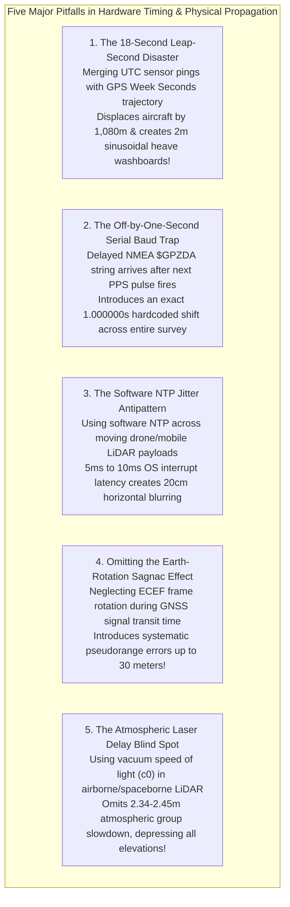

# Chapter 32: Hardware Timing, Synchronization, Leap Seconds, and Relativistic/Atmospheric Physics

*Why every range and position sensor is fundamentally a clock—and how microsecond timing bugs, leap seconds, and atmospheric refraction corrupt DEMs.*

---

## 32.7 Common Pitfalls and Key Takeaways

Hardware timing and physical propagation delays are the silent saboteurs of digital elevation modeling. A single misconfigured serial baud rate, an unhandled leap second, or a software network interrupt can introduce kilometer-scale position blunders or distort flat surfaces into phantom sinusoidal waves.

---

### 32.7.1 Common Pitfalls in Timing, Relativity, and Atmospheric Physics

#### 1. The 18-Second Leap-Second Disaster
* **The Failure Mode:** An airborne LiDAR or marine multibeam processing team merges raw sensor pings stamped in UTC with an inertial trajectory (SBET) recorded in GPS Time (GPS Week Seconds) without accounting for the integer leap-second difference.
* **Physical Reality:** As of 2026, GPS Time is ahead of UTC by exactly **18.000 seconds**.
* **Forensic Consequence:**
  * In the air ($v = 60\text{ m/s}$), the aircraft position is shifted by **$1,080\text{ meters}$ horizontally**. Laser points are projected from an aircraft location more than a kilometer away from the true firing point.
  * At sea ($v = 4.1\text{ m/s}$), the vessel is displaced by $74\text{ meters}$. Furthermore, because ocean swell periods ($4\text{–}8\text{ s}$) are out of phase by $18\text{ seconds}$, motion compensation inverts heave and pitch, transforming a flat sandy seabed into a **high-amplitude sinusoidal washboard surface** with $1\text{–}3\text{ meter}$ artificial waves.
* **Remedy:** Audit all timestamp headers. Ensure that pings and trajectories are converted to a single common time scale (GPST or TAI) prior to spatial ray-tracing.

#### 2. The Off-by-One-Second Serial Baud Trap
* **The Failure Mode:** A hydrographic survey launch synchronizes an echosounder by wiring a PPS TTL pulse along with an RS-232 serial cable broadcasting NMEA `$GPZDA` at 4800 or 9600 baud.
* **Physical Reality:** At low baud rates, combined with operating system FIFO buffer delays and serial multiplexing, transmitting the ASCII sentence takes over $80\text{ milliseconds}$. If transmission latency exceeds $1.0\text{ second}$, the `$GPZDA` string arrives at the sensor's microcontroller **after the next PPS pulse has already fired**.
* **Forensic Consequence:** The sensor firmware mistakenly binds the timestamp of Second $N$ to the rising edge of Second $N+1$. The entire survey payload operates with a continuous, hardcoded **$1.000000\text{-second}$ time lag**. On reciprocal survey lines (running North, then South), bathymetric features fail to align, creating a systematic **$8.2\text{-meter}$ along-track horizontal displacement** ($2 \times 4.1\text{ m/s}$) that fails IHO Order 1a cross-line checks.
* **Remedy:** Increase serial timing baud rates to **$115,200\text{ baud}$** or higher, verify timing offsets on an oscilloscope, or replace serial cables with **IEEE 1588v2 PTP Ethernet**.

#### 3. Relying on OS Arrival Time (`gettimeofday`) and Software NTP for Dynamic Sensors
* **The Failure Mode:** A commercial drone mapping operator or mobile mapping team stamps incoming USB/UART IMU packets or Ethernet LiDAR/camera frames using host OS reception calls (`gettimeofday()` or `clock_gettime()`) disciplined only by software NTP.
* **Physical Reality:** Software NTP and host OS reception calls operate above USB frame-polling buffers, NIC interrupt coalescing, and kernel thread schedulers, introducing variable latency and asymmetric jitter of **$1\text{ to }50\text{ milliseconds}$**.
* **Forensic Consequence:** At highway driving speeds ($30\text{ m/s}$) or aircraft/drone flight speeds ($20\text{–}70\text{ m/s}$), a $5\text{–}20\text{ ms}$ timing jitter produces horizontal blurring of **$10\text{ cm to }1.4\text{ m}$** plus roll-rate swath tilting ($H_{\text{agl}}\dot{\phi}\,\delta t_{\text{lat}}$) that splits curb faces, powerlines, and building facades into fuzzy double surfaces.
* **Remedy:** Never trust software packet-arrival timestamps (`gettimeofday`) for mobile mapping. Mandate hardware TTL Event Markers or **IEEE 1588v2 Precision Time Protocol (PTP)** with hardware PHY timestamping (`<100 ns`).

#### 4. Omitting the Earth-Rotation Sagnac Effect
* **The Failure Mode:** An engineer writing custom GNSS positioning software or spaceborne radar altimetry processors converts signal travel time to geometric distance assuming a static reference frame.
* **Physical Reality:** GNSS coordinates are defined in the Earth-Centered Earth-Fixed (ECEF) rotating coordinate system. During the $70\text{ milliseconds}$ it takes for a radio pulse to travel from satellite orbit to the ground, the Earth rotates eastward beneath the signal by $\Delta \theta = \omega_\oplus \tau$.
* **Forensic Consequence:** Failing to apply the relativistic Sagnac range correction introduces a coordinate-dependent pseudorange error of **up to $\pm 30\text{ meters}$**. All calculated receiver coordinates—and the resulting DEM elevation benchmarks—are systematically warped horizontally and vertically.
* **Remedy:** Implement the standard relativistic Sagnac correction equation $\Delta \rho_{\text{Sagnac}} = \frac{\omega_\oplus}{c_0}(X^s Y_r - Y^s X_r)$ in all GNSS processing engines.

#### 5. The Atmospheric Group Refractivity Omission (and Optical vs. Microwave Wet-Delay Confusion)
* **The Failure Mode:** A developer converts two-way laser travel time $\Delta t$ directly to slant range using vacuum light speed ($R = \frac{1}{2}c_0 \Delta t$), or applies a microwave GNSS wet-troposphere formula directly to an optical laser altimeter.
* **Physical Reality:** In sea-level air, the optical group refractive index is $n_g \approx 1.000277$ ($1064\text{ nm}$) to $1.000290$ ($532\text{ nm}$), while optical water-vapor delay is tiny ($\approx +1.6\text{ mm}$ per $10\text{ hPa}$), unlike microwave GNSS wet delay ($+5\text{–}35\text{ cm}$).
* **Forensic Consequence:** Omitting atmospheric group delay depresses **spaceborne laser elevations (ICESat-2, GEDI) by $2.34\text{–}2.45\text{ meters}$** across the full atmospheric column, and depresses **airborne LiDAR DEMs by $\sim 0.27\text{ m}$ per kilometer of flight altitude** ($\Delta P = P_0 - P(H)$) while curving swath edges upward via $\sec\theta$ ("atmospheric smile").
* **Remedy:** Always apply the Ciddor (1996) / Mendes & Pavlis (2004) wavelength-specific optical group delay integrated across the actual pressure column between aircraft/satellite and ground.

---

### 32.7.2 Key Takeaways for Practitioners

1. **Every Sensor Is a Clock:** Elevation is computed from wave propagation time. Sub-decimeter 3D mapping requires sub-microsecond synchronization across all platform subsystems.
2. **Beware the 18-Second Leap-Second Offset:** GPS Time does not have leap seconds; UTC does. Never merge UTC sensor timestamps with GPS Week Seconds navigation trajectories without accounting for the exact integer leap second offset.
3. **PTP Replaces Serial and NTP:** Replace point-to-point coaxial PPS/serial cables and jittery software NTP with IEEE 1588v2 Precision Time Protocol (PTP) utilizing hardware PHY timestamping ($<100\text{ ns}$).
4. **Relativity Is an Operational Reality:** Satellite positioning requires compensating for Special Relativistic time dilation ($-7.2\,\mu\text{s/day}$), General Relativistic blueshift ($+45.6\,\mu\text{s/day}$), orbital eccentricity, and the Earth-rotation Sagnac effect.
5. **Light Slows Down in Air:** Atmospheric group refractivity delays spaceborne laser pulses by $\sim 2.34\text{–}2.45\text{ meters}$ at sea level (and $\sim 0.27\text{ m/km}$ AGL for airborne LiDAR); always subtract atmospheric delay before computing 3D coordinates.
