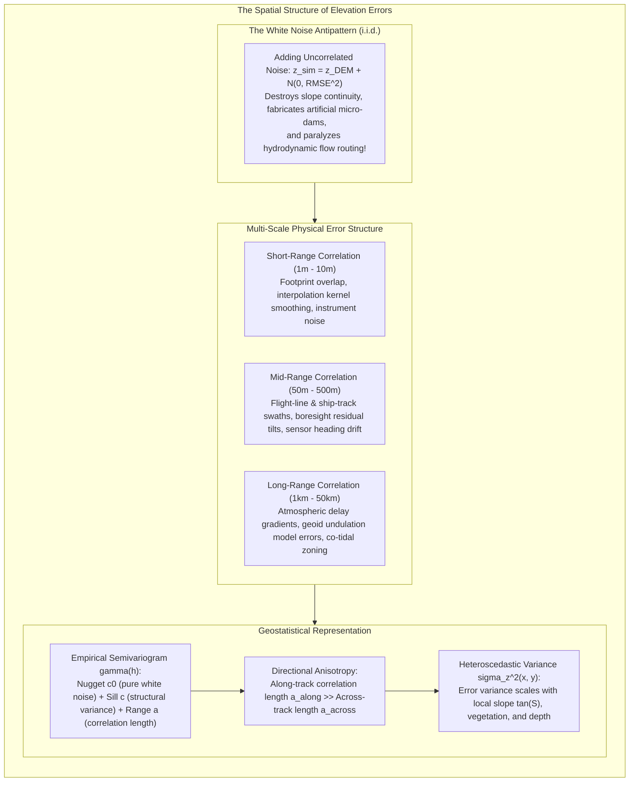
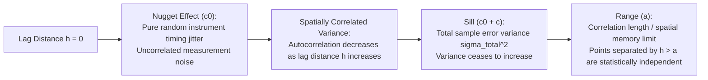
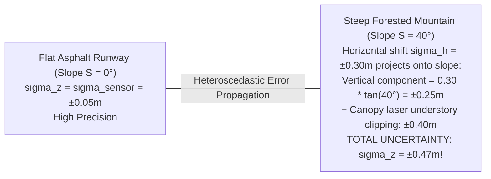

# Chapter 33: Geostatistical Error Simulation and Downstream Uncertainty Propagation

*Beyond static error metrics: generating equiprobable stochastic terrain ensembles to bound real-world risks in hydrology, viewsheds, and earthwork.*

---

## 33.1 Modeling Spatial Autocorrelation of DEM Errors

When an elevation dataset is published with an accuracy statement—such as "$\text{RMSE}_z = \pm 10\text{ cm}$" or "IHO Special Order compliant"—practitioners routinely make a fatal modeling assumption: they treat elevation error as independent, identically distributed (i.i.d.) Gaussian white noise. Adding uncorrelated white noise to a DEM creates an artificial "salt-and-pepper" or "gravel-bed" micro-texture that does not exist in nature, artificially increasing terrain surface area, obliterating drainage networks, and paralyzing hydrodynamic models.

In physical reality, **elevation errors are heavily spatially autocorrelated**. If an airborne LiDAR flight line suffers a $5\text{-cm}$ roll calibration bias, or if a multibeam sonar line is affected by an uncorrected tidal datum phase lag, adjacent elevation cells share nearly identical errors. Rigorous uncertainty modeling requires characterizing the spatial correlation structure of errors across multiple scales using **empirical semivariograms**, **directional anisotropy**, and **heteroscedastic variance scaling**.

---

### 33.1.1 The Failure of the Independent White Noise Myth

In many legacy GIS modeling workflows, uncertainty is simulated via naive Monte Carlo perturbation:
$$z_{\text{sim}}(x, y) = z_{\text{DEM}}(x, y) + \epsilon(x, y), \quad \text{where } \epsilon(x, y) \stackrel{\text{i.i.d.}}{\sim} \mathcal{N}(0, \sigma^2)$$

This formulation violates the physics of remote sensing and geomorphology:
1. **Destruction of Surface Slope:** 
   The spatial gradient of white noise is mathematically unbounded as cell size $\Delta x \to 0$:
   $$\mathbb{E}\left[ \left(\frac{\partial \epsilon}{\partial x}\right)^2 \right] \approx \frac{2\sigma^2}{\Delta x^2}$$
   On a $1\text{-meter}$ LiDAR grid with $\sigma = 0.10\text{ m}$, adding white noise creates random artificial slopes of $\pm 14\%$, turning a smooth, flat parking lot or water reservoir into a jagged field of spikes and pits.
2. **Artificial Micro-Dams in Hydrology:** 
   Water routing algorithms (D8, D-infinity) evaluate flow along the steepest downward descent. White noise introduces artificial $10\text{-cm}$ depressions in every stream channel, creating thousands of artificial sinks that trap simulated water, stopping overland flow and preventing floodwaters from reaching the river outlet.
3. **Severe Underestimation of Regional Volume Uncertainty:** 
   When integrating elevation differences across an area $A_\Omega = N \Delta x \Delta y$ to compute earthwork cut-and-fill volume, glacier mass balance, or dredging yardage:
   $$V = \Delta x \Delta y \sum_{i=1}^N \Delta z_i, \qquad \sigma_V^2 = \iint_\Omega \iint_\Omega \text{Cov}\big(e(\mathbf{x}), e(\mathbf{x}')\big)\,d\mathbf{x}\,d\mathbf{x}' = A_\Omega^2 \frac{\sigma_z^2}{N_{\text{eff}}}$$
   Under independent white noise ($N_{\text{eff}} = N$), random errors cancel rapidly via the Law of Large Numbers ($\sigma_V = A_\Omega \sigma_z / \sqrt{N}$). For a $10\text{ km}^2$ watershed ($N = 10^7$ pixels at $\Delta x = 1\text{ m}$) with $\sigma_z = 0.10\text{ m}$, white noise predicts a negligible volumetric standard error of $\sigma_{V,\text{white}} = 10^7 \times 0.10 / \sqrt{10^7} = \mathbf{316\text{ m}^3}$! Yet if the survey actually has a spherical variogram correlation range $a_1 = 500\text{–}800\text{ m}$ ($N_{\text{eff}} \approx \frac{5 A_\Omega}{\pi a_1^2} \approx 63.7\text{ to }24.9$ independent correlation patches; Rolstad et al., 2009; Hugonnet et al., 2022, Section 33.5.3), the true volumetric standard error is $\sigma_{V,\text{corr}} \approx 10^7 \times 0.10 / \sqrt{N_{\text{eff}}} = \mathbf{125,300\text{ to }200,500\text{ m}^3}$—meaning the white-noise assumption **underestimates volumetric risk by $400\times\text{ to }635\times$** (Heuvelink, 1998)!

---

### 33.1.2 The Multi-Scale Semivariogram Architecture

Geostatistical modeling characterizes spatial continuity using the **semivariance $\gamma(\mathbf{h})$** as a function of the spatial lag separation vector $\mathbf{h}$:

$$\gamma(\mathbf{h}) = \frac{1}{2 N(\mathbf{h})} \sum_{i=1}^{N(\mathbf{h})} \Big( \epsilon(\mathbf{x}_i) - \epsilon(\mathbf{x}_i + \mathbf{h}) \Big)^2$$
where $\epsilon(\mathbf{x}) \equiv e(\mathbf{x}) = z_{\text{DEM}}(\mathbf{x}) - z_{\text{truth}}(\mathbf{x})$ is the residual vertical error measured at geodetic check points ([notation-and-symbols.md](../00-front-matter/notation-and-symbols.md), Section 6.2), and $N(\mathbf{h})$ is the number of point pairs separated by vector $\mathbf{h}$.

#### 1. Anatomy of the Semivariogram
* **The Nugget Effect ($c_0$):** The apparent semivariance as $|\mathbf{h}| \to 0$. Represents uncorrelated detector noise, pulse timing jitter, and positioning noise.
* **The Structural Sill ($c$):** The spatially autocorrelated variance component.
* **The Total Sill ($c_0 + c$):** The asymptotic maximum variance, equal to the total sample error variance $\sigma_z^2$.
* **The Range ($a$):** The correlation length. Check points separated by distances $h < a$ share correlated errors; points separated by $h \ge a$ are statistically independent.

#### 2. Nested Theoretical Semivariogram Models
Real elevation errors exhibit **nested structures** spanning short, medium, and long correlation ranges. Geostatistical DEM error frameworks (Heuvelink, 1998; Hugonnet et al., 2021, 2022 in `xdem`) represent the empirical semivariogram as a linear combination of positive-definite nugget, **Spherical**, **Exponential**, and **Gaussian** models:

$$\gamma(h) = c_0^{\text{nug}} + c_1\,\gamma_{\text{sph}}(h; a_1) + c_2 \left( 1 - \exp\left(-\frac{3 h}{a_2}\right) \right) + c_3 \left( 1 - \exp\left(-\frac{3 h^2}{a_3^2}\right) \right)$$

where the classical **Spherical model** reaches its exact sill at finite range $a_1$:
$$\gamma_{\text{sph}}(h; a_1) = \begin{cases} \dfrac{3h}{2a_1} - \dfrac{1}{2}\left(\dfrac{h}{a_1}\right)^3, & 0 < h \le a_1 \\[6pt] 1, & h > a_1 \end{cases}$$
*(while Exponential $\exp(-3h/a_2)$ and Gaussian $\exp(-3h^2/a_3^2)$ parameterize practical ranges $a_2, a_3$ where $\gamma(a_k)$ reaches $95\%$ of each partial sill $c_k$, and parabolic origin behavior $\gamma_{\text{gauss}}(h) \propto h^2$ captures smooth orbital/geoid tilts)*.
* **Short Range ($a_1 \approx 5\text{–}30\text{ m}$):** Gridding kernel footprint overlap, stereo correlation window smoothing, and local canopy/boulder interpolation voids.
* **Medium Range ($a_2 \approx 150\text{–}1,000\text{ m}$):** Flight-line and multibeam swath widths, residual roll/pitch boresight tilts, and sound-velocity refraction "smiles."
* **Long Range ($a_3 \approx 5\text{–}50\text{ km}$):** Regional tropospheric/ionospheric delay gradients, satellite baseline/ephemeris drifts, and gravimetric geoid or co-tidal separation (`SEP`) undulations.

---

### 33.1.3 Directional Anisotropy: Flight-Line Striping

Elevation errors are rarely isotropic (identical in all directions). In airborne LiDAR, drone photogrammetry, and marine multibeam sonar, platforms move along parallel survey tracks:

* **The Along-Track Dimension:** Vehicle trajectory drift (IMU gyro bias drift, kinematic GPS pitch wander, dynamic vessel heave) evolves slowly over time, producing long correlation lengths along the flight direction:
  $$a_{\text{along}} \approx 2,000\text{ to }10,000\text{ meters}$$
* **The Across-Track Dimension:** Swath geometry, scan-angle mirror errors, and multibeam ray refraction oscillate across the swath width, yielding short correlation lengths perpendicular to the track:
  $$a_{\text{across}} \approx 50\text{ to }200\text{ meters}$$

This **geometric anisotropy ratio** ($k_{\text{aniso}} = a_{\text{along}} / a_{\text{across}} \approx 10:1\text{ to }50:1$) is formalized for an arbitrary survey flight/ship heading azimuth $\psi_{\text{track}}$ (measured clockwise from North, so unit track vector is $\hat{\mathbf{t}} = [\sin\psi_{\text{track}}, \cos\psi_{\text{track}}]^\top$ and across-track vector is $\hat{\mathbf{n}}_\perp = [\cos\psi_{\text{track}}, -\sin\psi_{\text{track}}]^\top$) via a linear coordinate metric tensor $\mathbf{M}_{\text{aniso}}$:
$$h_{\text{aniso}}(\mathbf{h}) = \sqrt{\mathbf{h}^\top \mathbf{M}_{\text{aniso}} \mathbf{h}} = \sqrt{ \left(\frac{\mathbf{h}\cdot\hat{\mathbf{t}}}{a_{\text{along}}}\right)^2 + \left(\frac{\mathbf{h}\cdot\hat{\mathbf{n}}_\perp}{a_{\text{across}}}\right)^2 }, \qquad \mathbf{M}_{\text{aniso}} = \frac{\hat{\mathbf{t}}\hat{\mathbf{t}}^\top}{a_{\text{along}}^2} + \frac{\hat{\mathbf{n}}_\perp\hat{\mathbf{n}}_\perp^\top}{a_{\text{across}}^2}$$

Evaluating any valid 1D isotropic variogram model $\gamma_0(h_{\text{aniso}})$ on this rescaled metric distance reproduces the exact elongated along-track striping covariance observed in multi-swath LiDAR, InSAR, and multibeam bathymetry.

---

### 33.1.4 Heteroscedastic Error Scaling ($\sigma_z(x, y)$)

In real terrain, error variance is **heteroscedastic** (non-uniform across the map). A DEM is far more uncertain on steep, forested mountain cliffs than on flat, paved airport runways.

The local standard deviation of elevation error $\sigma_z(x, y)$ is formulated as a coupled physical function of terrain slope $S(x, y)$, land cover classification, and horizontal positioning uncertainty $\sigma_{\text{horiz}}$:

$$\sigma_z^2(x, y) = \sigma_{\text{sensor}}^2 + \big( \sigma_{\text{horiz}} \cdot \tan S(x, y) \big)^2 + \sigma_{\text{cover}}^2(\text{landcover})$$

* On flat bare ground ($S \approx 0^\circ$): The horizontal error component vanishes ($\tan 0^\circ = 0$), leaving pure sensor ranging precision ($\sigma_z \approx \pm 0.05\text{ m}$).
* On steep slopes ($S = 45^\circ$, $\tan 45^\circ = 1.0$): Any horizontal positioning error $\sigma_{\text{horiz}}$ translates directly into an equivalent vertical error: $\Delta z = \sigma_{\text{horiz}} \cdot \tan S$. A sub-meter horizontal GNSS drift of $\pm 0.50\text{ m}$ instantly introduces a $\pm 0.50\text{-meter}$ vertical elevation error!

To simulate realistic error fields, geostatistical simulation engines first standardize raw elevation residuals on stable terrain by dividing by the inferred heteroscedastic spread $z_{\text{std}}(x, y) = e(x, y) / \sigma_z(x, y)$ (where $\sigma_z(x, y)$ is binned across terrain slope, maximum curvature, point density $\rho_{\text{pts}}$, or sensor beam angle—or read directly from a hydrographic BAG / IHO S-102 `Uncertainty` band scaled by $1/1.9600$), fit the multi-range anisotropic variogram on $z_{\text{std}}$, and multiply simulated unit-variance realizations back by $\sigma_z(x, y)$!
