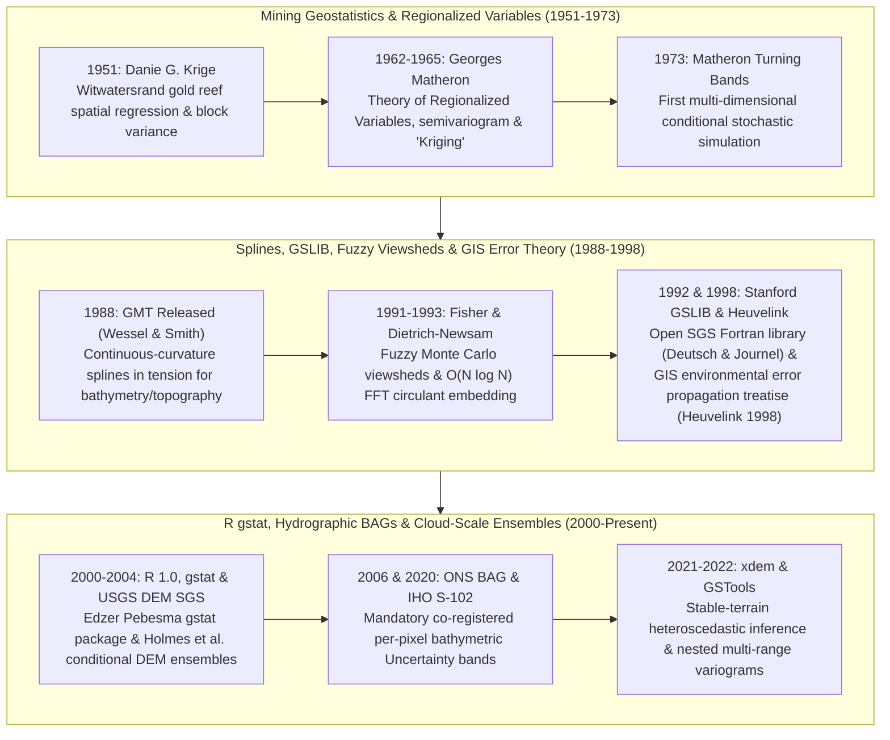

# Chapter 33: Geostatistical Error Simulation and Downstream Uncertainty Propagation

*Beyond static error metrics: generating equiprobable stochastic terrain ensembles to bound real-world risks in hydrology, viewsheds, and earthwork.*

---

## 33.4 Historical Evolution: From Gold Mining to Cloud-Native Ensembles

The mathematical framework used to simulate digital elevation error originated far from cartography: in the gold and diamond mines of South Africa. Over seven decades, geostatistics evolved from manual mining regression tables into rigorous spatial covariance theory, international hydrographic standards, and modern open-source Python packages for glaciology.

The milestones below, anchored in the `schwehr/gis-history` repository, trace the historical lineage of spatial error modeling and geostatistical simulation.

---

### 33.4.1 The South African Mining Origins and Fontainebleau Formalization: 1951 to 1973

#### 1951: Danie G. Krige and Gold Ore Valuation
In the deep Witwatersrand gold reefs of South Africa, mining engineers confronted a costly regression paradox: mining blocks selected because exploratory core assays exceeded the economic cut-off grade systematically yielded less gold than predicted upon excavation.
* In his landmark 1951 paper and Witwatersrand master's thesis, mining engineer **Daniel Gerhardus Krige** demonstrated that ore grades were spatially autocorrelated across lag distance and governed by a support-volume variance effect—samples taken meters apart shared geological continuity, whereas block averages had lower variance than core samples.
* Krige formulated empirical spatial regression weights linking surrounding reef assays to block estimates, laying the empirical foundation of modern mining, hydrographic, and environmental spatial statistics (`gis-history`).

#### 1962–1965: Georges Matheron and the Theory of Regionalized Variables
At the Centre de Géostatistique of the École des Mines de Paris in Fontainebleau, French mathematician **Georges Matheron** transformed Krige's empirical insights into a rigorous Hilbert-space probability theory (`Traité de géostatistique appliquée`, 1962–1963):
* Coined the term **"Kriging"** in honor of Krige and introduced the **Regionalized Variable** $Z(\mathbf{x})$, the second-order stationary and intrinsic hypotheses, and the **semivariogram $\gamma(\mathbf{h}) = \frac{1}{2}\mathbb{E}[(Z(\mathbf{x}+\mathbf{h}) - Z(\mathbf{x}))^2]$**.
* Proved that Ordinary Kriging provides the **Best Linear Unbiased Estimator (BLUE)** under known variogram covariance—while also revealing its fundamental limitation for nonlinear risk analysis: Kriging variance deficits smooth away high-frequency extremes and narrow channel/levee saddles!

#### 1973 (and 1967–1977): Turning Bands vs. Mandelbrot Fractional Brownian Surfaces
To overcome Kriging's smoothing bias in reservoir flow and mine-planning simulations, **Matheron (1973)** introduced Generalized Covariances of order $k$ and the **Turning Bands Method**, projecting independent 1D stochastic line processes onto 2D and 3D grids so ensembles honored both point measurements and target spatial roughness. During this same decade, **Benoît Mandelbrot (1967, 1977)** popularized **fractional Brownian motion (fBm)** with Hurst exponent $H \in (0, 1)$ ($\gamma(h) \propto h^{2H}$ without an upper sill) to synthesize realistic self-affine fractal mountain landscapes in computer graphics. Crucially, while natural *topography itself* exhibits multi-octave power-law scaling, empirical geodetic studies soon proved that *DEM measurement errors* possess bounded sills governed by finite sensor swath widths, trajectory smoothing filters, and control-station spacing—cementing bounded-sill nested variograms rather than unbounded fBm as the physically rigorous error model for elevation surveying.

---

### 33.4.2 GIS Error Propagation, Fuzzy Viewsheds, and GSLIB: 1988 to 1998

#### 1988: Generic Mapping Tools (GMT) and Continuous-Curvature Gridding
In **1988**, Paul Wessel and Walter H. F. Smith released **Generic Mapping Tools (GMT)** (`gis-history`), introducing `surface` (biharmonic splines in tension, 1990) and `blockmedian` / `blockmean` spatial pre-filtering so marine geophysicists could quantify sub-cell depth dispersion and suppress short-wavelength spatial aliasing before gridding sparse, highly anisotropic shipboard single-beam and multibeam soundings across ocean basins.

#### 1991–1993: Fisher's Fuzzy Viewsheds and Dietrich–Newsam FFT Circulant Embedding
As digital elevation models entered mainstream GIS via USGS $7.5\text{-minute}$ DEMs, **Peter F. Fisher (1991, 1993)** demonstrated that propagating uncorrelated pixel noise vs. spatially autocorrelated errors radically changed simulated viewshed areas, pioneering the **probabilistic/fuzzy viewshed**. Almost simultaneously, **C. R. Dietrich and G. N. Newsam (1993)** formulated **Circulant Embedding** via the 2D Fast Fourier Transform, slashing exact Gaussian random-field synthesis from $O(N^3)$ Cholesky factorization to $O(N\log N)$ complexity.

#### 1992 and 1998: Stanford GSLIB, FGDC NSSDA, and Heuvelink's GIS Error Propagation Framework
At Stanford University, **Clayton V. Deutsch and André G. Journel (1992; 2nd ed. 1998)** published **GSLIB** (*Geostatistical Software Library*), releasing open Fortran implementations of normal-score Sequential Gaussian Simulation (`sgsim`) that became universal across subsurface earth sciences. In **1998**, while the US Federal Geographic Data Committee replaced legacy contour-interval map thresholds with the statistical $95\%$ confidence **National Standard for Spatial Data Accuracy (NSSDA)** (later harmonized internationally in **ISO 19115:2003** and **ISO 19157** spatial data-quality lineage schemas; `gis-history`), Dutch spatial statistician **Gerard B. M. Heuvelink** published *Error Propagation in Environmental Modelling with GIS* (Heuvelink, 1998), unifying analytical Taylor-series Jacobian propagation, Rosenblueth point-estimate methods, and conditional geostatistical Monte Carlo simulation for non-linear terrain and hydrological models—joined by **Hunter & Goodchild (1997)** on coupled DEM slope/aspect uncertainty.

---

### 33.4.3 Open-Source Ecosystems, Hydrographic Uncertainty Bands, and `xdem`: 2000 to Present

#### 2000–2006: R 1.0, `gstat`, and USGS DEM Conditional Ensembles
Coinciding with the release of **R Version 1.0.0** in **2000** (`gis-history`), **Edzer Pebesma** integrated **`gstat`** (Pebesma, 2004) into S/R, providing open-source directional variography and multivariable conditional simulation. That same year, **Holmes, Chadwick, & Kyriakidis (2000)** paired GPS checkpoint residuals with `sgsim` conditional simulation on USGS $30\text{ m}$ DEMs, proving that localized terrain-routing errors reached $10\times$ the global RMSE on low-order hillslopes, followed by **Wechsler & Kroll (2006)** in watershed hydrology.

#### 2003–2006 (and 2020): CUBE, Open Navigation Surface BAGs, and IHO S-102
In hydrography, Brian Calder's **CUBE** estimator (**2003**) and the Open Navigation Surface **Bathymetric Attributed Grid (BAG, 2006)**—now elevated internationally into **IHO S-102**—mandated that every gridded seafloor elevation pixel carry an inseparable, co-registered Total Vertical Uncertainty (`Uncertainty`) band, giving marine risk models direct heteroscedastic $\sigma_z(x,y)$ inputs.

#### 2021–2022: `xdem` and `GSTools` at Planetary Scale
To quantify global glacier mass loss across tens of thousands of multi-temporal satellite stereo and radar DEMs without ground checkpoints everywhere, **Romain Hugonnet and colleagues (2021, 2022)** introduced **`xdem`**, inferring non-stationary heteroscedastic variance directly from stable off-ice terrain across slope/curvature covariates and fitting nested multi-range variograms to compute exact $N_{\text{eff}}$ volumetric confidence intervals—complemented in Python by **`GSTools`** (Müller et al., 2022) for sub-second spectral ensemble generation.

---

### 33.4.4 Institutional Shift: From Single-Line Maps to Probabilistic Risk Governance

Historically, even after academic geostatisticians proved the necessity of conditional simulation in the 1990s (NCGIA Research Initiative 1 on *Accuracy of Spatial Databases*, led by Michael Goodchild in 1988–1990; Hunter & Goodchild, 1997; Heuvelink, 1998), operational engineering and regulatory agencies resisted ensemble propagation for two practical reasons:
1. **Computational Cost:** Running $M = 500$ two-dimensional shallow-water hydrodynamic simulations on 1990s workstations (`gis-history`: SGI Indigo / Sun SPARC) required months of wall-clock compute for a single river reach, forcing agencies to standardize on a single deterministic "best-available" DEM.
2. **Statutory Binary Boundaries:** Legal frameworks—such as the US National Flood Insurance Program's Special Flood Hazard Area ($1\%\text{-annual-chance}$ binary polygon) or legacy paper nautical chart depth contours—demanded a single crisp vector line rather than a continuous probability field $P(\mathbf{x}) \in [0, 1]$.

Over the past decade, cloud-native GPU computing (`Dask`, `CUDA` shallow-water solvers, `GSTools` FFT synthesis; Chapter 34) and high-profile infrastructure disasters have overturned both barriers:
* **Graduated Probabilistic Flood Mapping (FEMA FFRD):** Modern flood-risk initiatives—including FEMA's **Future of Flood Risk Data (FFRD)** and European Floods Directive ensemble frameworks—replace deceptive deterministic wet/dry lines with multi-return-period, Monte Carlo probabilistic inundation grids coupling hydrologic discharge ensembles with spatially correlated DEM/levee-crest realizations.
* **Dynamic Risk-Based Under-Keel Clearance (IHO S-100 / S-102):** Inside modern Electronic Chart Display and Information Systems (ECDIS), pairing IHO **S-102** gridded bathymetry and per-cell TVU uncertainty with S-104 dynamic water levels and S-111 surface currents allows port authorities (e.g., Rotterdam, Torres Strait, Columbia River Bar) to transition from conservative static keel-clearance rules to probabilistic, uncertainty-aware transit windows.
* **Planetary-Scale Earth Observation & Geomorphic Change Accounting:** Building on Fuzzy Inference System DEM-of-Difference (`DoD`) error budgets in fluvial geomorphology (Wheaton et al., 2010) and 3D normal-cylinder `M3C2` confidence intervals on rockwalls (Lague et al., 2013), IPCC AR6 sea-level-rise cryospheric budgets (`xdem`; Hugonnet et al., 2021) and coastal sediment-budget audits have elevated multi-scale spatial autocorrelation from an academic specialty into a mandatory scientific audit standard.
