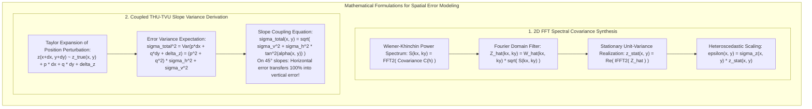

# Chapter 33: Geostatistical Error Simulation and Downstream Uncertainty Propagation

*Beyond static error metrics: generating equiprobable stochastic terrain ensembles to bound real-world risks in hydrology, viewsheds, and earthwork.*

---

## 33.5 Mathematical Foundations of Error Simulation and Slope Variance Coupling

Simulating realistic, spatially correlated error fields and propagating them through spatial models requires two core mathematical derivations:
1. **2D Fast Fourier Transform (FFT) Spectral Covariance Synthesis** with point-by-point heteroscedastic modulation.
2. The **Coupled THU-TVU Slope Variance Formula**, which proves why horizontal positioning uncertainty dominates vertical elevation uncertainty in steep topography.

---

### 33.5.1 Derivation of 2D FFT Spectral Covariance Synthesis

Let $\epsilon_{\text{stat}}(\mathbf{x})$ be a 2D stationary, zero-mean Gaussian random field on $\mathbb{R}^2$ governed by an isotropic target covariance function $C(\mathbf{h}) = \sigma^2 \rho(\|\mathbf{h}\|)$, where $\mathbf{h} = (h_x, h_y)$ is the spatial lag vector and $\rho$ is the correlation function (e.g., Gaussian $\rho(h) = e^{-(h/a)^2}$ or Exponential $\rho(h) = e^{-3h/a}$).

#### 1. The Wiener-Khinchin Theorem
Under the Wiener-Khinchin theorem, the covariance function $C(\mathbf{h})$ and the power spectral density $S(\mathbf{k})$ form a 2D continuous Fourier transform pair:

$$S(k_x, k_y) = \iint_{\mathbb{R}^2} C(h_x, h_y) e^{-i (k_x h_x + k_y h_y)} \, dh_x \, dh_y$$
where $\mathbf{k} = (k_x, k_y)$ is the spatial wavenumber vector ($\text{rad/m}$).

For an isotropic Gaussian covariance $C(h) = \sigma^2 e^{-(h/a)^2}$, the analytic 2D Fourier transform is:
$$S(k_x, k_y) = \pi a^2 \sigma^2 \exp\left( -\frac{a^2 (k_x^2 + k_y^2)}{4} \right)$$

For an isotropic Exponential covariance $C(h) = \sigma^2 e^{-3h/a}$:
$$S(k_x, k_y) = \frac{6\pi a^2 \sigma^2}{\big( 9 + a^2 (k_x^2 + k_y^2) \big)^{3/2}}$$

#### 2. Exact Discrete Frequency-Domain Synthesis (Circulant Embedding)
On a padded discrete $N_x \times N_y$ raster grid with grid spacings $\Delta x, \Delta y$:
1. Evaluate the wrapped discrete unit-variance correlation kernel $C_d[m, n] = \rho\big(\|\mathbf{h}_{m,n}\|\big)$ centered at $[0, 0]$ (so $C_d[0, 0] = 1$) and compute its real, non-negative 2D Discrete Fourier Transform $\widehat{C}_d[u, v] = \mathcal{F}_{\text{2D}}\{C_d\}[u, v] \ge 0$ (Dietrich & Newsam, 1993).
2. Draw an $N_x \times N_y$ real matrix of independent standard normal random variables $W[m, n] \stackrel{\text{i.i.d.}}{\sim} \mathcal{N}(0, 1)$, whose forward DFT $\widehat{W} = \mathcal{F}_{\text{2D}}\{W\}$ automatically satisfies conjugate Hermitian symmetry ($\widehat{W}[-u, -v] = \widehat{W}^*[u, v]$) with $\mathbb{E}\big[|\widehat{W}[u, v]|^2\big] = N_x N_y$.
3. Multiply by the real symmetric amplitude filter $\sqrt{\widehat{C}_d[u, v]}$ and apply the $1/(N_x N_y)$ inverse 2D DFT (`TOC.md` Section 33.5):
   $$z_{\text{stat}}[m, n] = \mathcal{F}_{\text{2D}}^{-1}\left\{ \sqrt{\mathcal{F}_{\text{2D}}\{C_d\}[u, v]} \cdot \mathcal{F}_{\text{2D}}\{W\}[u, v] \right\}$$
* **Exact Variance Proof:** Because multiplying a Hermitian-symmetric spectrum $\widehat{W}$ by a real even spectrum $\sqrt{\widehat{C}_d}$ preserves Hermitian symmetry, $z_{\text{stat}}[m, n]$ is **identically real** (unlike filtering complex noise and discarding the imaginary half via $\text{Re}(\cdot)$, which loses $50\%$ of the variance unless scaled by $\sqrt{2}$!), and by Parseval's identity $\mathbb{E}\big[z_{\text{stat}}[m, n]^2\big] = \frac{1}{(N_x N_y)^2}\sum_{u,v} \widehat{C}_d[u,v](N_x N_y) = C_d[0,0] = 1$.

#### 3. Heteroscedastic Modulation and Derivative Error Suppression
Modulating $z_{\text{stat}}^{(m)}(x, y)$ point-by-point by the spatially variable $1\sigma$ uncertainty map $\sigma_z(x, y)$ yields $e^{(m)}(x, y) = \sigma_z(x, y)\,z_{\text{stat}}^{(m)}(x, y)$. Notice how spatial autocorrelation governs finite-difference terrain slope variance! For a centered difference $\hat{p} = \frac{z(x+\Delta x, y) - z(x-\Delta x, y)}{2\Delta x}$, the slope error variance is controlled by the semivariogram $\gamma(2\Delta x) = \sigma_z^2\big(1 - \rho(2\Delta x)\big)$:
$$\sigma_{\hat{p}}^2 = \frac{\mathbb{E}\big[(e(x+\Delta x, y) - e(x-\Delta x, y))^2\big]}{4\Delta x^2} = \frac{2\,\gamma(2\Delta x)}{4\Delta x^2} = \frac{\sigma_z^2\big(1 - \rho(2\Delta x)\big)}{2\Delta x^2}$$
Whereas uncorrelated white noise ($\rho(2\Delta x) = 0$) explodes as $\frac{\sigma_z^2}{2\Delta x^2}$, a smooth Gaussian error field ($\rho(h) = e^{-h^2/a^2}$ with $a \gg \Delta x$) has $1 - \rho(2\Delta x) \approx \frac{4\Delta x^2}{a^2}$, collapsing the grid spacing $\Delta x$ out of the denominator to a finite physical tilt variance $\sigma_{\hat{p}}^2 \approx \frac{2\sigma_z^2}{a^2}$!

---

### 33.5.2 Derivation of the Coupled THU-TVU Slope Variance Formula

A major misconception in elevation error analysis is treating horizontal uncertainty ($\text{THU}$) and vertical uncertainty ($\text{TVU}$) as independent orthogonal quantities. On sloping terrain, **horizontal positioning error couples directly into vertical elevation error**.

#### 1. Taylor Series Perturbation
Let the true ground elevation surface be $z_{\text{true}}(x, y)$. 

Suppose a survey instrument attempts to measure a point at true location $(x, y)$, but suffers a horizontal positioning displacement error $(\delta x, \delta y)$ and a vertical sensor measurement error $\delta z_{\text{sensor}}$:

The recorded elevation $z_{\text{meas}}$ is:
$$z_{\text{meas}} = z_{\text{true}}(x + \delta x, \, y + \delta y) + \delta z_{\text{sensor}}$$

Assuming the horizontal errors $(\delta x, \delta y)$ are small relative to terrain curvature, we expand $z_{\text{true}}$ in a first-order Taylor series around $(x, y)$:

$$z_{\text{meas}} \approx z_{\text{true}}(x, y) + \frac{\partial z}{\partial x} \delta x + \frac{\partial z}{\partial y} \delta y + \delta z_{\text{sensor}}$$

Let the directional spatial terrain gradients be denoted as $p = \frac{\partial z}{\partial x}$ and $q = \frac{\partial z}{\partial y}$. The net vertical elevation error is:

$$\epsilon_z = z_{\text{meas}} - z_{\text{true}}(x, y) = p \cdot \delta x + q \cdot \delta y + \delta z_{\text{sensor}}$$

#### 2. Evaluating Total Error Variance
Assuming that horizontal positioning errors $\delta x, \delta y$ and vertical sensor noise $\delta z_{\text{sensor}}$ are zero-mean, mutually uncorrelated random variables:
$$\mathbb{E}[\delta x] = \mathbb{E}[\delta y] = \mathbb{E}[\delta z_{\text{sensor}}] = 0$$
$$\mathbb{E}[\delta x \cdot \delta y] = \mathbb{E}[\delta x \cdot \delta z_{\text{sensor}}] = \mathbb{E}[\delta y \cdot \delta z_{\text{sensor}}] = 0$$

Let horizontal positioning be isotropic with variance $\sigma_x^2 = \sigma_y^2 = \sigma_{\text{horiz}}^2$, and let vertical sensor variance be $\sigma_{\text{vert}}^2$.

The total vertical elevation error variance is the statistical expectation of $\epsilon_z^2$:

$$\sigma_{\text{total}, z}^2 = \mathbb{E}\big[ \epsilon_z^2 \big] = \mathbb{E}\left[ \big( p \cdot \delta x + q \cdot \delta y + \delta z_{\text{sensor}} \big)^2 \right]$$

Expanding the square:
$$\sigma_{\text{total}, z}^2 = p^2 \mathbb{E}[\delta x^2] + q^2 \mathbb{E}[\delta y^2] + \mathbb{E}[\delta z_{\text{sensor}}^2] + 2pq\mathbb{E}[\delta x \delta y] + 2p\mathbb{E}[\delta x \delta z] + 2q\mathbb{E}[\delta y \delta z]$$

All cross-terms vanish:
$$\sigma_{\text{total}, z}^2 = p^2 \sigma_{\text{horiz}}^2 + q^2 \sigma_{\text{horiz}}^2 + \sigma_{\text{vert}}^2 = \big( p^2 + q^2 \big) \sigma_{\text{horiz}}^2 + \sigma_{\text{vert}}^2$$

#### 3. Slope Angle Substitution
The terrain slope gradient magnitude is $\|\nabla z\| = \sqrt{p^2 + q^2}$. The physical ground slope angle $S$ is defined as:
$$\tan S = \|\nabla z\| = \sqrt{p^2 + q^2} \implies \tan^2 S = p^2 + q^2$$

Substituting $\tan^2 S$ into the variance equation:

$$\sigma_{\text{total}, z}^2(x, y) = \sigma_{\text{vert}}^2 + \sigma_{\text{horiz}}^2 \cdot \tan^2 S(x, y)$$

Taking the square root yields the **Coupled THU-TVU Slope Equation**:

$$\sigma_{\text{total}, z}(x, y) = \sqrt{\sigma_{\text{vert}}^2 + \big( \sigma_{\text{horiz}} \cdot \tan S(x, y) \big)^2}$$

#### 4. Physical and Operational Implications
* **Flat Terrain ($S = 0^\circ$):** $\tan 0^\circ = 0 \implies \sigma_{\text{total}, z} = \sigma_{\text{vert}}$. Horizontal errors have zero vertical impact.
* **$45^\circ$ Slopes ($S = 45^\circ$):** $\tan 45^\circ = 1.0 \implies \sigma_{\text{total}, z} = \sqrt{\sigma_{\text{vert}}^2 + \sigma_{\text{horiz}}^2}$. Horizontal positioning uncertainty transfers $100\%$ into vertical uncertainty!
* **Steep Mountain Cliffs / Fjord Walls ($S = 60^\circ$):** $\tan 60^\circ = \sqrt{3} \approx 1.732 \implies \tan^2 60^\circ = 3.0$.
  $$\sigma_{\text{total}, z} = \sqrt{\sigma_{\text{vert}}^2 + 3 \cdot \sigma_{\text{horiz}}^2}$$
  If an airborne drone has vertical sensor precision $\sigma_{\text{vert}} = \pm 0.05\text{ m}$ but horizontal GNSS position drift $\sigma_{\text{horiz}} = \pm 0.30\text{ m}$:
  $$\sigma_{\text{total}, z} = \sqrt{(0.05)^2 + 3 \cdot (0.30)^2} = \sqrt{0.0025 + 0.27} = \sqrt{0.2725} \approx \mathbf{\pm 0.522\text{ meters}}$$
  The total vertical elevation error is **over ten times larger** than the raw vertical sensor precision! Horizontal positioning drift completely overwhelms vertical laser accuracy on steep slopes.

> [!WARNING]
> **Confidence-Level Scaling Before THU–TVU Propagation ($95\%$ vs. $1\sigma$)**
> In hydrographic standards (**IHO S-44** and **NOAA HSSD**) and ASPRS accuracy reports, vertical uncertainty ($\text{TVU}_{95\%}$ or $\text{NVA}$) is reported as a **1D $95\%$ linear confidence interval** ($1.9600\,\sigma_{\text{vert}}$), whereas horizontal uncertainty ($\text{THU}_{95\%}$ or $\text{CE95}$) is reported as a **2D $95\%$ circular Rayleigh confidence radius** ($2.4477\,\sigma_{\text{horiz}}$ for isotropic single-axis standard deviation $\sigma_x = \sigma_y = \sigma_{\text{horiz}}$; [notation-and-symbols.md](../00-front-matter/notation-and-symbols.md), Section 6.2). Always convert both to $1\sigma$ standard deviations *before* applying the Coupled Slope Variance Equation:
> $$\sigma_{\text{total},z}^2(x,y) = \left(\frac{\text{TVU}_{95\%}}{1.9600}\right)^2 + \tan^2\alpha(x,y)\,\left(\frac{\text{THU}_{95\%}}{2.4477}\right)^2$$
> Plugging $\text{THU}_{95\%}$ directly into a $1\sigma$ formula without dividing by $2.4477$ overestimates the horizontal-to-vertical variance contribution by a factor of $(2.4477 / 1.9600)^2 = \mathbf{1.56\times}$!

---

### 33.5.3 Worked Numerical Example: Nested Variogram Volume Uncertainty vs. White Noise

Suppose a coastal engineering team differences two $1\text{ m}$ topo-bathymetric LiDAR DEMs across a $A_\Omega = 4.0\text{ km}^2$ ($2\text{ km} \times 2\text{ km}$, $N = 4 \times 10^6\text{ pixels}$, equivalent disk radius $R_\Omega = \sqrt{A_\Omega/\pi} = 1,128.4\text{ m}$) nourished beach and nearshore bar zone, measuring a mean elevation gain $\overline{\Delta z} = +0.18\text{ m}$ ($V = +720,000\text{ m}^3$). Empirical variogram fitting on stable coastal pavement yields total variance $\sigma_e^2 = (0.08\text{ m})^2 = 0.0064\text{ m}^2$ partitioned into a short-range spherical component ($c_1 = 0.0024\text{ m}^2, a_1 = 20\text{ m}$) and a medium-range flight-swath spherical component ($c_2 = 0.0040\text{ m}^2, a_2 = 600\text{ m}$):
* **Naive White-Noise Assumption:** $\sigma_{V,\text{white}} = A_\Omega \frac{\sigma_e}{\sqrt{N}} = 4\times 10^6 \times \frac{0.08}{2000} = \mathbf{\pm 160\text{ m}^3}$ ($95\%$ CI: $\pm 314\text{ m}^3$, or $\pm 0.04\%$—falsely implying near-exact certainty!).
* **Nested Geostatistical Integration (Hugonnet et al., 2022):** For each spherical range $a_k \ll 2 R_\Omega$, the areal variance reduction factor is $\frac{\sigma_{\bar{e},k}^2}{c_k} \approx \frac{1}{N_{\text{eff},k}} \approx \frac{\pi a_k^2}{5 A_\Omega}$ (exact spherical disk integral approximation), giving $\sigma_{\bar{e}}^2 \approx c_1\frac{\pi(20)^2}{2\times 10^7} + c_2\frac{\pi(600)^2}{2\times 10^7} = 1.51\times 10^{-7} + 2.26\times 10^{-4} \approx 2.263\times 10^{-4}\text{ m}^2 \implies \sigma_{\bar{e}} = \mathbf{0.01504\text{ m}}$ ($N_{\text{eff}} = \sigma_e^2 / \sigma_{\bar{e}}^2 \approx \mathbf{28.3}$).
* **True Propagated Volume Uncertainty:** $\sigma_V = A_\Omega\,\sigma_{\bar{e}} = 4\times 10^6 \times 0.01504 = \mathbf{\pm 60,180\text{ m}^3}$ ($95\%$ CI: **$\pm 117,950\text{ m}^3$**, or $\pm 16.4\%$ of the entire beach nourishment contract)! Notice how the $600\text{ m}$ flight-line swath component ($c_2$) accounts for $99.9\%$ of the volumetric uncertainty.
