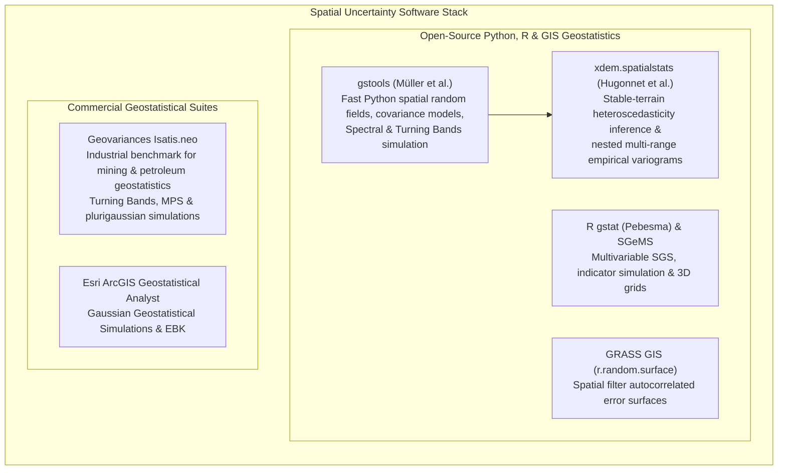

# Chapter 33: Geostatistical Error Simulation and Downstream Uncertainty Propagation

*Beyond static error metrics: generating equiprobable stochastic terrain ensembles to bound real-world risks in hydrology, viewsheds, and earthwork.*

---

## 33.6 Software Ecosystem

Executing geostatistical error simulation and propagating uncertainty through spatial pipelines requires software capable of variogram estimation, fast Gaussian random field generation, and large-array raster modulation. This section reviews the open-source libraries and enterprise software suites used in spatial uncertainty analysis.



---

### 33.6.1 Open-Source Geostatistical Libraries

#### 1. `gstools`: Fast Geostatistical Tools in Python
Developed by Sebastian Müller and Lennart Schüler, **`gstools`** is a high-performance, object-oriented geostatistical Python library built on Cython and SciPy:
* **Covariance Models:** Provides rich theoretical covariance structures (Gaussian, Exponential, Matérn, Stable, Spherical).
* **Random Field Generation:** Implements the **Spectral Method** (randomized FFT phase synthesis) and **Turning Bands Method** to generate 2D and 3D spatial random fields in milliseconds.
* **Conditioning:** Supports Kriging-based conditioning to force random fields to honor sparse point observations.

```python
"""
Generate an equiprobable stochastic terrain realization using gstools.
Synthesizes an anisotropic spatially autocorrelated error field, modulates it by
local slope-dependent heteroscedastic variance, and adds it to a baseline DEM.
"""

import numpy as np
import gstools as gs


def generate_stochastic_dem_realization(
    base_dem: np.ndarray,
    dx: float,
    dy: float,
    practical_range_m: float = 250.0,
    anis_ratio: float = 0.25,
    track_azimuth_deg: float = 30.0,
    sensor_vert_noise: float = 0.05,
    horiz_pos_noise: float = 0.30,
    seed: int = 42,
) -> np.ndarray:
    """
    Generates a single equiprobable DEM realization (shape: ny, nx) with
    anisotropic autocorrelated, slope-coupled heteroscedastic elevation error.
    """
    ny, nx = base_dem.shape
    x_coords = np.arange(nx) * dx
    y_coords = np.arange(ny) * dy

    # 1. Define Exponential model with unit variance (var=1.0).
    # Note: In GSTools, rho(r) = exp(-r / len_scale), so practical 95% range a = 3 * len_scale,
    # and 2D angles are counter-clockwise from +x (East): theta_math = 90.0 - track_azimuth_deg!
    model = gs.Exponential(
        dim=2,
        var=1.0,
        len_scale=practical_range_m / 3.0,
        anis=anis_ratio,
        angles=np.radians(90.0 - track_azimuth_deg),
    )

    # 2. Synthesize stationary 2D Gaussian random field via Spectral / Fourier generator.
    # Pass [x_coords, y_coords] and transpose (.T) from (nx, ny) to raster (ny, nx) layout!
    srf = gs.SRF(model, mode_no=2000, seed=seed)
    stat_error_field = srf.structured([x_coords, y_coords]).T

    # 3. Compute local terrain slope gradient ||grad(z)|| = tan(alpha) from baseline DEM
    grad_y, grad_x = np.gradient(base_dem, dy, dx)
    tan_slope = np.sqrt(grad_x**2 + grad_y**2)

    # 4. Coupled THU-TVU 1-sigma heteroscedastic error standard deviation
    sigma_hetero = np.sqrt(sensor_vert_noise**2 + (horiz_pos_noise * tan_slope) ** 2)

    # 5. Modulate stationary unit-variance field and add to baseline DEM
    hetero_error_field = stat_error_field * sigma_hetero
    return base_dem + hetero_error_field
```

#### 2. `xdem.spatialstats`: Empirical Heteroscedasticity and Multi-Range Variograms
Developed for planetary-scale cryospheric and geomorphological change detection (Hugonnet et al., 2021, 2022), **`xdem`** provides an end-to-end statistical inference pipeline directly on GeoTIFF `DEM` objects without requiring dense GPS checkpoints:
* **`xdem.spatialstats.infer_heteroscedasticity_from_stable`:** Bins elevation differences `dh` on stable control terrain across $N$-dimensional terrain covariates (such as `slope` and `max_curvature`) using robust **NMAD** estimators to construct a continuous per-pixel $\sigma_{\text{dh}}(x, y)$ raster and standardize residuals `z_std = dh / sigma_dh`.
* **`xdem.spatialstats.sample_empirical_variogram` & `fit_sum_model_variogram`:** Built atop `scikit-gstat` (`skgstat.Variogram` / `DirectionalVariogram`), subsamples pairwise disks, rings, and directional azimuth sectors across multi-million-pixel rasters to compute empirical semivariograms from meter to $100\text{-km}$ lags, fitting weighted sums of `Spherical`, `Exponential`, and `Gaussian` models.
* **`xdem.spatialstats.neff_circular` & `spatial_error_propagation`:** Integrates the fitted multi-range variogram over arbitrary watershed or glacier polygons to compute exact effective sample counts $N_{\text{eff}}$ and volumetric standard errors.

```python
import xdem

# Infer slope/curvature heteroscedasticity + nested variogram from stable terrain in xdem
dh = dem_2024 - dem_2015
slope, max_curv = xdem.terrain.get_terrain_attribute(dem_2024, attribute=["slope", "max_curvature"])

err_map, df_bin, err_fn = xdem.spatialstats.infer_heteroscedasticity_from_stable(
    dvalues=dh, list_var=[slope, max_curv], stable_mask=stable_mask
)
z_std = dh / err_map
emp_var = xdem.spatialstats.sample_empirical_variogram(
    values=z_std.data.squeeze(), gsd=dem_2024.res[0], n_variograms=5, estimator="dowd"
)
func_sum, params_var = xdem.spatialstats.fit_sum_model_variogram(["Spherical", "Spherical"], emp_var)
```

#### 3. R `gstat`, Stanford `SGeMS`, and GRASS GIS `r.random.surface`
* **R `gstat` (Pebesma, 2004):** Benchmark multivariable geostatistical package supporting anisotropic variogram fitting (`fit.variogram`) and multi-realization conditional Sequential Gaussian Simulation via `predict(gstat_obj, newdata = grid_stars, nsim = 200)` across `sf` and `stars` spatial layers.
* **SGeMS (Stanford Geostatistical Modeling Software):** Open-source C++ GUI and scripting workbench implementing GSLIB algorithms (`sgsim`, `dssim` direct sequential simulation, `sisim` indicator simulation, and `snesim` multi-point statistics) on 2D surfaces and 3D stratigraphic grids.
* **GRASS GIS (`r.random.surface`):** Generates spatially autocorrelated DEM error realizations directly inside GRASS workflows via spatial moving-average filter cones parameterized by maximum distance (`distance=250`) and distance-decay exponent (`exponent=1.0`), ideal for shell-scripted Monte Carlo viewshed (`r.viewshed`) and watershed (`r.watershed`) loops:
  ```bash
  r.random.surface output=err_realization_01 distance=250.0 exponent=1.0 high=1000 seed=42
  ```

---

### 33.6.2 Commercial and Industrial Geostatistical Platforms

#### 1. Geovariances Isatis.neo
Developed in partnership with the Mines Paris – PSL Centre de Géostatistique (Matheron's laboratory), **Isatis.neo** is the industrial standard for mining, civil tunneling, and offshore wind seabed hazard modeling—offering massively parallel 2D/3D Turning Bands, Local Anisotropy Kriging (following curved river channels or continental-slope contours!), and Plurigaussian/Multi-Point simulations.

#### 2. Esri ArcGIS Pro Geostatistical Analyst
* **`Gaussian Geostatistical Simulations`:** Consumes a `Simple Kriging` layer to generate $M$ conditional or unconditional realizations clipped to polygons, automatically computing cell-by-cell quantile rasters and threshold exceedance probability maps (e.g., $P(z < z_{\text{surge}})$).
* **Empirical Bayesian Kriging (EBK):** Accounts for variogram parameter estimation uncertainty itself by simulating an ensemble of local semivariogram spectra rather than assuming a single deterministic variogram is known without error.

---

### 33.6.3 End-to-End Probabilistic Connected-Flood Propagation Recipe

A classic implementation bug in probabilistic coastal/fluvial inundation scripts is using a disconnected "bathtub" check (`z_sim < water_level`), which falsely floods isolated inland quarries and behind-levee polders even when the levee crest remains unbroken! The production Python workflow below combines `gstools` conditional/heteroscedastic ensembles with `scipy.ndimage.label` **hydrological connectivity** so an inland pixel floods in realization $m$ *if and only if* a continuous overtopping path links it to the river or open ocean:

```python
"""
Probabilistic hydrologically-connected coastal/levee flood propagation over M realizations.
Combines anisotropic GSTools error ensembles with 8-connected flood-fill routing.
"""

import numpy as np
import gstools as gs
from scipy.ndimage import label


def compute_probabilistic_connected_inundation(
    dem: np.ndarray,
    sigma_z: np.ndarray,
    ocean_seed_mask: np.ndarray,
    surge_level_m: float,
    dx: float = 2.0,
    dy: float = 2.0,
    corr_range_m: float = 300.0,
    n_realizations: int = 200,
    min_hazard_depth_m: float = 0.30,
) -> tuple[np.ndarray, np.ndarray]:
    """
    Returns (prob_inundation, p90_depth_m) over n_realizations correlated DEMs.
    """
    ny, nx = dem.shape
    x_c, y_c = np.arange(nx) * dx, np.arange(ny) * dy
    # gstools.Gaussian defaults rescale=sqrt(pi)/2 (integral scale); set rescale=sqrt(3)
    # so corr_range_m matches the 95%-sill practical range exp(-3 * (r / corr_range_m)^2)
    cov_model = gs.Gaussian(dim=2, var=1.0, len_scale=corr_range_m, rescale=np.sqrt(3.0))
    struct_8conn = np.ones((3, 3), dtype=int)  # 8-neighbor D8 planar connectivity

    exceedance_count = np.zeros((ny, nx), dtype=np.int32)
    depth_stack = np.zeros((n_realizations, ny, nx), dtype=np.float32)

    for m in range(n_realizations):
        srf = gs.SRF(cov_model, mode_no=1500, seed=1000 + m)
        z_sim = dem + sigma_z * srf.structured([x_c, y_c]).T

        # Identify all pixels below surge level that are 8-connected to ocean_seed_mask
        potentially_wet = (z_sim < surge_level_m) | ocean_seed_mask
        comp_labels, _ = label(potentially_wet, structure=struct_8conn)
        ocean_labels = np.unique(comp_labels[ocean_seed_mask])
        ocean_labels = ocean_labels[ocean_labels > 0]
        connected_wet = np.isin(comp_labels, ocean_labels)

        water_depth = np.where(connected_wet, np.maximum(0.0, surge_level_m - z_sim), 0.0)
        exceedance_count += (water_depth >= min_hazard_depth_m).astype(np.int32)
        depth_stack[m] = water_depth

    prob_inundation = exceedance_count / float(n_realizations)
    p90_depth_m = np.percentile(depth_stack, 90.0, axis=0)
    return prob_inundation, p90_depth_m
```

When ingesting hydrographic **Bathymetric Attributed Grids (`.bag`)** or **IHO S-102 (`.h5`)** surfaces via GDAL/`rasterio`, Band 1 stores positive-up elevation $z$ (`m`) while Band 2 stores Total Vertical Uncertainty (`TVU` at $95\%$ confidence, per IHO S-44 / NOAA HSSD). Always divide Band 2 by `1.9600` (after masking `1000000.0` nodata sentinels via `np.where(tvu_95 >= 1e6, np.nan, tvu_95 / 1.9600)`) before passing `sigma_z` into `compute_probabilistic_connected_inundation` or UKC grounding ensembles so $95\%$ bounds are not treated as $1\sigma$ standard deviations!

---

### 33.6.4 Geostatistical Simulation Algorithms and Toolchains Compared

| Algorithm / Software | Computational Scaling | Exact Conditioning? | Anisotropy & Multi-Scale? | Best Operational Use Case |
| :--- | :--- | :--- | :--- | :--- |
| **Sequential Gaussian Sim (`gstat`, `SGeMS`)** | $O(M \cdot N \cdot k^3)$ | Direct ($k$-NN Kriging) | Yes (3D ellipsoidal) | Small-to-medium grids ($<10^6$ cells) with dense checkpoints |
| **Turning Bands (`GSTools`, `Isatis.neo`)** | $O(M \cdot N \cdot L)$ | Via Dual Kriging | Yes (multi-component) | Massive 2D/3D grids, out-of-core chunking without FFT padding |
| **FFT Circulant Embedding (`GSTools`, MATLAB)** | $O(M \cdot N\log N)$ | Via Dual Kriging | Yes (2D spectral tensor) | Ultra-fast 2D raster ensembles ($10^7\text{–}10^8$ pixels per realization) |
| **`xdem.spatialstats` (Python)** | $O(N_{\text{sub}}^2)$ ring sampling | Stable-terrain inference | Nested multi-range sums | Inferring heteroscedastic $\sigma_z(x,y)$ & $N_{\text{eff}}$ from multi-temporal DEMs |
| **GRASS `r.random.surface`** | $O(M \cdot N \cdot W^2)$ | Unconditional | Isotropic filter cone | Shell-scripted Monte Carlo `r.viewshed` & `r.watershed` sensitivity |
| **ArcGIS `Gaussian Geostatistical Sim`** | $O(M \cdot N \cdot k^3)$ | Simple Kriging / EBK | Yes (with EBK subsets) | Enterprise GIS coastal/utility threshold exceedance mapping |
