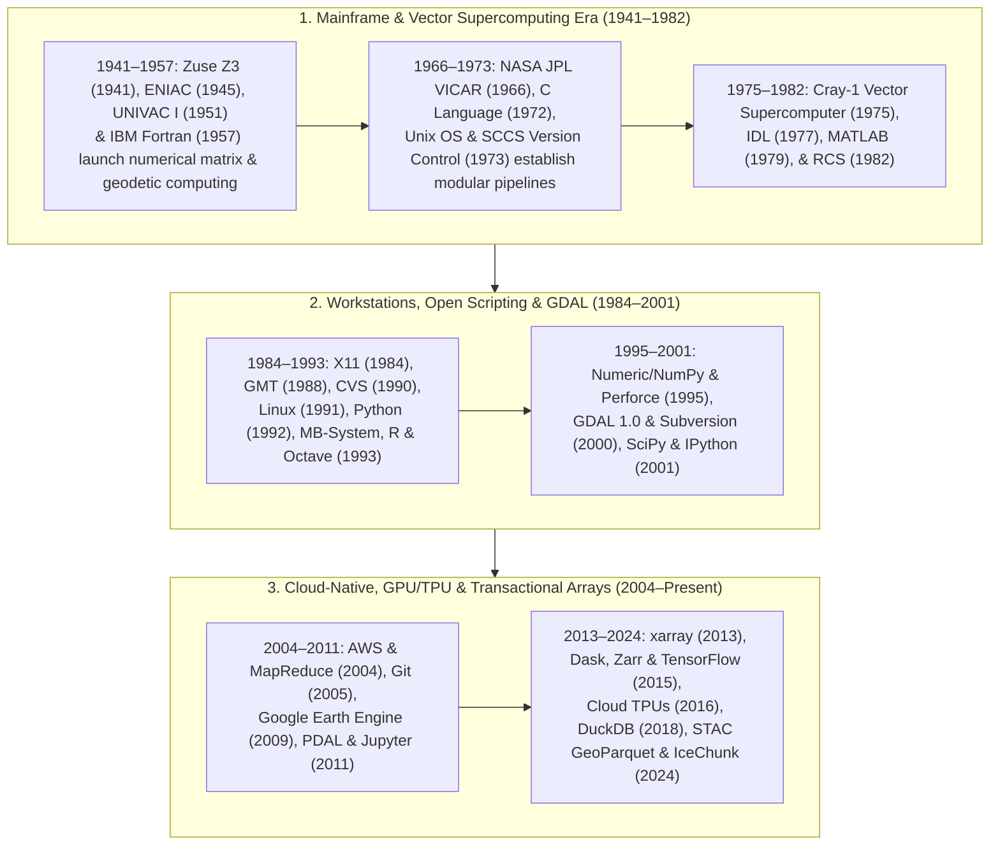
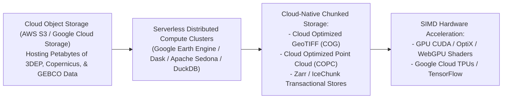

# Chapter 34: Cloud-Native Petabyte Pipelines, GPU Acceleration, and Automated Testing for DEMs

*Software engineering at planetary scale: building reproducible, high-throughput, thoroughly tested elevation processing systems.*

---

## 34.1 Evolution of Geospatial Computing Architectures

Digital elevation modeling has always pushed the absolute limits of computational hardware and software engineering. In the 1960s, a $512 \times 512$ elevation matrix was a massive dataset that strained the magnetic core memory of an IBM mainframe. Today, continental-scale programs like USGS 3DEP, Copernicus GLO-30, and Nippon Foundation-GEBCO Seabed 2030 process petabytes of point clouds and multi-resolution raster pyramids distributed across thousands of cloud-native worker nodes.

The eighty-year computational arc below—anchored in the historical computing milestones of the `schwehr/gis-history` repository—traces how computing paradigms shifted from early vacuum-tube mainframes and Fortran numerical algorithms to Unix C toolchains, open-source Python scientific libraries, distributed MapReduce clusters, GPU/TPU accelerators, and cloud-native transactional array storage.

---

### 34.1.1 The Mainframe and Vector Supercomputing Era: 1941 to 1982

#### 1. From Z3 and ENIAC to Fortran
* **1941–1951:** The birth of digital computing: Konrad Zuse's **Z3** (1941) in Germany, the **ENIAC** (1945) at the University of Pennsylvania, and the commercial **UNIVAC I** (1951). Early military geodesists used these machines to solve massive least-squares normal equations for continental triangulation adjustments, ellipsoidal geodesic distances, and ballistic gravity trajectories.
* **1957: Fortran (Formula Translation):** Developed by John Backus at IBM, Fortran became the foundational language of scientific computing. It introduced multidimensional arrays, compiler-optimized floating-point arithmetic, and `DO`-loops. Landmark terrain algorithms—including NOAA's early ellipsoidal inverse utilities, USGS contour-to-grid interpolation codes (`GCTP`, 1980), and the Harvard Lab's 1970s `SYMAP`/`SYMVU` terrain plotting engines—were implemented in Fortran, and Fortran BLAS/LAPACK routines still execute beneath modern Python elevation solvers.

#### 2. JPL VICAR, Unix/C, and Early Version Control
* **1966: JPL VICAR (Video Image Communication and Retrieval):** Developed at NASA JPL to process television and stereo imagery from the Ranger and Mariner missions. VICAR pioneered the modular pipeline philosophy: decomposing terrain and image processing into small single-purpose executables connected via standardized binary rasters with self-describing ASCII metadata labels.
* **1972–1973: C, Unix, and SCCS:** Dennis Ritchie and Ken Thompson at Bell Labs created the **C programming language** (1972) and rewrote the **Unix operating system** in C (1973). Unix introduced hierarchical filesystems, standard streams, and pipes (`|`), enabling complex geospatial batch workflows. In 1973, Marc Rochkind introduced **SCCS (Source Code Control System)**, initiating software revision tracking; Walter Tichy subsequently modernized file-level history with **RCS (Revision Control System)** in 1982.
* **1975–1979: Vector Supercomputers, IDL, and MATLAB:** Seymour Cray delivered the **Cray-1** (1975), whose vector registers executed parallel floating-point operations across contiguous memory vectors, unlocking global geopotential spherical harmonic expansions and hydrodynamic storm-surge models. Simultaneously, high-level array languages emerged for interactive science: David Stern released **IDL (Interactive Data Language)** in 1977 (widely adopted in planetary and spaceborne remote sensing, and powering ENVI), and Cleve Moler created **MATLAB** in 1979 to give engineers interactive matrix algebra (`A \ b` least-squares geodetic adjustments and Kriging linear systems) without writing low-level Fortran.

---

### 34.1.2 Workstations, Open-Source Scripting, and GDAL: 1984 to 2001

#### 1. The Unix Workstation, Version Control, and Scripting Transition
During the 1980s and 1990s, scientific computing decentralized from centralized mainframes to departmental Unix workstations (Sun Microsystems, Silicon Graphics, DEC) running the **X Window System (X11, 1984)** for interactive graphical terrain visualization and map inspection:
* **1988–1993: GMT and MB-System:** Paul Wessel and Walter H. F. Smith leveraged Unix shell scripting and C to build **Generic Mapping Tools (GMT, 1988)**, introducing continuous-curvature splines in tension (`surface`) and scriptable cartography. In 1993, David Caress and Dale Chayes released **MB-System**, applying the identical modular Unix C-pipeline architecture to marine multibeam echosounder ray-tracing, swath cleaning, and bathymetric gridding (`mbgrid`).
* **1990–2000: Collaborative Version Control (CVS, Perforce, Subversion):** Distributed engineering teams moved from single-file RCS locks to **CVS (Concurrent Versions System, 1990)**, **Perforce (1995)** for high-volume monorepo development (predecessor to Google Piper), and **Apache Subversion (SVN, 2000)**—establishing the configuration management discipline required to keep geodetic datum tables and DEM processing parameters reproducible.
* **1991–1995: Linux, Python, R, Octave, and Numeric:** Linus Torvalds released the **Linux** kernel (1991), creating an open-source POSIX server infrastructure, while Guido van Rossum created **Python** (1992). In 1993, Ross Ihaka and Robert Gentleman launched **R** (which soon hosted `gstat` and spatial geostatistics), alongside **GNU Octave** as an open-source matrix alternative to MATLAB. In 1995, Jim Hugunin and collaborators released **Numeric** (later unified into **NumPy** by Travis Oliphant in 2006), exposing C-contiguous `ndarray` buffers to Python so array math executed at compiled C speed.
* **2001: SciPy and IPython:** **SciPy** bundled battle-tested Fortran/C numerical libraries (KD-trees, sparse linear solvers, FFTs, optimization) into Python, while Fernando Pérez created **IPython**, laying the groundwork for interactive exploratory geospatial analysis.

#### 2. 2000: Frank Warmerdam and GDAL
In 2000, Frank Warmerdam released **GDAL/OGR (Geospatial Data Abstraction Library)** (initiated in 1998):
* Solved the "Tower of Babel" in spatial data: instead of writing bespoke parsers for GeoTIFF, HDF5, NetCDF, USGS `.dem`, BAG, or Shapefiles, developers programmed against a single unified data model (`GDALDataset`, `GDALRasterBand`, affine geotransforms, and CRS bindings via `PROJ`).
* GDAL became the universal translation and warping substrate beneath modern GIS—powering QGIS, PostGIS, GRASS, NASA Ames Stereo Pipeline, Google Earth, and Python's `rasterio` and `rioxarray`.

---

### 34.1.3 The Cloud-Native Distributed Era: 2004 to Present

By the mid-2000s, global Earth observation archives (SRTM, Landsat, Sentinel, ICESat-2, NOAA NCEI bathymetry, and USGS 3DEP) grew from gigabytes to tens of petabytes, rendering the legacy workflow—downloading full files to a local workstation—physically impossible. Computing shifted from *"bring the data to the compute"* to **"bring compute to the data"** alongside open HTTP range-requestable storage formats.

#### 1. MapReduce, AWS, Git, and Google Earth Engine (2004–2009)
* **2004: MapReduce & AWS Cloud:** Jeffrey Dean and Sanjay Ghemawat published Google's **MapReduce** paper (OSDI 2004; *CACM* 2008), formalizing fault-tolerant parallel computation across thousands of commodity machines. That same year, **Amazon Web Services (AWS)** pioneered elastic cloud infrastructure, leading to object storage (S3, 2006) where petabyte DEM tiles live behind RESTful HTTP endpoints.
* **2005: Git:** Linus Torvalds created **Git**, enabling decentralized branching, cryptographic commit hashes, and automated Continuous Integration (CI/CD) workflows for terrain software and STAC data catalogs.
* **2009: Google Earth Engine (GEE):** Proposed by Rebecca Moore and engineered by Noel Gorelick, Matt Hancher, and colleagues, GEE co-located petabytes of public elevation and remote sensing archives (SRTM, ALOS AW3D30, Copernicus, USGS 3DEP, Landsat) directly with a serverless, lazy-evaluating spatial execution engine, reducing continental terrain and flood analyses from weeks to seconds.

#### 2. Interactive Notebooks, Point Clouds, Pangeo, and AI Accelerators (2011–2018)
* **2011: Jupyter & PDAL:** IPython evolved toward **Jupyter Notebooks** (Project Jupyter, 2015), fusing executable geospatial code, equations, and interactive maps. Simultaneously, Howard Butler and collaborators created **PDAL (Point Data Abstraction Library)**, bringing GDAL-style composable pipeline abstraction to massive LiDAR and multibeam bathymetric point clouds (and later **COPC** octrees in 2021).
* **`xarray` (2013), `Dask` (2015), and `Zarr` (2015):** Within the open-source Pangeo community, Stephan Hoyer and Joe Hamman built **`xarray`** (labeled multi-dimensional arrays implementing the NetCDF data model in Python), Matthew Rocklin created **`Dask`** (dynamic blocked task graphs for out-of-core computing), and Alistair Miles created **`Zarr`** (splitting $N$-dimensional arrays into individually compressed chunks stored as separate cloud object keys, eliminating HDF5/NetCDF single-file locking bottlenecks).
* **2015–2016: TensorFlow and Cloud TPUs:** Google released **TensorFlow** (2015) and deployed custom **Tensor Processing Units (TPUs, 2016)**—systolic matrix-multiplication ASICs that accelerated convolutional and transformer models used for bare-earth DTM filtering (stripping canopy and buildings as in FABDEM), DEM super-resolution, and automated feature detection.
* **2018: DuckDB:** Mark Raasveldt and Hannes Mühleisen initiated **DuckDB**, an embeddable, vectorized columnar SQL engine. Paired with **STAC GeoParquet** (2024), DuckDB enables analysts to filter millions of 3DEP LiDAR tiles or NOAA multibeam survey polygons directly over S3/GCS in milliseconds without standing up a database server.

#### 3. 2024+: IceChunk and Transactional Cloud Arrays
Legacy object-store Zarr directories lack multi-writer atomicity: if a distributed bathymetric or LiDAR composite update fails mid-run, readers observe torn, partially overwritten tiles. Released in October 2024, **IceChunk** pairs Zarr chunk payloads with an immutable, Git-like transactional manifest log stored in object storage:
* Guarantees **ACID** (Atomic, Consistent, Isolated, Durable) commits and **time-travel snapshots** across petabyte arrays.
* Allows hundreds of cloud workers to append newly surveyed coastal TBDEMs or time-stamped ArcticDEM strips concurrently, atomically publishing a clean version only after automated CI/CD invariants pass.

#### 4. Worked Bandwidth Comparison: Monolithic Download vs. Cloud-Native Streaming
Suppose a coastal engineer needs a $20\text{ km} \times 20\text{ km}$ watershed cutout from a continental $1\text{ m}$ mosaic archived as a $1^\circ \times 1^\circ$ ($\approx 100\text{ km} \times 100\text{ km}$) uncompressed `Float32` GeoTIFF ($40\text{ GB}$):
* **Legacy Local Pipeline:** Downloading the $40\text{ GB}$ file over a $100\text{ Mbps}$ ($12.5\text{ MB/s}$) connection takes $\frac{40{,}000\text{ MB}}{12.5\text{ MB/s}} = 3{,}200\text{ s}$ ($53.3\text{ min}$) before the first calculation runs, and reads $96\%$ unnecessary pixels.
* **Cloud-Native COG / Zarr Streaming:** Stored as a `DEFLATE`- or `LERC`-compressed COG with $512 \times 512$ internal tiles ($\sim 0.4\text{ MB}$ compressed per tile), the $20\text{ km} \times 20\text{ km}$ bounding box intersects $\lceil 20{,}000 / 512 \rceil^2 = 40 \times 40 = 1{,}600$ tiles ($\approx 640\text{ MB}$ total at full $1\text{ m}$ resolution), or at the $4\text{ m}$ overview pyramid level only $\lceil 5{,}000 / 512 \rceil^2 = 10 \times 10 = 100$ tiles ($\approx 40\text{ MB}$) fetched via parallel HTTP `Range` requests in **$< 3.5\text{ seconds}$**—a **$60\times$ to $1{,}000\times$ reduction** in network egress and up to a **$900\times$ speedup** in time-to-insight across both terrestrial (3DEP) and marine (Seabed 2030 / CUDEM / S-102) workflows.
