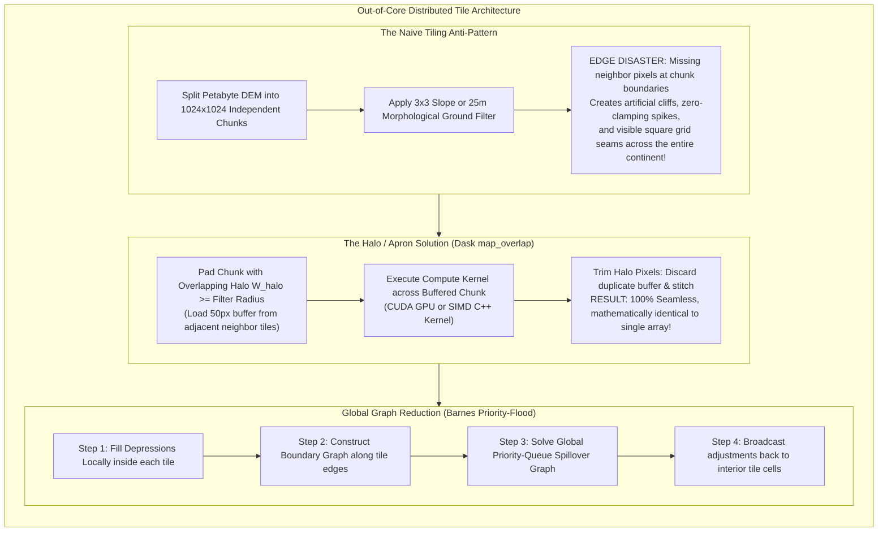

# Chapter 34: Cloud-Native Petabyte Pipelines, GPU Acceleration, and Automated Testing for DEMs

*Software engineering at planetary scale: building reproducible, high-throughput, thoroughly tested elevation processing systems.*

---

## 34.2 Out-of-Core Tiled Processing and Halo/Apron Management

When a digital elevation dataset spans hundreds of gigabytes or petabytes (such as the 3DEP continental $1\text{-meter}$ LiDAR mosaic or global Copernicus GLO-30), it cannot be loaded into random-access memory (RAM) as a single array. The dataset must be processed **out-of-core**: partitioned into regular spatial chunks or tiles (typically $512\times 512$ or $2048\times 2048$ pixels) distributed across hundreds of CPU/GPU worker nodes.

However, naive tile-by-tile processing introduces a catastrophic failure mode: **boundary seam artifacts**. Spatial convolutions (hillshading, slope, curvature), morphological ground filters, and spline interpolations evaluate a moving window of neighboring pixels. At tile edges, missing neighbors produce artificial cliffs, black borders, and severed drainage lines. Solving this requires rigorous **halo/apron buffer management** and **distributed boundary-graph algorithms**.



---

### 34.2.1 The Tile-Boundary Artifact Disaster

In distributed Python frameworks (`Dask`, `Ray`, `Spark`) or C++ tile engines, a 2D elevation matrix is broken into a regular grid of chunks.

#### 1. The Finite-Difference Boundary Collapse
Consider an analytical hillshade or slope calculation using Horn's $3\times 3$ finite-difference operator. To evaluate the horizontal gradient $p = \frac{\partial z}{\partial x}$ at cell $(i, j)$, the algorithm requires cells $(i-1, j)$ and $(i+1, j)$.
* When the kernel evaluates the rightmost column of an unbuffered chunk ($i = 1023$ in a $1024\times 1024$ tile), the neighbor $(i+1, j)$ sits in the adjacent chunk.
* If the chunk is processed in isolation, the software defaults to **zero-padding** ($z = 0$) or **edge clamping** ($z_{1024} = z_{1023}$).
* Clamping makes the gradient zero ($p = 0$), flattening the edge; zero-padding causes the gradient to compute a vertical drop of thousands of meters down to sea level.
* **The Forensic Signature:** The stitched mosaic displays glaring, razor-sharp **grid line scars** outlining every $1024\times 1024$ chunk across the entire map sheet.

#### 2. Morphological and Filtering Ringing
For larger neighborhood operators—such as a $50\text{-meter}$ Progressive Morphological Filter (PMF) used to separate ground from trees, or biharmonic spline gap filling:
* The filter radius spans dozens to hundreds of pixels ($R = 50\text{ cells}$).
* Edge effects penetrate deep into the interior of the tile, warping elevations by meters across a wide band along every tile border.

---

### 34.2.2 Halo / Apron Management with Dask `map_overlap`

The solution to boundary artifacts is **Halo Management** (also known as apron, ghost-cell, or guard-band padding):
1. **Pad:** Prior to executing the spatial operation, each tile is expanded by a halo buffer of width $W_{\text{halo}}$ loaded from the surrounding neighbor tiles:
   $$W_{\text{halo}} \ge R_{\text{filter}}$$
   When chaining $K$ sequential neighborhood operators inside a single fused chunk kernel (e.g., a $5\times 5$ Gaussian pre-filter with $R_1 = 2$, followed by a $3\times 3$ Sobel/Horn slope with $R_2 = 1$, followed by a $25\text{ m}$ morphological ground filter with $R_3 = 25\text{ px}$ at $1\text{ m}$ resolution), the required fused apron width is additive:
   $$W_{\text{halo}} \ge \sum_{k=1}^{K} R_k$$
2. **Compute:** The spatial filter is executed across the entire padded tile of dimension $(N_x + 2 W_{\text{halo}}) \times (N_y + 2 W_{\text{halo}})$.
3. **Trim:** After computation, the outer $W_{\text{halo}}$ pixels are discarded, retaining only the valid, uncorrupted interior core of size $N_x \times N_y$.

#### Chunk Size vs. Halo Overhead Trade-Off
Choosing chunk dimension $N$ involves balancing worker memory against redundant halo I/O. For square $N \times N$ chunks with halo width $W_{\text{halo}}$, the fractional pixel-read overhead is:

$$f_{\text{overhead}} = \frac{(N + 2 W_{\text{halo}})^2 - N^2}{N^2} = \frac{4 W_{\text{halo}}}{N} + \frac{4 W_{\text{halo}}^2}{N^2}$$

* *Worked Example:* For a $50\text{-cell}$ morphological filter ($W_{\text{halo}} = 50$) on tiny $128 \times 128$ chunks, $f_{\text{overhead}} = \frac{200}{128} + \frac{10{,}000}{16{,}384} = 217\%$ redundant I/O and compute! Increasing chunk size to $2048 \times 2048$ (`Float32` memory $= 2048^2 \times 4\text{ B} = 16.8\text{ MB}$ raw, $18.5\text{ MB}$ with halo) drops overhead to $f_{\text{overhead}} = \frac{200}{2048} + \frac{10{,}000}{4{,}194{,}304} = 10.0\%$—reducing cloud egress and compute cost by nearly $3\times$.

In the scientific Python stack, halo padding and trimming are automated by **`dask.array.map_overlap`**:

```python
"""
Seamless parallel out-of-core slope and aspect using Dask map_overlap.
Demonstrates halo management that eliminates tile boundary seams across
a multi-gigabyte chunked elevation raster while enforcing North-up ENU signs.
"""

import dask.array as da
import numpy as np

def compute_horn_slope(chunk: np.ndarray, res_x: float = 1.0, res_y: float = 1.0) -> np.ndarray:
    """
    Computes terrain slope in degrees using Horn's 3x3 finite-difference operator
    on a North-up grid (row 0 = North, col 0 = West).
    Input chunk is guaranteed to have a 1-pixel halo buffer provided by map_overlap.
    """
    z = chunk.astype(np.float64, copy=False)
    # Positive East (+x) derivative: right column minus left column
    dz_dx = ((z[:-2, 2:] + 2.0 * z[1:-1, 2:] + z[2:, 2:]) -
             (z[:-2, :-2] + 2.0 * z[1:-1, :-2] + z[2:, :-2])) / (8.0 * res_x)

    # Positive North (+y) derivative: top row minus bottom row
    dz_dy = ((z[:-2, :-2] + 2.0 * z[:-2, 1:-1] + z[:-2, 2:]) -
             (z[2:, :-2] + 2.0 * z[2:, 1:-1] + z[2:, 2:])) / (8.0 * res_y)

    slope_rad = np.arctan(np.hypot(dz_dx, dz_dy))
    slope_deg = np.degrees(slope_rad).astype(np.float32)

    # Re-pad interior result by 1 pixel so Dask map_overlap(trim=True) slices
    # back cleanly to the original unbuffered chunk dimensions without off-by-one shifts.
    return np.pad(slope_deg, pad_width=1, mode="edge")

def parallel_seamless_slope_pipeline(dask_dem_array: da.Array, cell_size: float = 1.0) -> da.Array:
    """
    Executes distributed slope calculation across chunks with automated halo buffering.
    
    Args:
        dask_dem_array: Out-of-core Dask Array chunked into e.g. (2048, 2048) blocks.
        cell_size: Metric grid spacing in meters (must be in a projected metric CRS).
        
    Returns:
        Dask Array of slope (degrees) with zero tile-boundary artifacts.
    """
    print(f"Executing out-of-core slope with Dask chunks: {dask_dem_array.chunksize}")
    
    # map_overlap automatically:
    # 1. Pads each chunk with depth=1 pixel from neighboring chunks
    # 2. Executes compute_horn_slope on the buffered block
    # 3. Trims away the 1-pixel halo, stitching a perfectly seamless output
    seamless_slope = da.map_overlap(
        compute_horn_slope,
        dask_dem_array,
        depth=1,            # Halo buffer width (1 cell for 3x3 kernel)
        boundary="reflect", # Neumann zero-slope fallback at outer dataset edges
        trim=True,          # Automatically slice away 1-px halo after computation
        dtype=np.float32,
        res_x=cell_size,
        res_y=cell_size,
    )
    
    return seamless_slope
```

---

### 34.2.3 Non-Local Graph Operations: Distributed Priority-Flood

Local convolutions (slope, hillshade) require only small halos ($W_{\text{halo}} = 1\text{ to }50\text{ cells}$). However, **hydrological depression filling, watershed delineation, and bathymetric sill spillover analysis** represent **non-local global graph operations**:
* A sink, karst polje, or deep submarine basin in Tile A may only spill over a low saddle point located in Tile F, fifty kilometers away.
* Water backed up behind that saddle point floods backward across Tiles B, C, D, and E.
* Naive halo buffering fails because the required halo width is unknown and could span the entire continent or ocean basin!

#### The Barnes (2016) Boundary-Graph Reduction
Building on Barnes, Lehman, & Mulla (2014), Richard Barnes (2016) formulated distributed **Parallel Priority-Flood** via boundary-graph reduction:
1. **Local Tile Fill:** Each distributed worker node loads a local DEM chunk independently. Using the $O(N \log N)$ priority-queue algorithm, the node fills all depressions contained entirely within the chunk, and computes minimum spillover elevations between perimeter cells.
2. **Boundary Graph Extraction:** Each node extracts a lightweight 1D topological graph consisting only of the perimeter cells along its four edges, recording the minimum minimax elevation required to traverse between boundary edges.
3. **Global Network Reduction:** The lightweight boundary graphs from all $K$ tiles are assembled into a single master network on a coordinator node. The coordinator solves the global priority-queue spillover across the inter-tile network in seconds.
4. **Seeded Local Priority-Flood Broadcast:** The globally solved boundary elevations $z_{\text{global}}(v)$ are broadcast back to the worker nodes, each of which runs a fast local Priority-Flood seeded from its boundary cells at $z_{\text{global}}(v)$ to fill interior depressions to their true continental or oceanic spill levels.
* *Result:* Enables depression filling and watershed delineation across **trillions of cells** on distributed cloud clusters with zero memory bottlenecks and bit-identical outputs to a serial run.

---

### 34.2.4 GPU Acceleration: CUDA Shared Memory, OptiX Ray Tracing, and WebGPU

While CPUs manage distributed cloud I/O, GDAL decoding, and Dask task graphs, dense floating-point raster kernels are increasingly offloaded to **Graphics Processing Units (GPUs)**:

* **Massive Thread Parallelism & Arithmetic Intensity:** Modern data-center and workstation GPUs (e.g., NVIDIA H100, RTX 4090) expose over $16{,}000$ scalar cores executing SIMT (Single Instruction, Multiple Threads) warps across millions of elevation cells concurrently, accelerating finite-difference terrain derivatives, Gaussian pyramids, and focal statistics by $20\times\text{–}100\times$ over single-socket CPUs.
* **CUDA Shared-Memory Halo Tiling:** Global GPU VRAM bandwidth is often the primary bottleneck for $3\times 3$ or $5\times 5$ DEM stencils (where each cell is read 9 to 25 times by neighbors). High-performance CUDA kernels cooperatively load a $32 \times 32$ thread block **plus its $1$-pixel apron** into a $34 \times 34$ on-chip **Shared Memory (`__shared__`)** tile, synchronize with `__syncthreads()`, and evaluate Horn's gradient directly from sub-nanosecond SRAM:

```cuda
// Conceptual CUDA kernel: 32x32 thread block with 1-pixel shared-memory halo (34x34 tile)
__global__ void horn_slope_tiled_kernel(
    const float* __restrict__ dem, float* __restrict__ slope_deg,
    int nx, int ny, float inv_8dx, float inv_8dy)
{
    __shared__ float tile[34][34]; // 32x32 core + 1-pixel halo apron on all 4 sides
    int gx = blockIdx.x * 32 + threadIdx.x;
    int gy = blockIdx.y * 32 + threadIdx.y;

    // Cooperatively populate 34x34 tile (interior + apron cells clamped at raster border)
    for (int dy = threadIdx.y; dy < 34; dy += 32) {
        int sy = min(max(int(blockIdx.y * 32) + dy - 1, 0), ny - 1);
        for (int dx = threadIdx.x; dx < 34; dx += 32) {
            int sx = min(max(int(blockIdx.x * 32) + dx - 1, 0), nx - 1);
            tile[dy][dx] = dem[sy * nx + sx];
        }
    }
    __syncthreads(); // Barrier: all apron pixels guaranteed resident in fast SRAM

    if (gx < nx && gy < ny) {
        int tx = threadIdx.x + 1, ty = threadIdx.y + 1;
        float dzdx = ((tile[ty-1][tx+1] + 2.f*tile[ty][tx+1] + tile[ty+1][tx+1]) -
                      (tile[ty-1][tx-1] + 2.f*tile[ty][tx-1] + tile[ty+1][tx-1])) * inv_8dx;
        float dzdy = ((tile[ty-1][tx-1] + 2.f*tile[ty-1][tx] + tile[ty-1][tx+1]) -
                      (tile[ty+1][tx-1] + 2.f*tile[ty+1][tx] + tile[ty+1][tx+1])) * inv_8dy;
        slope_deg[gy * nx + gx] = atanf(hypotf(dzdx, dzdy)) * 57.2957795f;
    }
}
```

* **Hardware Ray-Tracing Engines (NVIDIA OptiX / Vulkan RT) & WebGPU:** Historically, computing a 3D viewshed, radar shadow zone, or Sky-View Factor (SVF) across a $10\text{k} \times 10\text{k}$ DEM required stepping millions of software Bresenham rays across the grid. Modern engines convert the elevation grid into a hardware-accelerated **Bounding Volume Hierarchy (BVH)**:
  * Dedicated **RT Cores** execute billions of ray-triangle intersections per second, resolving RF line-of-sight, solar insolation shadows, and bathymetric acoustic shadow masks in milliseconds.
  * In the browser, **WebGPU compute shaders** (`WGSL`) evaluate dynamic hillshading, flood-stage slicing, and client-side terrain viewsheds directly on decoded Terrain-RGB / COG tiles at $>60\text{ fps}$ with zero server round-trips.
