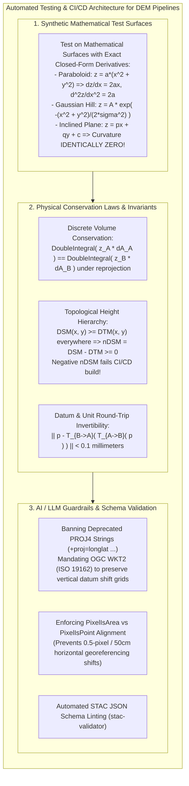
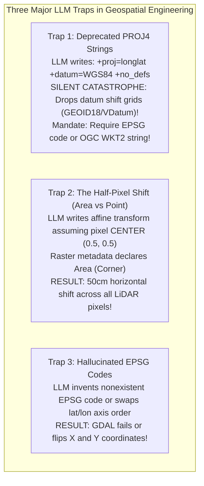

# Chapter 34: Cloud-Native Petabyte Pipelines, GPU Acceleration, and Automated Testing for DEMs

*Software engineering at planetary scale: building reproducible, high-throughput, thoroughly tested elevation processing systems.*

---

## 34.3 Automated Testing, CI/CD, and Verification for DEM Software & Data Pipelines

In standard web or database engineering, bugs announce themselves with immediate crashes: null pointer dereferences, stack overflows, or syntax errors. In digital elevation engineering, **bugs are almost universally silent**. 

A sign inversion in a boresight roll angle, an unhandled geoid grid shift, a swapped axis order (latitude/longitude vs. easting/northing), or an off-by-half-pixel grid registration produces a perfectly valid GeoTIFF file. The file passes format linting, loads cleanly in QGIS, and renders a visually pleasing hillshade—yet the topography is displaced horizontally by twenty meters or depressed vertically into the sea.

Building mission-critical elevation pipelines requires replacing ad-hoc visual inspection with **automated Continuous Integration / Continuous Deployment (CI/CD)**, **property-based testing**, and **strict mathematical invariants**. Furthermore, as software teams increasingly employ Large Language Models (LLMs) and AI coding agents to write geospatial code, engineering systems must enforce automated guardrails against hallucinated projections and deprecated PROJ4 strings.



---

### 34.3.1 Synthetic Analytical Surfaces: Exact Derivative Verification

Never verify a new slope, aspect, curvature, or hydrological flow algorithm on real-world LiDAR or sonar data alone. In real terrain, the true continuous surface derivatives $\frac{\partial z}{\partial x}, \frac{\partial^2 z}{\partial x^2}$ are unknown, making it impossible to separate algorithm discretization error or indexing sign bugs from sensor noise.

Automated unit tests must evaluate algorithms against **synthetic mathematical surfaces with known analytical derivatives** (letting $r^2 = x^2 + y^2$, $p = \partial z/\partial x$, $q = \partial z/\partial y$):

#### 1. The Circular Paraboloid
$$z(x, y) = a \big( x^2 + y^2 \big) = a r^2$$
* **Analytical Derivatives and Curvatures:**
  $$\frac{\partial z}{\partial x} = 2 a x, \quad \frac{\partial z}{\partial y} = 2 a y, \quad \|\nabla z\|_2 = 2 |a| r$$
  $$\frac{\partial^2 z}{\partial x^2} = 2a, \quad \frac{\partial^2 z}{\partial y^2} = 2a, \quad \frac{\partial^2 z}{\partial x \partial y} = 0, \quad \nabla^2 z = 4a$$
  $$\text{Profile Curvature } \kappa_p = \frac{2a}{(1 + 4a^2 r^2)^{3/2}}, \quad \text{Tangential Curvature } \kappa_t = \frac{2a}{(1 + 4a^2 r^2)^{1/2}}$$
  $$\text{Plan (Contour) Curvature } \kappa_c = \frac{\text{sgn}(a)}{r} \;\; (r > 0), \qquad \text{Mean Curvature } \kappa_m = \frac{\kappa_p + \kappa_t}{2} = \frac{a(2 + 4a^2 r^2)}{(1 + 4a^2 r^2)^{3/2}}, \qquad \text{Gaussian Curvature } K = \kappa_p \kappa_t = \frac{4a^2}{(1 + 4a^2 r^2)^2}$$
  *(Note: Here upward-concave bowls $a > 0$ have positive differential-geometry normal curvature; some GIS packages invert the sign so convex hills $a < 0$ are positive, or label tangential curvature $\kappa_t = \kappa_c \sin\alpha$ as "plan curvature"—unit tests must explicitly assert the software package's exact curvature convention.)*
* *Unit Test:* Evaluate the finite-difference curvature and Laplacian operators on an analytical paraboloid grid. Because second-order central differences have zero truncation error on quadratic polynomials, any deviation beyond floating-point roundoff on $\partial^2 z/\partial x^2$ or $\nabla^2 z$ immediately fails the CI/CD build.

#### 2. The Radial Gaussian Hill (Inflection-Ring Benchmark)
$$z(x, y) = A \exp\left( -\frac{x^2 + y^2}{2\sigma^2} \right) = A \exp\left( -\frac{r^2}{2\sigma^2} \right)$$
* **Analytical Derivatives:**
  $$\nabla z = -\frac{z}{\sigma^2}\begin{bmatrix} x \\ y \end{bmatrix}, \qquad \mathbf{H}(z) = \frac{z}{\sigma^4}\begin{bmatrix} x^2 - \sigma^2 & xy \\ xy & y^2 - \sigma^2 \end{bmatrix}, \qquad \nabla^2 z = \frac{z}{\sigma^4}\left(r^2 - 2\sigma^2\right)$$
* *Unit Test Value:* Unlike a paraboloid, a Gaussian hill possesses both convex summits ($r < \sqrt{2}\sigma$, $\nabla^2 z < 0$) and concave aprons ($r > \sqrt{2}\sigma$, $\nabla^2 z > 0$), separated by a sharp circular Laplacian zero-crossing inflection ring at $r = \sqrt{2}\sigma$. This makes it the ideal synthetic test surface for verifying anisotropic directional derivatives, multi-scale TPI, and $O(\Delta x^2)$ grid-refinement convergence rates.

#### 3. The Inclined Plane
$$z(x, y) = p x + q y + c$$
* **Analytical Invariant:** All second-order partial derivatives must be **identically zero**:
  $$\frac{\partial^2 z}{\partial x^2} \equiv 0, \quad \frac{\partial^2 z}{\partial y^2} \equiv 0, \quad \nabla^2 z \equiv 0$$
  $$\text{Slope Angle } \alpha = \arctan\sqrt{p^2 + q^2} = \text{const}, \qquad \psi_{\text{aspect}} = \text{atan2}(-p, -q) \pmod{2\pi} = \text{const}$$
* *Unit Test:* Rotating the inclined plane through all four quadrants ($N, E, S, W$) catches $90^\circ$ / $180^\circ$ aspect-convention flips and North-up vs. South-up array row-indexing bugs immediately.

---

### 34.3.2 Physical Conservation Laws, Golden Tiles, and STAC Schema Checkers

In property-based testing (using libraries like `hypothesis` in Python), tests do not check single hardcoded values; they assert that **fundamental physical invariants hold across thousands of randomly generated terrain surfaces**:

#### 1. The Normalized DSM Non-Negativity Invariant
In forest and urban mapping, a Digital Surface Model (DSM) includes tree canopies and building roofs, while a Digital Terrain Model (DTM) represents the bare ground:
$$\text{Physical Invariant: } \quad \text{DSM}(x, y) \ge \text{DTM}(x, y), \quad \forall (x, y) \in \Omega$$

The normalized Digital Surface Model (nDSM, canopy/building height) is:
$$\text{nDSM}(x, y) = \text{DSM}(x, y) - \text{DTM}(x, y)$$

* **The CI/CD Invariant Test:**
  $$\min_{(x, y)} \text{nDSM}(x, y) \ge 0.000\text{ meters}$$
  If an automated pipeline ever outputs $\text{nDSM} < -0.05\text{ m}$ (indicating that bare ground floats above tree canopies or bridge decks), the CI/CD runner blocks the deployment, automatically detecting ground-filtering over-smoothing or mismatched vertical datums. Analogously, for marine/estuarine multi-horizon grids (Chapter 29), CI checks enforce non-crossing stratigraphic ordering ($z_{\text{water}} \ge z_{\text{lutocline}} \ge z_{\text{nautical}} \ge z_{\text{bedrock}}$).

#### 2. Datum Round-Trip Invertibility
When transforming elevation coordinates between coordinate reference systems (e.g., from WGS84 ellipsoidal coordinates to State Plane NAVD88 orthometric heights, or marine ERS separation models):
$$\mathbf{p}_{\text{recovered}} = \mathcal{T}_{B \to A}\Big( \mathcal{T}_{A \to B}(\mathbf{p}) \Big)$$

* **The Invariant Test:**
  $$\|\mathbf{p} - \mathbf{p}_{\text{recovered}}\| \le 0.0001\text{ meters} \quad (0.1\text{ mm})$$
  Any failure to close the loop within sub-millimeter tolerance indicates non-invertible transformation equations or missing reverse grid-shift lookup tables.

#### 3. Golden-Tile Regression and STAC Catalog Schema Checkers
* **Golden-Tile Regression:** Production pipelines archive small ($256\times 256$ or $512\times 512$) benchmark tiles spanning steep alpine ridges, flat waterbodies, and intertidal bathymetry. On every pull request, CI runs the full pipeline on these golden tiles and asserts that pixelwise residuals against certified baseline products remain within numerical tolerance ($\|\Delta z\|_\infty < 10^{-5}\text{ m}$), preventing silent refactoring regressions.
* **STAC & Format Validation:** Cloud DEM catalogs—modeled after Google Earth Engine's open-source 2023 **Jsonnet + STAC catalog validation pipeline** (`earthengine-catalog`)—run automated schema linters (`stac-validator`, `rio-cogeo validate`, and `IHO S-158` / HDF5 checks for `S-102` and `BAG`) in CI to verify bounding boxes, temporal ISO-8601 stamps, WKT2 CRS properties, overview pyramids, and `NoData` tags before any catalog entry is published.

---

### 34.3.3 Guardrails for AI/LLM Coding Agents in DEM Engineering

As engineering organizations increasingly deploy AI coding assistants to author spatial data pipelines, automated testing suites must establish strict static-analysis guardrails against **hallucinated and deprecated geospatial patterns**:



#### 1. Banning Deprecated PROJ4 Strings (Mandating OGC WKT2)
Large Language Models trained on historical codebases frequently generate legacy PROJ4 strings:
```text
# DANGEROUS LEGACY CODE GENERATED BY LLMs:
"+proj=utm +zone=18 +datum=NAD83 +units=m +no_defs"
```
* **Why This Is Fatal:** In modern PROJ (version 6+), PROJ4 strings cannot represent vertical datums, dynamic datum epochs (e.g., `NAD83(2011) epoch 2010.00` vs. `NAD83(1986)`), or crustal deformation models. Supplying a PROJ4 string causes GDAL and PROJ to silently bypass authoritative grid shifts (such as `GEOID18` or `NADCON5`), introducing **$1.0\text{ to }1.5\text{-meter}$ vertical or horizontal offsets** without raising an exception!
* **The CI/CD Linter Guardrail:** Automated pre-commit hooks (such as `ruff` AST rules or regex CI checks) must reject code containing `+proj=` strings, enforcing ISO 19162 **OGC WKT2 (Well-Known Text 2)** strings or explicit compound EPSG authority codes—such as **`EPSG:6349`** (`NAD83(2011) + NAVD88 height`) or **`EPSG:6347+5703`** (`NAD83(2011) / UTM zone 18N + NAVD88 height`). Note also that `EPSG:6347` alone is strictly a 2D horizontal CRS with no vertical datum!

#### 2. The `PixelIsArea` vs. `PixelIsPoint` Off-by-Half-Pixel Shift
A classic raster bug occurs in affine geotransform definitions:
* **`PixelIsArea` (Corner Registration):** Coordinate $(x_{\min}, y_{\max})$ corresponds to the **outer top-left boundary corner** of the pixel.
* **`PixelIsPoint` (Center Registration):** Coordinate $(x_{\min}, y_{\max})$ corresponds to the **center point** of the top-left pixel.
* If an LLM writes code that maps pixel indices $(i, j)$ to coordinates assuming center registration on a raster whose GeoTIFF header declares `PixelIsArea`:
  $$\Delta x_{\text{shift}} = \frac{\Delta x}{2}, \quad \Delta y_{\text{shift}} = \frac{\Delta y}{2}$$
  On a $1\text{-meter}$ LiDAR DEM, this introduces a permanent, unflagged **$0.50\text{-meter}$ horizontal shift per axis ($0.71\text{ m}$ diagonal displacement)** across every cell on the map!
* **The Unit Test Guardrail:** Every pipeline test must explicitly assert consistency between `AREA_OR_POINT` metadata (`Area` vs. `Point`) and the affine transformation origin.

---

### 34.3.4 Production Python Verification Suite (`pytest` + `hypothesis`)

```python
"""
Automated CI/CD Verification Suite for Digital Elevation Model Pipelines.
Demonstrates analytical paraboloid & Gaussian hill derivative verification,
nDSM non-negativity invariant testing, WKT2 compound CRS validation, and
PixelIsArea vs PixelIsPoint metadata checks using pytest and hypothesis.
"""

import numpy as np
import pyproj
from hypothesis import given, strategies as st

def analytical_paraboloid(nx: int = 101, ny: int = 101, a: float = 0.005, dx: float = 1.0):
    """Generates an analytical paraboloid z = a * (x^2 + y^2) with exact derivatives."""
    x = (np.arange(nx) - nx // 2) * dx
    y = (ny // 2 - np.arange(ny)) * dx  # North-up convention (+y North at row 0)
    X, Y = np.meshgrid(x, y)
    Z = a * (X**2 + Y**2)
    exact_slope_deg = np.degrees(np.arctan(2.0 * abs(a) * np.hypot(X, Y)))
    exact_laplacian = np.full_like(Z, 4.0 * a)
    return Z, exact_slope_deg, exact_laplacian, dx

def test_slope_and_laplacian_on_analytical_paraboloid():
    """Verify numerical slope and Laplacian finite differences against analytical truth."""
    Z, exact_slope, exact_lap, dx = analytical_paraboloid(nx=101, ny=101, a=0.005, dx=1.0)

    # Note: axis 0 is North->South (-y), axis 1 is West->East (+x)
    dz_drow, dz_dx = np.gradient(Z, dx, dx)
    dz_dy = -dz_drow
    numerical_slope = np.degrees(np.arctan(np.hypot(dz_dx, dz_dy)))

    # Central second-order Laplacian
    num_lap = (Z[:-2, 1:-1] + Z[2:, 1:-1] + Z[1:-1, :-2] + Z[1:-1, 2:] - 4.0 * Z[1:-1, 1:-1]) / (dx**2)

    interior = (slice(5, -5), slice(5, -5))
    assert np.max(np.abs(numerical_slope[interior] - exact_slope[interior])) < 1e-9
    assert np.max(np.abs(num_lap[4:-4, 4:-4] - exact_lap[interior])) < 1e-9

@given(
    dtm_val=st.floats(min_value=-50.0, max_value=4000.0, allow_nan=False),
    canopy_height=st.floats(min_value=0.0, max_value=80.0, allow_nan=False),
)
def test_ndsm_physical_invariant(dtm_val, canopy_height):
    """Property-based test: nDSM = DSM - DTM must be strictly non-negative everywhere."""
    dsm_val = dtm_val + canopy_height
    ndsm = dsm_val - dtm_val
    assert ndsm >= 0.0, f"Physical invariant violated: negative canopy height {ndsm}"

def validate_pipeline_crs(crs_spec: str) -> pyproj.CRS:
    """CI/CD Guardrail: Reject deprecated PROJ4 strings and enforce compound WKT2/EPSG."""
    if crs_spec.strip().startswith("+proj="):
        raise ValueError(f"Deprecated PROJ4 string prohibited in pipeline: {crs_spec}")
    crs = pyproj.CRS.from_user_input(crs_spec)
    wkt2 = crs.to_wkt(pyproj.enums.WktVersion.WKT2_2019)
    assert crs.is_compound and "COMPOUNDCRS" in wkt2, "3D DEM pipeline requires a Compound CRS!"
    return crs

def test_crs_guardrail_enforces_wkt2_compound():
    """Verify valid 3D compound EPSG passes while legacy PROJ4 strings are blocked."""
    crs = validate_pipeline_crs("EPSG:6347+5703")  # NAD83(2011) UTM 18N + NAVD88 height
    assert crs.is_compound
    try:
        validate_pipeline_crs("+proj=utm +zone=18 +datum=NAD83 +units=m +no_defs")
        raise AssertionError("Legacy PROJ4 string should have been rejected!")
    except ValueError:
        pass
```
