# Chapter 34: Cloud-Native Petabyte Pipelines, GPU Acceleration, and Automated Testing for DEMs

*Software engineering at planetary scale: building reproducible, high-throughput, thoroughly tested elevation processing systems.*

---

## 34.4 Mathematical Foundations of Distributed Hydrology and Volumetric Invariants

Processing petabyte-scale elevation datasets in distributed environments requires algorithms whose mathematical complexity scales linearly or quasi-linearly with pixel count, and whose spatial operations can be verified by conservation laws. This section derives the exact mathematics of the **Priority-Flood $O(N \log N)$ depression-filling algorithm** with **parallel boundary-graph reduction**, and formulates the **Discrete Green's Theorem Volumetric Invariance** test.

```mermaid
flowchart TD
    subgraph MathFoundations34["Mathematical Formulations for Scalable DEM Engineering"]
        direction TB
        subgraph PriorityFloodMath["1. Priority-Flood Graph Inundation (Barnes et al. 2014)"]
            PriorityQueue["Priority Queue Q initialized with perimeter boundary cells\nExtract-Min operation: Pops lowest-elevation spill cell c"]
            NeighborCheck["Neighbor Update for cell n:\nIf z(n) <= z(c) => Depression Detected!\nFill elevation: z(n) = z(c)\nPush n to Priority Queue Q"]
            ComplexityProof["Time Complexity: O(N log N) using Min-Heap\nO(N) for integer/quantized grids using Radix Sort Priority Queues"]
            PriorityQueue --> NeighborCheck --> ComplexityProof
        end

        subgraph BoundaryReduction["2. Parallel Domain-Decomposition Graph Reduction"]
            TileGraph["Boundary Perimeter Graph G = (V_B, E_B)\nVertices: Tile edge cells\nEdge weights: Bottleneck spillover elevations"]
            GlobalSpill["Global Graph Priority-Queue Solve\nConnects inter-tile spill paths across distributed workers"]
            TileGraph --> GlobalSpill
        end

        subgraph GreensTheorem["3. Discrete Green's Theorem Volumetric Conservation"]
            GreenForm["Continuous Green's Theorem:\nDoubleIntegral_Omega ( dQ/dx - dP/dy ) dx dy = ContourIntegral_{partial Omega} ( P dx + Q dy )"]
            VolumeInvariance["Volumetric Invariant across Reprojection & Resampling:\nV = ContourIntegral_{partial Omega} [ Integral_0^x z(u, y) du ] dy == sum( z_ij * Delta_A_ij )"]
            GreenForm --> VolumeInvariance
        end
    end
```

---

### 34.4.1 The Priority-Flood Algorithm: Optimal Depression Filling

In hydrological modeling, a raw DEM contains thousands of small depressions (sinks, pits) caused by sensor noise, tree canopies, and interpolation artifacts. To route flow continuously to the ocean, depressions must be filled to their lowest spill point.

Historically, algorithms used iterative $O(N^2)$ depression-filling schemes (such as Jenson & Domingue 1988 or Planchon & Darboux 2001). The **Priority-Flood algorithm** (Barnes, Lehman, & Mulla 2014) proved that depression filling is mathematically isomorphic to an inward-marching front governed by a priority queue, solving the problem in **$O(N \log N)$** time.

#### 1. Algorithmic State and Initialization
Let the DEM be defined on a graph $G = (V, E)$ of $N$ cells. 
* Let $z(c)$ be the elevation of cell $c \in V$.
* Let $Q$ be a **min-priority queue** storing cells ordered strictly by their current elevation $z(c)$.
* Let $\text{visited}(c)$ be a boolean array tracking processed cells.

**Initialization:**
Push all outer boundary edge cells of the DEM (cells bordering the edge of the raster or ocean nodata cells) into the priority queue $Q$, and mark them as visited:
$$Q \leftarrow \big\{ c \in \partial \Omega \big\}, \quad \text{visited}(c) = \text{true}, \quad \forall c \in \partial \Omega$$

#### 2. The Inundation Invariant Loop
While $Q$ is not empty:
1. Pop the cell $c$ with the **minimum elevation** from $Q$:
   $$c \leftarrow \text{Extract-Min}(Q)$$
2. For each unvisited neighbor $n \in \mathcal{N}(c)$ (using 8-connectivity):
   * Mark $n$ as visited: $\text{visited}(n) = \text{true}$.
   * **The Inundation Condition:** If the neighbor's original elevation is less than or equal to $c$, it is trapped inside a depression:
     $$z(n) \leftarrow \max\big( z(n), \, z(c) \big)$$
   * Push $n$ into $Q$:
     $$\text{Insert}\big( Q, \, n \big)$$

#### 3. Mathematical Proof of Correctness
* **Theorem:** *Priority-Flood raises every cell in a depression to the exact elevation of the lowest saddle point connecting it to the outer boundary, without overfilling.*
* **Proof Sketch:** Because cells are popped from $Q$ in strictly non-decreasing order of elevation ($z(c_{k+1}) \ge z(c_k)$), the front advances into depressions strictly from the lowest accessible boundary spill point inward. When the front enters a depression, all interior cells lower than the spill elevation are raised to exactly $z_{\text{spill}}$. Because the queue is monotonic, no cell can be raised above its true spillway, and every cell is visited and modified **exactly once**.
* **Complexity:** Inserting and popping $N$ cells in a binary min-heap requires $O(\log N)$ per operation. The total computational complexity is **strictly $O(N \log N)$**. For integer-quantized elevations (e.g., millimeter or centimeter integers), replacing the binary heap with a **Radix Priority Queue** reduces complexity to **linear time $O(N)$**.

---

### 34.4.2 Parallel Domain-Decomposition and Boundary-Graph Reduction

To execute Priority-Flood across a distributed cloud cluster (where the DEM is split into $K$ tiles $T_1, \dots, T_K$ on separate machines), Barnes et al. (2016) developed **Boundary-Graph Reduction**:

#### 1. Intra-Tile Inundation
Each worker node loads tile $T_k$ and runs Priority-Flood using only its own perimeter edges as an initial boundary. Sinks contained entirely within the interior of the tile are filled immediately in parallel.

#### 2. The Perimeter Bottleneck Graph
For each tile $T_k$, the worker extracts an undirected graph $G_k = (V_k, E_k)$ where:
* Vertices $V_k = \partial T_k$ are the perimeter cells of the tile.
* For every pair of perimeter cells $u, v \in V_k$, an edge weight $w(u, v)$ represents the **minimum elevation path** connecting $u$ to $v$ across the interior of the tile:
  $$w(u, v) = \min_{\mathcal{P}_{u \to v}} \max_{c \in \mathcal{P}} z(c)$$
This compresses a $2048 \times 2048$ raster ($4.19\text{ million pixels}$) into a tiny 1D boundary graph of only $8,188\text{ perimeter vertices}$.

#### 3. Global Spillover Solution
The boundary graphs from all $K$ tiles are transmitted to a coordinator node and stitched along shared tile edges:
$$G_{\text{global}} = \bigcup_{k=1}^K G_k$$
The coordinator runs Priority-Flood on the compact global boundary graph, solving for the global spillover elevation $z_{\text{global}}(v)$ for every tile edge cell in seconds.

#### 4. Interior Adjustment via Seeded Local Priority-Flood
The globally resolved boundary elevations $z_{\text{global}}(v)$ for every perimeter cell $v \in \partial T_k$ are returned to each worker node. Rather than broadcasting a single uniform floor across the tile, the worker initializes a **seeded local Priority-Flood** queue $Q_k$ with every perimeter cell $v \in \partial T_k$ pinned to its global elevation $z_{\text{global}}(v)$ and marches inward through $T_k$. Equivalently, every interior cell $c \in T_k$ receives the exact minimax path elevation across all 8-connected paths $\mathcal{P}: c \to \partial T_k$:
$$z_{\text{final}}(c) = \max\left( z(c), \; \min_{\mathcal{P}: c \to \partial T_k} \max\left[ z_{\text{global}}\big(v_{\text{end}}(\mathcal{P})\big), \, \max_{u \in \mathcal{P}} z(u) \right] \right)$$
Because each worker needs only its own tile array $T_k$ and its boundary vector $z_{\text{global}}(\partial T_k)$, this achieves **exact, bit-identical depression filling** to a monolithic serial run, while executing out-of-core across trillions of cells in cloud object storage. The identical boundary-graph reduction also generalizes to marine bathymetry for identifying submarine canyon sill depths and closed-basin spillover pathways across global grids such as GEBCO.

---

### 34.4.3 Discrete Green's Theorem for Volumetric Conservation Invariants

When an automated pipeline reprojects, resamples, or filters a digital elevation model, an essential automated test is verifying **mass and volume conservation**.

Under Green's Theorem, the double integral of a scalar field over a 2D domain $\Omega$ is transformed into a line integral around the closed piecewise-smooth boundary $\partial\Omega$:

$$\iint_\Omega \left( \frac{\partial Q}{\partial x} - \frac{\partial P}{\partial y} \right) dx \, dy = \oint_{\partial \Omega} \big( P \, dx + Q \, dy \big)$$

#### 1. Formulating Volume as a Line Integral
The total volume $V$ beneath an elevation surface $z(x, y)$ above reference datum $z = 0$ is:
$$V = \iint_\Omega z(x, y) \, dx \, dy$$

Choose vector field components $P(x, y) = 0$ and $Q(x, y) = \int_{x_0}^x z(u, y) \, du$.
Then:
$$\frac{\partial Q}{\partial x} - \frac{\partial P}{\partial y} = z(x, y) - 0 = z(x, y)$$

Substituting into Green's Theorem yields the exact line integral for volume:

$$V = \oint_{\partial \Omega} \left[ \int_{x_0}^x z(u, y) \, du \right] dy$$

#### 2. Exact Mesh-to-Raster (TIN-to-DEM) Volumetric Conservation via Green's Theorem
When converting a 2.5D Triangulated Irregular Network (TIN) or 3D surface mesh $\mathcal{T} = \{\triangle_m\}_{m=1}^{M_{\text{tri}}}$ into a regular raster grid $z_{i,j}$, Green's Theorem provides an exact closed-form reference volume over every triangular facet $\triangle_m$ with 2D vertices $(x_{m,1}, y_{m,1}), (x_{m,2}, y_{m,2}), (x_{m,3}, y_{m,3})$ and vertex elevations $(z_{m,1}, z_{m,2}, z_{m,3})$. Because $z(x, y)$ is linear inside each triangle, evaluating the boundary line integral $\oint_{\partial\triangle_m} \big[\int z\,du\big]\,dy$ around the three directed edges yields the exact truncated triangular-prism volume:

$$V_{\text{TIN}} = \sum_{m=1}^{M_{\text{tri}}} A_{2\text{D},m} \left( \frac{z_{m,1} + z_{m,2} + z_{m,3}}{3} \right), \qquad A_{2\text{D},m} = \frac{1}{2}\Big|\big(x_{m,2} - x_{m,1}\big)\big(y_{m,3} - y_{m,1}\big) - \big(x_{m,3} - x_{m,1}\big)\big(y_{m,2} - y_{m,1}\big)\Big|$$

Comparing $V_{\text{TIN}}$ against the rasterized volume $V_{\text{raster}} = \sum_{i,j} z_{i,j}\,\Delta x\,\Delta y$ over identical domain boundaries $\partial\Omega$ verifies that mesh-to-raster gridding conserves total earthwork or sediment volume within discretization tolerance ($\frac{|V_{\text{TIN}} - V_{\text{raster}}|}{|V_{\text{TIN}}|} \le \epsilon_{\text{vol}}$).

#### 3. The Discrete Metric-Area Conservation Test Across Raster Reprojections in CI/CD
Let a baseline elevation raster $z_A$ on grid $\Omega_A$ (e.g., UTM Zone 10N, conformal with point scale factor $k_A(i, j)$) be reprojected into a target raster $z_B$ on grid $\Omega_B$ (e.g., CONUS Albers Equal Area `EPSG:5070`, where $dA_{\text{true}} = \Delta x_B \Delta y_B$).

Crucially, because a conformal projection stretches planar area by $k^2$ relative to the true ellipsoid surface (Chapter 2), the physical ellipsoidal area of cell $(i, j)$ on grid $A$ is $\Delta A_A(i, j) = \frac{\Delta x_A \Delta y_A}{k_A(i, j)^2}$ (or $\Delta A_{\text{geo}}(\varphi) = M(\varphi) N(\varphi)\cos\varphi\,\Delta\varphi\,\Delta\lambda$ for geographic lat/lon grids). The geodetically consistent discrete volumes are:
$$V_A = \sum_{(i, j) \in \Omega_A} z_A(i, j) \cdot \Delta A_A(i, j), \qquad V_B = \sum_{(k, l) \in \Omega_B} z_B(k, l) \cdot \Delta A_B(k, l)$$

* **The Volumetric Invariance Metric:**
  $$\frac{|V_A - V_B|}{|V_A|} \le \epsilon_{\text{vol}}$$
  * For conservative area-weighted resampling (`gdalwarp -r average`), $\epsilon_{\text{vol}} \le 10^{-4}$ ($0.01\%$) when evaluated on valid interior domains (excluding partial boundary edge pixels).
  * For bilinear or bicubic resampling over rugged terrain, volume deviation remains small ($\epsilon_{\text{vol}} \le 5 \times 10^{-4}$ or $0.05\%$) when metric cell areas $\Delta A$ include $k^{-2}$ Jacobian scaling.
* **Worked Numerical Check (Why Ignoring $k^2$ Triggers False CI Failures):** Consider a $100\text{ km} \times 100\text{ km}$ plateau at mean elevation $z = 500\text{ m}$ centered along the UTM central meridian ($k_0 = 0.9996$). Naive planar summation $\sum z \Delta x \Delta y$ yields $V_{\text{planar}} = 10^{10}\text{ m}^2 \times 500\text{ m} = 5.0000 \times 10^{12}\text{ m}^3$. Reprojected to an exact equal-area grid (`EPSG:5070`), the true physical area is $A_{\text{true}} \approx 10^{10} / k_0^2 = 1.0008005 \times 10^{10}\text{ m}^2$, giving $V_B = 5.0040 \times 10^{12}\text{ m}^3$—an apparent $0.080\%$ volume gain that breaks a $\epsilon_{\text{vol}} = 0.05\%$ CI check unless $\Delta A_A = \Delta x_A \Delta y_A / k_A^2$ is applied!
* If an automated CI/CD test detects $\frac{|V_A - V_B|}{|V_A|} > 0.001$ ($0.1\%$) *after* metric area weighting, the pipeline automatically flags an unhandled vertical datum shift, an off-by-one boundary clipping bug, or severe interpolation ringing.

#### 4. Worked Boundary-Graph Spillover Example
Suppose a $1\text{ km} \times 2\text{ km}$ DEM is split into west tile $T_1$ and east tile $T_2$ along a shared vertical boundary $x = x_{\text{seam}}$:
* Tile $T_1$ contains a closed karst basin at $z = 110\text{ m}$ surrounded on the N, W, and S edges by a $150\text{ m}$ ridge, but touching $x_{\text{seam}}$ at a low saddle $v_1$ at $z = 122\text{ m}$ and a second seam cell $v_2$ at $z = 140\text{ m}$.
* Tile $T_2$ slopes down to an ocean outlet at $z = 100\text{ m}$, separated from $v_1$ by a $125\text{ m}$ divide inside $T_2$.
1. **Local Pass:** Running Priority-Flood on $T_1$ alone drains the $110\text{ m}$ basin only out to $v_1 = 122\text{ m}$ (underfilling by $3\text{ m}$!).
2. **Global Boundary Solve:** The boundary graph connects $v_1$ in $T_1$ across the seam to $T_2$'s boundary edge, propagating the $125\text{ m}$ divide inside $T_2$ back to $z_{\text{global}}(v_1) = 125\text{ m}$.
3. **Seeded Local Sweep:** $T_1$ re-runs Priority-Flood seeded with $z_{\text{global}}(v_1) = 125\text{ m}$ on the seam, raising every trapped cell in the $110\text{ m}$ basin to exactly $125.00\text{ m}$—identical to a monolithic single-machine run!
