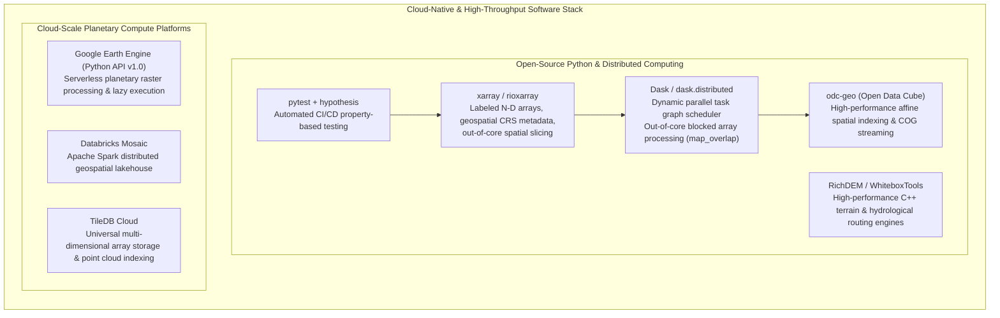

# Chapter 34: Cloud-Native Petabyte Pipelines, GPU Acceleration, and Automated Testing for DEMs

*Software engineering at planetary scale: building reproducible, high-throughput, thoroughly tested elevation processing systems.*

---

## 34.5 Software Ecosystem

Building petabyte-scale digital elevation pipelines requires an enterprise-grade software stack capable of orchestrating asynchronous task graphs, managing multi-terabyte chunked memory arrays, and enforcing strict automated testing. This section reviews the open-source libraries and commercial cloud platforms powering modern planetary-scale elevation engineering.



---

### 34.5.1 Open-Source Cloud-Native Python Stack

#### 1. `xarray` and `rioxarray`
The combination of `xarray` and `rioxarray` forms the backbone of modern scientific raster analysis in Python:
* **`xarray.DataArray`:** Wraps raw elevation arrays with explicit coordinate axes (`x`, `y`), variable attributes (`units="meters"`, `long_name="bare earth elevation"`), and time dimensions (`time`).
* **`rioxarray` Extension:** Integrates GDAL/Rasterio geospatial metadata directly into `xarray`, managing Coordinate Reference Systems (`crs`), affine geotransforms, spatial clipping (`clip`), and on-the-fly reprojection (`reproject`).

#### 2. `Dask` and `dask.distributed`
Dask enables parallelized, out-of-core computing across multi-core workstations or thousands of cloud instances:
* Divides large arrays into a grid of independent **Dask Chunks** (e.g., $2048 \times 2048$ blocks).
* Constructs a **Directed Acyclic Graph (DAG)** of operations (lazy evaluation), optimizing memory consumption and executing tasks in parallel across worker threads.
* Implements `map_overlap` to manage tile halos and buffer aprons seamlessly.

```python
"""
Cloud-native out-of-core elevation processing pipeline using xarray, rioxarray, and Dask.
Demonstrates chunked processing of a multi-gigabyte DEM, computing hillshade,
and writing directly to a Cloud Optimized GeoTIFF (COG).
"""

import threading
import xarray as xr
import rioxarray
import dask.array as da
import numpy as np

def compute_chunked_hillshade(dem_da: xr.DataArray, azimuth: float = 315.0, altitude: float = 45.0) -> xr.DataArray:
    """
    Computes shaded relief across out-of-core chunked Dask arrays with zero edge seams.
    """
    res_x = abs(float(dem_da.rio.resolution()[0]))
    res_y = abs(float(dem_da.rio.resolution()[1]))
    
    az_rad = np.radians(azimuth)
    alt_rad = np.radians(altitude)
    
    def _hillshade_kernel(block):
        # block is guaranteed to have 1-pixel halo on all sides (North-up: row 0 = North)
        z = block.astype(np.float64, copy=False)
        # Positive East (+x) derivative: right column minus left column
        dz_dx = ((z[:-2, 2:] + 2.0 * z[1:-1, 2:] + z[2:, 2:]) -
                 (z[:-2, :-2] + 2.0 * z[1:-1, :-2] + z[2:, :-2])) / (8.0 * res_x)
        # Positive North (+y) derivative: top row minus bottom row
        dz_dy = ((z[:-2, :-2] + 2.0 * z[:-2, 1:-1] + z[:-2, 2:]) -
                 (z[2:, :-2] + 2.0 * z[2:, 1:-1] + z[2:, 2:])) / (8.0 * res_y)

        slope = np.arctan(np.hypot(dz_dx, dz_dy))
        # Downhill aspect clockwise from North: atan2(-dz/dx, -dz/dy)
        aspect = np.arctan2(-dz_dx, -dz_dy)

        # Lambertian hillshade formula (azimuth CW from North matches aspect CW from North)
        shaded = np.sin(alt_rad) * np.cos(slope) + np.cos(alt_rad) * np.sin(slope) * np.cos(az_rad - aspect)
        shaded_u8 = np.clip(255.0 * np.maximum(0.0, shaded), 0, 255).astype(np.uint8)
        return np.pad(shaded_u8, pad_width=1, mode="edge")

    # Execute out-of-core parallel mapping with 1-pixel halo
    dask_data = dem_da.data
    shaded_dask = da.map_overlap(
        _hillshade_kernel,
        dask_data,
        depth=1,
        boundary="reflect",
        trim=True,
        dtype=np.uint8,
    )
    
    # Wrap back into rioxarray DataArray
    hillshade_da = xr.DataArray(
        shaded_dask,
        coords=dem_da.coords,
        dims=dem_da.dims,
        attrs={"long_name": "Analytical Shaded Relief", "units": "DN"}
    )
    hillshade_da.rio.write_crs(dem_da.rio.crs, inplace=True)
    return hillshade_da

def run_production_pipeline(input_cloud_cog: str, output_cog_path: str):
    """Executes distributed pipeline and writes Cloud Optimized GeoTIFF."""
    print(f"Opening cloud asset: {input_cloud_cog}")
    # Open lazily with Dask chunks of 2048x2048
    dem = rioxarray.open_rasterio(input_cloud_cog, chunks={"x": 2048, "y": 2048})
    
    print("Executing out-of-core hillshade task graph...")
    hillshade = compute_chunked_hillshade(dem.squeeze())
    
    print(f"Exporting Cloud Optimized GeoTIFF: {output_cog_path}")
    hillshade.rio.to_raster(
        output_cog_path,
        driver="COG",
        compress="DEFLATE",
        blocksize=512,
        lock=threading.Lock(),
    )
    print("Pipeline completed successfully.")
```

#### 3. `odc-geo`, `Zarr` / `IceChunk`, and `DuckDB` over STAC GeoParquet
* **`odc-geo` (Open Data Cube):** Provides lightweight, mathematically strict `GeoBox` and `GridSpec` abstractions decoupled from full database infrastructure. `odc-geo` snaps arbitrary Dask-backed `xarray` DEM layers onto pixel-aligned multi-sensor grids (`odc.geo.xr.xr_reproject`) while preserving `PixelIsArea` vs. `PixelIsPoint` registration and WKT2 CRS integrity.
* **`Zarr` & `IceChunk`:** Rather than writing thousands of separate GeoTIFF files during continental or global bathymetric syntheses, pipelines store chunked elevation, TVU uncertainty, and TID provenance bands inside cloud Zarr stores backed by **IceChunk** transactional snapshots, enabling atomic rollbacks if a post-processing QA check fails.
* **`DuckDB` Spatial + STAC GeoParquet:** Instead of crawling millions of JSON STAC files, modern catalogs index tile footprints, acquisition epochs, and quality levels in columnar GeoParquet files queried directly in object storage:

```sql
-- Zero-server DuckDB query over remote STAC GeoParquet (3DEP / CUDEM catalog)
INSTALL spatial; LOAD spatial;
INSTALL httpfs; LOAD httpfs;

SELECT id, assets.data.href, "proj:epsg", datetime
FROM read_parquet('s3://my-dem-catalog/stac-tiles.parquet')
WHERE ST_Intersects(geometry, ST_GeomFromText('POLYGON((-122.5 37.7, -122.3 37.7, -122.3 37.9, -122.5 37.9, -122.5 37.7))'))
  AND datetime >= TIMESTAMP '2020-01-01';
```

#### 4. `Apache Sedona` (Distributed Spark Vector & Raster Analytics)
**Apache Sedona** (formerly GeoSpark) extends Apache Spark SQL and DataFrames with distributed spatial partitioning (quadtree / KDB-tree) and raster algebra (`RS_Slope`, `RS_ZonalStats`). Sedona excels when joining hundreds of millions of vector footprints (building polygons, ship AIS tracks, hydrographic tracklines, or LiDAR swath polygons) against multi-terabyte COG or bathymetric tiles across a cluster.

#### 5. `RichDEM` and `WhiteboxTools`
* **RichDEM:** High-performance C++ terrain analysis library developed by Richard Barnes. Provides optimized SIMD and MPI/OpenMP implementations of flow accumulation, Priority-Flood depression filling, parallel boundary-graph reduction, and terrain curvature, processing billions of cells across multi-node clusters.
* **WhiteboxTools:** Developed by John Lindsay (University of Guelph) in Rust. Features over 500 advanced geomorphometric, LiDAR filtering, and hydrological tools (including `BreachDepressionsLeastCost` and `D8MassFlux`) compiled for multi-threaded parallel execution with Python, R, and QGIS frontends.

#### 6. Automated CI/CD: `pytest`, `hypothesis`, and `Git / GitHub Actions`
Every production DEM repository pairs **Git** branching with automated **GitHub Actions** (or GitLab CI) workflows executing `ruff` WKT2/PROJ4 AST checks, analytical surface `pytest` + `hypothesis` invariants, and `stac-validator` / `rio-cogeo validate` gates on every pull request:

```yaml
# .github/workflows/dem-ci.yml — Automated QA Gate for DEM Pipelines
name: DEM Pipeline & Catalog CI
on: [pull_request, push]
jobs:
  verify:
    runs-on: ubuntu-latest
    steps:
      - uses: actions/checkout@v4
      - uses: actions/setup-python@v5
        with:
          python-version: "3.12"
      - run: pip install pytest hypothesis numpy pyproj rioxarray rio-cogeo stac-validator ruff
      - name: Ban Legacy PROJ4 Strings
        run: "! grep -rn '+proj=' src/ pipelines/"
      - name: Run Analytical Surface & Invariant Tests
        run: pytest tests/test_analytical_surfaces.py tests/test_invariants.py -v
      - name: Validate Golden COG & STAC Metadata
        run: |
          rio cogeo validate tests/golden/coastal_tbdem_cog.tif --strict
          stac-validator tests/golden/collection.json
```

---

### 34.5.2 Commercial Cloud and Enterprise Engines

#### 1. Google Earth Engine (Python API v1.0+)
Google Earth Engine provides serverless execution across planetary elevation catalogs:
* Automatically partitions computation into dynamic quadtree pyramids and executes map-reduce reductions lazily across thousands of Google Cloud compute instances.
* The modern Earth Engine Python API (v1.0+, 2024) integrates cleanly with `xarray` (`xee`) and Apache Arrow, enabling seamless data transfer between Google's planetary catalog and open-source Pangeo workflows.

#### 2. Databricks Mosaic
An enterprise geospatial framework built directly into the Databricks Lakehouse:
* Extends Apache Spark SQL with native Discrete Global Grid indexing (H3, S2, British National Grid) and GPU-accelerated spatial joins.
* Distributes multi-resolution elevation overlays and catastrophic flood exposure modeling across petabyte enterprise data lakes.

#### 3. TileDB Cloud
A commercial multi-dimensional array database engine:
* Stores both dense elevation rasters and sparse 3D LiDAR/sonar point clouds natively as versioned, Hilbert-indexed multi-dimensional sparse/dense arrays over S3/GCS buckets.
* Provides serverless SQL and Python/C++ range slicing with fine-grained Role-Based Access Control (RBAC) for proprietary infrastructure and classified bathymetric surveys.

---

### 34.5.3 Comparative Software Architecture Matrix

Selecting the right computational engine depends on whether the bottleneck is raster stencil arithmetic, non-local watershed topology, vector-to-DEM joins, or point-cloud octree streaming:

| Software / Platform | License | Primary Data Model | Halo / Out-of-Core Strategy | GPU / Accelerator Support | Typical DEM & Bathymetry Workloads |
| :--- | :--- | :--- | :--- | :--- | :--- |
| **`xarray` + `Dask` + `rioxarray`** | Apache-2.0 / BSD | Chunked N-D labeled arrays | Explicit `da.map_overlap` halos; lazy DAG scheduling | Via `cupy` / `numba` Dask chunks | Multi-terabyte regional slope, hillshade, DoD error propagation, Zarr/IceChunk cubes |
| **`odc-geo`** | Apache-2.0 | `GeoBox` & `GridSpec` rasters | Native chunk-aligned reprojection onto Dask graphs | CPU SIMD via Rasterio/PROJ | Multi-sensor COG alignment, `PixelIsArea`/`PixelIsPoint` enforcement |
| **`RichDEM`** | GPL-3.0 | Grid / MPI tiles | Barnes (2016) global boundary-graph reduction | OpenMP / MPI multi-node CPU | Continental Priority-Flood pit filling, flow accumulation across $10^{11}+$ cells |
| **`WhiteboxTools`** | MIT | Raster / LAS / Shapefile | Tile-streaming Rust kernels | Multi-core CPU threads | Hydro-enforcement, culvert breaching, geomorphometric derivatives |
| **`Apache Sedona` + `DuckDB`** | Apache-2.0 / MIT | Distributed spatial SQL / Parquet | Spatial R-tree / quadtree partitioning; HTTP Range | Spark cluster / vectorized CPU | STAC GeoParquet querying, joining $10^8$ AIS tracks or footprints with DEM tiles |
| **`Google Earth Engine`** | Proprietary Cloud (Open API) | Dynamic quadtree image pyramids | Automatic tile overlap & scale-pyramid reductions | Google Cloud distributed clusters | Planetary SDB, multi-decade coastal shoreline change, global terrain reductions |
| **`TileDB Cloud` / `Mosaic`** | Commercial / Apache Spark | Dense/sparse N-D arrays / Lakehouse | Hilbert curve chunking; Spark H3/S2 joins | GPU SQL / distributed Spark | Enterprise flood risk portfolios, multi-billion-point bathymetric/LiDAR archives |

In production open-source workflows, practitioners routinely combine **GDAL** virtual rasters (`gdalbuildvrt`) or **PDAL** COPC readers with `DuckDB` catalog filtering and `Dask` array pipelines—streaming only the HTTP byte ranges needed for each watershed tile while persisting certified outputs into `IceChunk` Zarr stores or `ZSTD`/`LERC`-compressed COGs.
