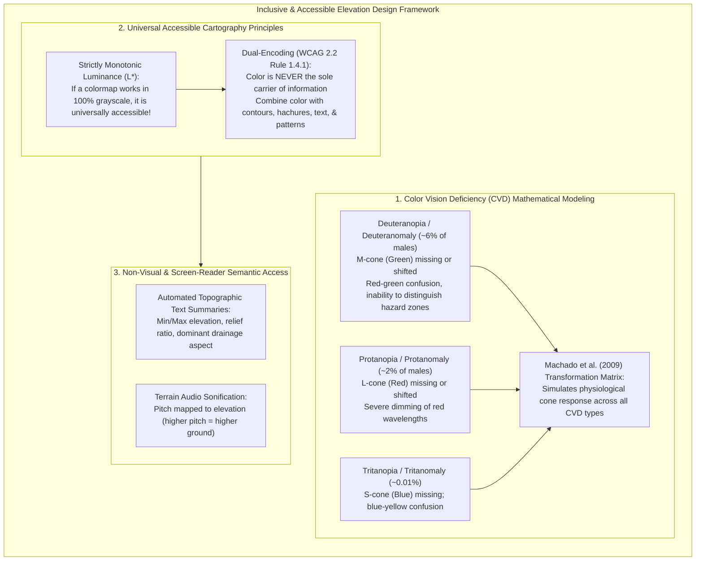

# Chapter 35: Accessibility, Physical/Tactile Terrain Models, and Field Augmented Reality (AR)

*Bringing elevation data off the 2D monitor: inclusive design, 3D-printed/CNC solid terrain, and in-situ augmented reality.*

---

## 35.1 Accessible and Colorblind-Safe Elevation Design

For decades, digital elevation cartography has been designed under the unspoken assumption that every user possesses typical trichromatic color vision and interacts with terrain solely through a standard two-dimensional computer monitor. In reality, **over $8\%$ of men and $0.5\%$ of women** live with Color Vision Deficiency (CVD), millions of individuals navigate with low vision or blindness, and emergency responders in the field require hands-on, high-contrast, or audio-tactile interfaces.

An inaccessible elevation map is a public safety hazard. When an emergency evacuation map uses a red-green color ramp to denote flood danger, a deuteranopic resident cannot distinguish safe high ground from a submerged death trap. Designing truly accessible elevation products requires mathematically modeling human color perception deficiencies, enforcing dual-encoding principles, and developing screen-reader-accessible terrain semantics.



---

### 35.1.1 The Neurobiology and Mathematics of Color Vision Deficiency

Human color perception is trichromatic, mediated by three classes of retinal cone photoreceptors:
* **S-Cones (Short Wavelength):** Peak sensitivity near $\lambda \approx 420\text{ nm}$ (Blue).
* **M-Cones (Medium Wavelength):** Peak sensitivity near $\lambda \approx 530\text{ nm}$ (Green).
* **L-Cones (Long Wavelength):** Peak sensitivity near $\lambda \approx 560\text{ nm}$ (Red).

#### 1. The Taxonomy of Color Vision Deficiencies
* **Deuteranopia (Dichromacy) & Deuteranomaly (Anomalous Trichromacy):** The most common form of CVD ($\sim 6\%$ of males). The M-cone pigment is either absent or shifted in spectral sensitivity toward the L-cone. Red and green hues collapse onto an identical yellowish-gray axis.
* **Protanopia & Protanomaly ($\sim 2\%$ of males):** The L-cone pigment is absent or shifted. Long-wavelength red light appears significantly darker, and reds and greens are confused.
* **Tritanopia & Tritanomaly ($\sim 0.01\%$ of the population):** The S-cone pigment is absent; blue and yellow hues are confused.
* **Monochromacy / Achromatopsia (1 in 30,000):** Complete absence of functioning cone photoreceptors; vision is mediated entirely by rods, perceiving only achromatic luminance ($L^*$).

#### 2. The Machado et al. (2009) Color Vision Deficiency Simulation
To verify whether an elevation colormap is accessible, automated visualization pipelines simulate how colors appear to observers with CVD. Under the Machado, Oliveira, and Fernandes (2009) physiologically-based model, display-encoded sRGB values $\mathbf{C}_{\text{sRGB}} \in [0, 1]^3$ must **first be linearized** into physical light-intensity space before applying the $3 \times 3$ cone-shift transformation matrix $\mathbf{M}_{\text{CVD}}$:

$$\mathbf{C}_{\text{lin}} = \text{sRGB}^{-1}(\mathbf{C}_{\text{sRGB}}), \qquad \mathbf{C}_{\text{CVD, lin}} = \text{clip}_{[0, 1]}\!\big( \mathbf{M}_{\text{CVD}}(\text{type}, s) \cdot \mathbf{C}_{\text{lin}} \big)$$

where $s \in [0, 1]$ represents deficiency severity ($s = 1.0$ for complete dichromacy), after which $\mathbf{C}_{\text{CVD, lin}}$ is converted back via gamma encoding for display or transformed to CIE $L^*a^*b^*$ space. (Applying $\mathbf{M}_{\text{CVD}}$ directly to gamma-encoded sRGB distorts luminance linearity and corrupts color-difference metrics.)

*For complete Deuteranopia ($s = 1.0$, linear RGB, row sums $= 1.000000$ preserving neutral white/gray):*
$$\mathbf{M}_{\text{deuteranopia}} = \begin{pmatrix} 0.367322 & 0.860646 & -0.227968 \\ 0.280085 & 0.672501 & 0.047414 \\ -0.011820 & 0.042940 & 0.968880 \end{pmatrix}$$

*For complete Protanopia ($s = 1.0$, linear RGB):*
$$\mathbf{M}_{\text{protanopia}} = \begin{pmatrix} 0.152286 & 1.052583 & -0.204868 \\ 0.114503 & 0.786281 & 0.099216 \\ -0.003882 & -0.048116 & 1.051998 \end{pmatrix}$$

*For complete Tritanopia ($s = 1.0$, linear RGB):*
$$\mathbf{M}_{\text{tritanopia}} = \begin{pmatrix} 1.255528 & -0.076749 & -0.178779 \\ -0.078411 & 0.930809 & 0.147602 \\ 0.004733 & 0.691367 & 0.303900 \end{pmatrix}$$

* **The CI/CD Accessibility & Contrast Linter:**
  An automated testing pipeline transforms each elevation colormap stop through $\mathbf{M}_{\text{deuteranopia}}$, $\mathbf{M}_{\text{protanopia}}$, and $\mathbf{M}_{\text{tritanopia}}$, then computes both **WCAG 2.2 relative luminance contrast** ($CR = (L_1 + 0.05) / (L_2 + 0.05) \ge 3.0$ for graphical elements and $\ge 4.5$ for contour/elevation labels) and the **CIEDE2000 perceptual difference ($\Delta E_{00}$)** (Sharma et al., 2005). If $\Delta E_{00} < 3.0$ between adjacent discrete elevation bands or if relative luminance $L^*$ reverses direction across a sequential ramp, the colormap fails CI/CD review.

```python
"""
Automated CI/CD Color Vision Deficiency (CVD) & Monotonic Luminance Linter
for sequential and topo-bathymetric elevation colormaps (Machado et al., 2009).
"""

import numpy as np

M_CVD = {
    "deuteranopia": np.array([[0.367322, 0.860646, -0.227968], [0.280085, 0.672501, 0.047414], [-0.011820, 0.042940, 0.968880]]),
    "protanopia":   np.array([[0.152286, 1.052583, -0.204868], [0.114503, 0.786281, 0.099216], [-0.003882, -0.048116, 1.051998]]),
    "tritanopia":   np.array([[1.255528, -0.076749, -0.178779], [-0.078411, 0.930809, 0.147602], [0.004733, 0.691367, 0.303900]]),
}

def srgb_to_linear(srgb: np.ndarray) -> np.ndarray:
    """Invert IEC 61966-2-1 sRGB gamma encoding to physical linear RGB."""
    return np.where(srgb <= 0.04045, srgb / 12.92, ((srgb + 0.055) / 1.055) ** 2.4)

def simulate_cvd_luminance(palette_srgb: np.ndarray, cvd_type: str = "deuteranopia") -> np.ndarray:
    """Return CIE relative luminance Y in [0, 1] perceived by an observer with CVD."""
    lin = srgb_to_linear(np.asarray(palette_srgb, dtype=np.float64))
    sim_lin = np.clip(lin @ M_CVD[cvd_type].T, 0.0, 1.0)
    # CIE XYZ Y-channel (relative luminance) from sRGB primaries
    return 0.2126 * sim_lin[..., 0] + 0.7152 * sim_lin[..., 1] + 0.0722 * sim_lin[..., 2]

def assert_accessible_sequential_ramp(palette_srgb: np.ndarray) -> None:
    """Fail if any CVD simulation breaks monotonic luminance ordering."""
    for cvd in ("deuteranopia", "protanopia", "tritanopia"):
        y = simulate_cvd_luminance(palette_srgb, cvd)
        diffs = np.diff(y)
        is_monotonic = np.all(diffs > 0) or np.all(diffs < 0)
        assert is_monotonic, f"Non-monotonic luminance reversal under {cvd}: creates false ridges!"
```

---

### 35.1.2 Designing Universal, Accessible Elevation Palettes

#### 1. The Monotonic Luminance Invariant (Land & Marine Domains)
The single most powerful rule in accessible cartography is **monotonic lightness**:
* **Terrestrial & Single-Domain Bathymetric Ramps:** If perceived lightness $L^*$ in CIELAB or CAM02-UCS space increases or decreases strictly monotonically with elevation $z$ (or depth $d$), the surface preserves its full shape-from-shading gradient when printed in monochrome or viewed under any form of CVD. Palettes such as `batlow`, `viridis`, `cividis` (explicitly optimized for deuteranopia/protanopia), and `cmocean.deep` enforce smooth perceptual lightness trajectories.
* **Topo-Bathymetric (TBDEM) Diverging Hinges ($z = 0$ / MLLW):** Seamless coastal maps face a dual challenge: observers must instantaneously tell whether a pixel is **submerged ($z < 0$)** or **emergent land ($z > 0$)** even under CVD. Classic green-land / red-shoal palettes collapse catastrophically under deuteranopia. Accessible topo-bathymetric colormaps (such as `cmocean.topo` or Crameri's `oleron` and `bukavu`) pair distinct blue-versus-tan chromatic channels (separable by S-cones preserved in red-green CVD) with a **sharp luminance step or coastline vector breakline** at the datum shoreline ($z = 0$), plus optional `CATZOC` stipple textures over low-confidence zones.

#### 2. The Dual-Encoding Requirement (WCAG 2.2)
Under the W3C Web Content Accessibility Guidelines (WCAG 2.2, Success Criterion 1.4.1: *Use of Color*, published October 2023):
> *"Color is not used as the only visual means of conveying information, indicating an action, prompting a response, or distinguishing a visual element."*

To satisfy WCAG 2.2 across terrestrial flood, landslide, and nautical products:
* **Contours, Hachures, and Breaklines:** Overlay labeled elevation contours (`isohypses`) or depth contours (`isobaths`) and slope hachures (`Swiss`/`Imhof` ticks) on top of color-tinted rasters so elevation ordering remains unambiguous without hue discrimination.
* **Texture and Hatching:** Differentiate high-risk flood zones, shallow navigational hazards, or low-reliability (`CATZOC C/D`) bathymetry using diagonal cross-hatching, stippling dots, or dashed boundary patterns alongside color fills.
* **Direct Typography & High-Contrast Mode:** Annotate critical thresholds directly (`"BFE: 12.4 m"`, `"SHOAL 4.2 m MLLW"`) with haloed high-contrast text ($\ge 4.5:1$ luminance ratio against the underlying raster) and offer a single-click monochrome/high-contrast hachure stylesheet in web viewers.

---

### 35.1.3 Non-Visual Access: Screen Readers and Audio Sonification

How does a completely blind or severely visually impaired individual interpret a digital elevation or bathymetric model? Accessible GIS requires translating 2D and 3D spatial surfaces into non-visual semantic formats.

#### 1. Automated Topographic and Bathymetric Semantic Summaries
Modern accessible web pipelines generate automated natural-language terrain summaries from DEM metadata, zonal statistics, and hydrological graphs, embedding them inside semantic HTML `<figure>`, `<figcaption>`, and `aria-describedby` containers:

```html
<!-- Accessible Semantic Elevation Summary for Screen Readers (WCAG 1.1.1 / 1.4.1) -->
<figure role="img" aria-labelledby="dem-title" aria-describedby="dem-desc">
  
  <figcaption id="dem-title" class="sr-only">
    Boulder Creek Watershed Bare-Earth Digital Terrain Model (NAVD88)
  </figcaption>
  <div id="dem-desc" class="sr-only">
    <p><strong>Geographic Domain:</strong> 15 km east-west by 12 km north-south, UTM Zone 13N.</p>
    <p><strong>Elevation Range:</strong> Minimum 1,620 meters in the eastern plains, rising to maximum 3,140 meters at Green Mountain.</p>
    <p><strong>Dominant Landforms:</strong> The western 60% consists of steep granitic foothills with slopes exceeding 35 degrees, draining eastward through Boulder Canyon. The eastern 40% transitions into alluvial plains with slopes under 2 degrees.</p>
    <p><strong>Flood Hazard:</strong> 14% of the mapped area sits within the 100-year regulatory flood zone bordering Boulder Creek.</p>
  </div>
</figure>
```
For marine charts, equivalent automated summaries report minimum navigable channel depth, shoalest isolated rock/DTON coordinates relative to MLLW/LAT, and `CATZOC` confidence category.

#### 2. Interactive Terrain Audio Sonification
Building on auditory display research (Hermann, Hunt, & Neuhoff, 2011; Bearman & Lovett, 2010), **terrain sonification** maps spatial position $(x, y)$, elevation $z$, and uncertainty $\sigma_z$ to acoustic parameters:
* **Pitch Mapping:** Fundamental frequency scales exponentially (logarithmically in human pitch perception) with elevation $z$:
  $$f_{\text{audio}}(z) = f_0 \cdot 2^{\frac{z - z_{\min}}{z_{\max} - z_{\min}} \cdot k_{\text{octaves}}}$$
  *Worked Audio Example:* With base frequency $f_0 = 130.8\text{ Hz}$ (C3) and $k_{\text{octaves}} = 3.0$ octaves over a coastal TBDEM spanning $z \in [-50\text{ m}, +100\text{ m}]$, the deepest submarine canyon hums at $130.8\text{ Hz}$, sea level ($z = 0\text{ m}$, normalized $1/3$) sounds at $130.8 \times 2^{1.0} = 261.6\text{ Hz}$ (Middle C4), and the $100\text{ m}$ summit rings at $130.8 \times 2^{3.0} = 1046.4\text{ Hz}$ (C6).
* **Domain & Uncertainty Modulation:** Subaqueous bathymetry ($z < 0$) can trigger a filtered low-pass wave timbre to distinguish seabed from dry land at $z = 0$, stereo panning maps horizontal cursor $x$-position left-to-right, and gentle amplitude vibrato or white-noise shimmer encodes elevated TVU uncertainty ($\sigma_z$)—allowing blind analysts to trace coastlines, ridgelines, and uncertain survey gaps purely by ear.
