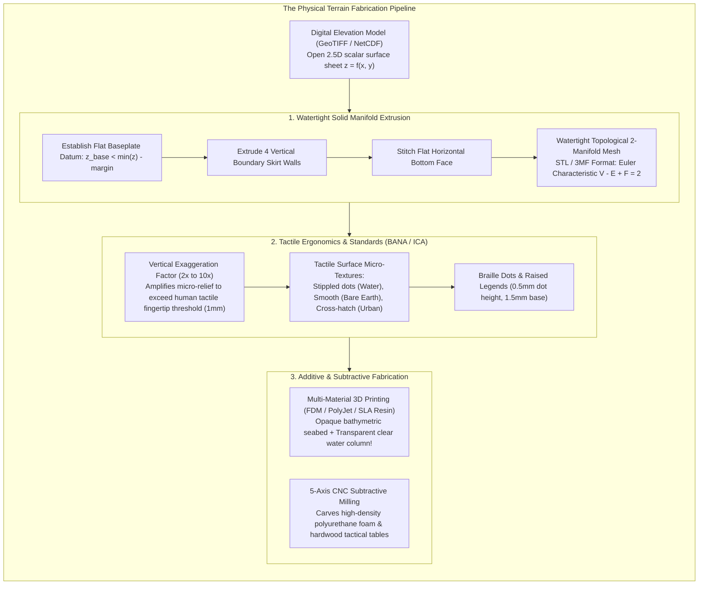
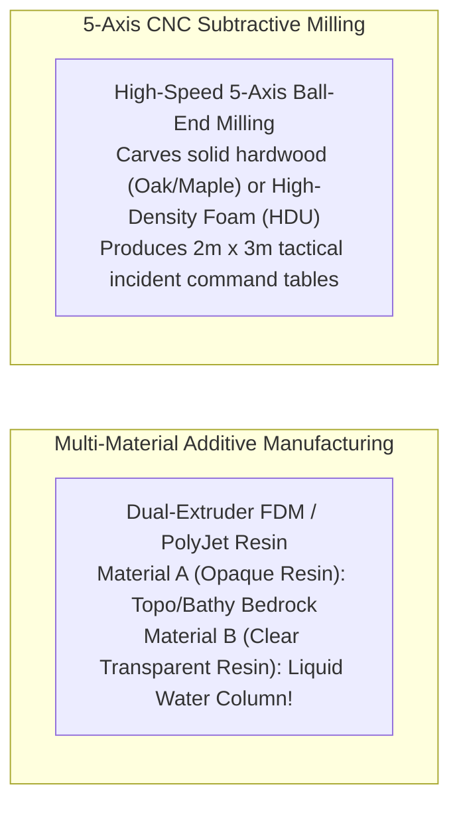

# Chapter 35: Accessibility, Physical/Tactile Terrain Models, and Field Augmented Reality (AR)

*Bringing elevation data off the 2D monitor: inclusive design, 3D-printed/CNC solid terrain, and in-situ augmented reality.*

---

## 35.2 Physical and Tactile Terrain Models: 3D Printing and CNC Milling

While digital elevation models live inside computer memory, human beings interact most intimately with physical matter. For centuries, military commanders, geologists, and educators relied on physical relief models—painstakingly sculpted from plaster, papier-mâché, clay, or laminated cardboard contours.

Today, additive manufacturing (3D printing) and subtractive 5-axis computer numerical control (CNC) milling allow practitioners to transform digital rasters into physical, touchable terrain models. These physical artifacts serve two vital purposes: they provide **tactile cartographic independence for blind and low-vision individuals**, and they provide tangible, multi-material spatial models for emergency incident command tables, watershed education, and museum exhibits.

---

### 35.2.1 From 2.5D Rasters to Watertight 3D Solids

A digital elevation raster or TIN is an "open sheet": it has an upper surface, but zero thickness, zero side walls, and no bottom. If an unclosed raster surface is loaded into 3D printer slicing software (such as PrusaSlicer, Bambu Studio, or Cura), the slicing engine fails with non-manifold topological errors.

To fabricate a physical model, the open surface must be transformed into a **watertight, closed 2-manifold solid volume**:

#### 1. The Solid Extrusion Geometry
1. **Define the Baseplate Elevation ($z_{\text{base}}$):**
   Identify the absolute minimum elevation within the dataset ($z_{\min} = \min_{(x, y)} z(x, y)$). Establish a flat horizontal baseplate elevation at a safe structural offset:
   $$z_{\text{base}} = z_{\min} - \Delta z_{\text{margin}}$$
   where $\Delta z_{\text{margin}}$ (typically $2\text{–}5\text{ mm}$ at model scale) ensures that the lowest valley or ocean trench maintains sufficient structural plastic thickness so the model does not break during printing.
2. **Generate the Four Vertical Skirt Walls:**
   For every boundary edge vertex $(x_b, y_b, z(x_b, y_b))$ along the outer perimeter neatline, create a corresponding base vertex $(x_b, y_b, z_{\text{base}})$. Connect adjacent perimeter pairs to form vertical rectangular side walls, triangulated into planar quads.
3. **Generate the Closed Bottom Baseplate:**
   Construct a flat horizontal bottom polygon at $z = z_{\text{base}}$ spanning the outer coordinates, triangulated with downward-pointing surface normals (outward from the solid volume).
4. **Enforce Watertight Manifold Topology:**
   Ensure every edge is shared by **exactly two triangular facets**, and verify that the closed surface integral of outward normal vectors equals zero:
   $$\oint_{\partial \mathcal{V}} \hat{\mathbf{n}} \, dA = \mathbf{0}$$

#### 2. Metric Projection, Scale Conversion, and Format Standards: STL vs. 3MF
* **Mandatory Metric Projection Before Extrusion:** Never feed an unprojected geographic raster (`EPSG:4326` degrees) directly into a 3D mesh extruder. Mixing horizontal degrees ($\Delta \lambda \approx 0.0001^\circ$) with vertical meters ($z \approx 500\text{ m}$) creates a razor-thin vertical spike $111{,}000\times$ too tall and skewed in longitude by $\sec\varphi$! Always reproject the DEM into a local metric CRS (UTM or equal-area) before converting coordinates to physical printer millimeters:
  $$x_{\text{mm}} = \frac{1000}{S_H}(x - x_0), \quad y_{\text{mm}} = \frac{1000}{S_H}(y - y_0), \quad z_{\text{mm}} = \Delta z_{\text{margin}} + VE \cdot \frac{1000}{S_H}\big(z(x,y) - z_{\min}\big)$$
  where $S_H$ is the horizontal map scale denominator (e.g., $S_H = 50{,}000$ for $1:50{,}000$) and $VE$ is vertical exaggeration.
* **The Triangle Polygon Budget:** A $1\text{-meter}$ LiDAR raster of a $10\text{ km} \times 10\text{ km}$ county contains $100\text{ million pixels}$ ($200\text{ million triangles}$). Loading this directly into a slicer causes memory exhaustion. Mesh decimation algorithms (such as Garland–Heckbert Quadric Error Metrics—QEM) simplify the mesh down to $1\text{–}3\text{ million triangles}$, preserving edge sharpness on ridgelines and submarine canyon rims while collapsing flat plains into large triangles.
* **STL vs. 3MF:** The legacy Stereolithography (`.stl`) format stores only raw triangle vertex coordinates without units, color, or multi-material metadata (leading to classic $1\text{ mm}$ vs. $1\text{ m}$ import scaling bugs). Modern pipelines—as emphasized by Hasiuk et al. (2017) and Rase (2012)—increasingly export **3D Manufacturing Format (`.3mf`)**, an open XML-ZIP container storing millimeter units, color textures, multi-material boundaries, and guaranteed manifold connectivity.

---

### 35.2.2 Tactile Cartography Standards for Blind and Low-Vision Users

A sighted user perceives terrain via 2D visual perspective, analytical shading, and color hypsometry. A blind or visually impaired user perceives terrain through the **somatosensory system (active haptic exploration with fingertips)**. Designing a tactile terrain model requires understanding tactile spatial resolution and standardizing haptic symbology under the guidelines of the **Braille Authority of North America (BANA, 2010/2012)** and the **International Cartographic Association (ICA)**.

#### 1. The Human Tactile Threshold and Vertical Exaggeration
The human fingertip has a spatial two-point discrimination threshold of approximately **$1.5\text{ to }2.5\text{ millimeters}$**, and can detect vertical surface steps as small as **$0.2\text{ millimeters}$**.
* **The Flat Earth Reality:** Real-world planetary topography is surprisingly low-relief at regional map scales. On a true-scale $1:100{,}000$ model ($10\text{ cm}$ wide representing $10\text{ km}$), a deep $150\text{-meter}$ river valley corresponds to a physical relief of only **$1.5\text{ millimeters}$**, while $10\text{-meter}$ river bluffs, levees, and submerged sand waves shrink to **$0.10\text{ mm}$**—completely imperceptible to human touch! Even at continental scale ($1:1{,}000{,}000$), a $1{,}500\text{-meter}$ canyon wall measures just $1.5\text{ mm}$.
* **Mandatory Vertical Exaggeration ($VE$):**
  To bring landforms clearly above the somatosensory and FDM printer layer-height ($0.1\text{–}0.2\text{ mm}$) thresholds, tactile models apply a **Vertical Exaggeration Factor**:
  $$z_{\text{model}} = z_{\text{base}} + VE \cdot \big( z(x, y) - z_{\text{base}} \big)$$
  * In rugged alpine terrain or steep seamounts (Alps, Rocky Mountains, Monterey Canyon): $VE = 1.5\times\text{ to }3.0\times$.
  * In moderate rolling foothills and continental shelves: $VE = 3.0\times\text{ to }6.0\times$.
  * In low-relief coastal floodplains, deltas, and abyssal plains: $VE = 10.0\times\text{ to }20.0\times$.

#### 2. Stepped Contour Terracing vs. Smooth Relief
* **Smooth Relief:** Provides intuitive, organic tactile exploration of natural landforms, mountain ridges, and drainage divides. Printing with finer layer heights ($0.05\text{ mm}$ SLA or $0.10\text{ mm}$ adaptive-layer FDM) prevents horizontal slicer "contour terracing" artifacts on gentle slopes where false ridges could confuse finger interpretation.
* **Stepped Contour Terraces:** Instead of smooth surfaces, the model is intentionally quantized into discrete vertical steps (e.g., $100\text{-meter}$ elevation or $20\text{-meter}$ bathymetric contour steps). Each step provides an unambiguous, sharp tactile edge that allows blind users to count elevation or depth intervals directly with their fingers, bridging qualitative shape with quantitative measurement.

#### 3. Standard Tactile Surface Micro-Textures and Braille
Under BANA tactile cartography guidelines and NLS Specification 800 dimensions:
* **Waterbodies (Oceans / Lakes):** Depicted as perfectly smooth, recessed basins, or engraved with fine parallel wave textures when representing open water beside land.
* **Urban / Built Environments:** Texturized with raised cross-hatching or stippled grids.
* **Stream Thalwegs & Submarine Canyons:** Engraved as continuous concave grooves ($1.0\text{ mm}$ wide, $0.5\text{ mm}$ deep) that fingertips can trace uninterrupted downstream.
* **Braille Annotations:** Mountain summits, harbors, and elevation keys are labeled in Grade 2 Braille oriented horizontally along the base or plateau collars. Standard BANA/NLS book-braille specifications dictate:
  $$\text{Dot Height: } \approx 0.48\text{ mm } (0.019\text{ in}), \quad \text{Base Diameter: } \approx 1.44\text{ mm } (0.057\text{ in}), \quad \text{Intra-Cell Dot Spacing: } \approx 2.34\text{ mm}$$
  with horizontal cell-to-cell spacing of $\approx 6.2\text{ mm}$ and interline spacing of $\approx 10.0\text{ mm}$—meaning Braille labels consume substantial physical map footprint and must be budgeted during layout design.

---

### 35.2.3 Advanced Additive and Subtractive Fabrication Modalities

#### 1. Multi-Material Resin 3D Printing: The Transparent Water Column
One of the most compelling breakthroughs in marine and coastal DEM communication (Rase, 2012) is **multi-material photopolymer jetting (e.g., Stratasys PolyJet)** and dual-cast **SLA resin** fabrication:
* **The Seabed & Datum Harmonization:** Seamless TBDEMs are converted from positive-down chart depths ($d$) into continuous positive-up datum heights ($z$) referenced to MHW or LMSL, with baseplate $z_{\text{base}} = z_{\min, \text{seabed}} - \Delta z_{\text{margin}}$ spanning the deepest canyon floor. The submerged seabed and subaerial topography are printed in solid full-color opaque resin tinted with Haxby or `cmocean.topo` palettes.
* **The Water Column:** Simultaneously, the overlying ocean volume from the seabed ($z < 0$) up to the MHW/MSL plane ($z = 0$) is printed in **optically clear, polished transparent resin**.
* *The Result:* Mariners, coastal planners, and blind/low-vision learners can physically see and inspect submerged shipping channels, submarine canyons, and under-keel clearance hazards inside a solid crystal block—or fabricate separable water-column caps that lift off to expose the tactile seafloor underneath.

#### 2. 5-Axis CNC Milling for Tactical Incident Command Tables
While 3D printing excels for desktop models ($15\text{–}35\text{ cm}$ tiles), regional planning and emergency operations require multi-meter relief tables:
* **Subtractive Milling:** High-speed 3- and 5-axis CNC routers equipped with ball-end carbide mills carve continuous elevation models out of blocks of **High-Density Urethane (HDU) tooling foam**, dense polystyrene, aluminum, or laminated hardwood planks.
* **Tactical Projection Sand Tables:** Installed in emergency operations centers (e.g., wildfire incident command posts, tsunami inundation briefings, and museum exhibits), these durable $2\text{ m} \times 3\text{ m}$ solid terrain tables are paired with calibrated overhead projectors (or AR overlays) projecting real-time satellite wildfire perimeters, flood depths, and AIS vessel tracks directly onto the physical topography.
