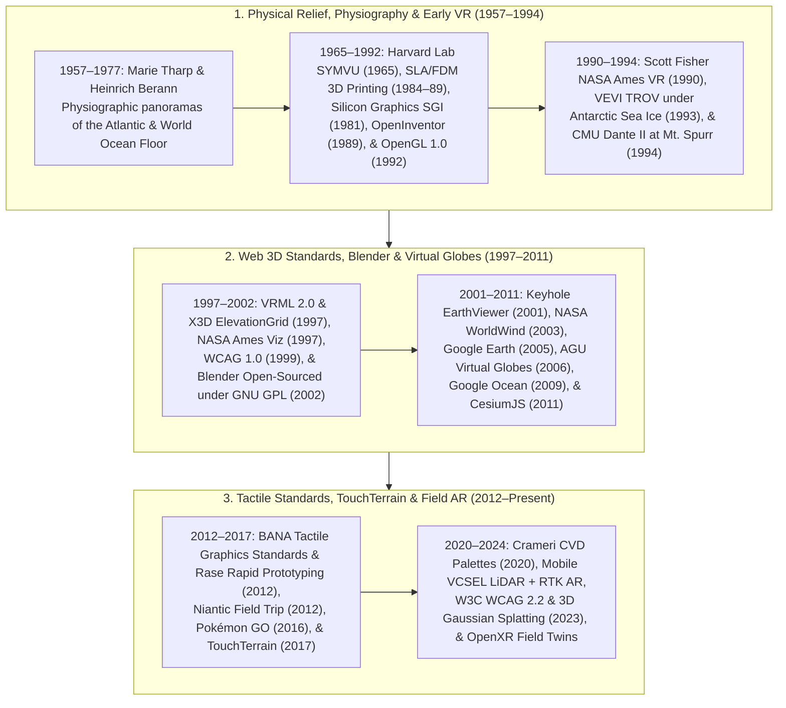

# Chapter 35: Accessibility, Physical/Tactile Terrain Models, and Field Augmented Reality (AR)

*Bringing elevation data off the 2D monitor: inclusive design, 3D-printed/CNC solid terrain, and in-situ augmented reality.*

---

## 35.4 Historical Evolution: From Hand-Painted Relief to Niantic and Field AR

The desire to experience topography beyond a flat two-dimensional map has driven innovations in physical modeling, artistic physiography, virtual reality, and augmented reality for over seven decades. The milestones below, anchored in the `schwehr/gis-history` repository, trace how the representation of terrain progressed from mid-20th-century physiographic panoramas to immersive NASA rover interfaces and mass-market geospatial augmented reality.

---

### 35.4.1 From Physical Relief Sculpting to Physiographic Panoramas and SGI: 1957 to 1990

#### 1. Early Hand-Crafted Relief Models and Marie Tharp's Physiography (1957)
Long before digital printers existed, cartographers sculpted physical terrain blocks by hand. In late 19th-century Switzerland, **Xaver Imfeld** and later **Eduard Imhof** perfected *Reliefkunst*—hand-carved plaster and gypsum alpine reliefs built by cutting stacked contour sheets and sculpting glacial troughs at carefully tuned vertical exaggerations ($1.5\times\text{–}3\times$)—while the **USGS** and U.S. Army Map Service mass-produced vacuum-formed embossed vinyl relief maps for aviation and field geology during the mid-20th century.

When **Marie Tharp** and Bruce Heezen began mapping the Atlantic seafloor at Columbia University's Lamont Geological Observatory in the 1950s, Cold War military classification prohibited publishing raw contoured bathymetric charts in many regions, while dry contour lines failed to communicate the dramatic axial rift valley of the Mid-Atlantic Ridge:
* Collaborating with Austrian landscape painter **Heinrich Berann**, Tharp translated thousands of single-beam echograms into perspective **physiographic diagrams**—publishing the *North Atlantic Physiographic Diagram* (1957) and the *World Ocean Floor* panorama (1977).
* Berann combined artistic vertical exaggeration, alpine rock shading, and oblique relief to depict submarine canyons, abyssal plains, and mid-ocean ridges as tangible landforms.
* *The Historical Impact:* Tharp and Berann demonstrated that physical and perceptual terrain representation makes hidden geological structure—especially beneath the opaque ocean—immediately intelligible to scientists and the public alike.

#### 2. Computer Wireframes, Silicon Graphics, and Scott Fisher's VR (1965–1992)
* **1965–1981: From `SYMVU` to SGI:** Following the founding of the **Harvard Laboratory for Computer Graphics and Spatial Analysis (1965)**—which pioneered automated 3D hidden-line perspective terrain plots (`SYMVU`)—Jim Clark founded **Silicon Graphics (SGI)** in 1981, introducing dedicated Geometry Engine hardware, **OpenInventor (1989)**, and **OpenGL 1.0 (1992)** that enabled interactive flythroughs over gridded elevation meshes.
* **1973–1999: Birth of Digital & Tactile Accessibility:** The **U.S. Rehabilitation Act of 1973 (Section 508, amended 1998)** and **Americans with Disabilities Act (1990)** established legal mandates for non-visual information access, culminating in the **W3C Web Content Accessibility Guidelines (WCAG 1.0 in 1999 $\to$ 2.0 in 2008 $\to$ 2.2 in 2023)** and **BANA's *Guidelines and Standards for Tactile Graphics* (2010/2012)**.
* **1990: Scott Fisher and NASA Ames Virtual Reality:** Dr. Scott Fisher—who directed the Virtual Environment Workstation (VIEW) project at NASA Ames Research Center—published his landmark 1990 *Scientific American* overview and founded Telepresence Research. Fisher pioneered stereoscopic head-mounted displays (HMDs), 6-DoF head tracking, and spatialized 3D audio cues, establishing embodied virtual terrain navigation.

---

### 35.4.2 Teleoperation Virtual Environments and Web 3D Standards: 1993 to 2002

#### 1. 1993–1994: NASA Ames VEVI (`TROV` & `Dante II`) and 1997 NASA Ames Viz
Developed by the Intelligent Mechanisms Group (IMG) at NASA Ames Research Center:
* **1993 (*TROV* under Antarctic Sea Ice):** NASA Ames integrated the **Virtual Environment Vehicle Interface (VEVI)** with the *TROV* (Telepresence Remotely Operated Vehicle), allowing scientists wearing VR headsets in California to pilot a modified Phantom S2 underwater robot beneath sea ice in **McMurdo Sound, Antarctica** over live 3D bathymetric terrain meshes streamed over satellite links.
* **1994 (*Dante II* in Mount Spurr Volcano):** VEVI subsequently provided real-time 3D terrain visualization for Carnegie Mellon University's eight-legged *Dante II* walking robot as it descended into the active volcanic crater of Mount Spurr, Alaska, fusing scanning laser rangefinder sweeps with stereo imagery.
* **1997 (NASA Ames Viz):** Building on VEVI, Ames Viz rendered live stereo-reconstructed Martian terrain meshes for the *Mars Pathfinder* Sojourner rover mission—allowing planetary geologists to interactively measure rock slopes, plot rover traverses, and verify wheel clearance in virtual terrain prior to uploading commands, establishing modern robotic digital twin workflows.

#### 2. 1984–2002: From Rapid Prototyping (SLA/FDM) to VRML 2.0, X3D, and Blender
In parallel with virtual reality, physical 3D fabrication moved from hand-carving to computer-controlled additive manufacturing:
* **1984–1989 (SLA & FDM Patents):** Chuck Hull patented stereolithography (**SLA**, 1984/1986) and created the `.stl` triangular mesh format at 3D Systems, while Scott Crump patented Fused Deposition Modeling (**FDM**, 1989)—allowing DEM height grids to be extruded directly into polymer terrain blocks without custom CNC tooling.
* **1997 (VRML 2.0 and X3D):** The Web3D Consortium standardized the **Virtual Reality Modeling Language (VRML 2.0 / ISO 14772)** and its XML-based successor **X3D**, introducing an explicit `ElevationGrid` scene-graph node for streaming 2.5D terrain heights and draped imagery into web browsers and pioneering declarative 3D scene graphs (later inspiring `glTF` and `OGC 3D Tiles`).
* **2002 (Open-Sourcing of Blender):** Dutch developer Ton Roosendaal founded the Blender Foundation and led a community crowdfunding campaign to liberate **Blender** under the GNU GPL. Coupled with `BlenderGIS` and 3D-print manifold toolboxes, Blender gave cartographers zero-cost QEM decimation, Boolean Braille embossing, and Cycles ray-tracing.

---

### 35.4.3 Virtual Globes, Tactile Standards, and Field AR: 2006 to Present

#### 1. 2006–2011: Virtual Globes, Google Ocean, OpenROV, and CesiumJS
Following Keyhole, Inc. (1999) and Keyhole EarthViewer 1.0 (2001), Google launched **Google Earth (2005)** alongside **NASA WorldWind (2003)**. At the December 2006 **AGU Fall Meeting Virtual Globes Session** (organized by John Bailey), earth scientists formally adopted interactive 3D virtual globes for fault mapping, volcano monitoring, and public hazard outreach. In **2009**, **Google Ocean** (integrated into Google Earth 5.0) unlocked seamless below-the-surface seafloor flythroughs across global bathymetry. The arrival of **Three.js (2010)**, **CesiumJS (2011)**, and open hardware underwater robotics (**OpenROV, 2011**) moved plugin-free 3D terrain globes and live underwater exploration natively into web browsers and community oceanography.

#### 2. 2012–2023: Tactile Cartography Standards, TouchTerrain, and WCAG 2.2
Parallel to virtual globes, accessibility and additive manufacturing matured into standardized geospatial disciplines:
* **2012:** Wolf-Dieter Rase formalized multi-material rapid prototyping of physical thematic maps and transparent water-column models, while the **Braille Authority of North America (BANA)** consolidated its *Guidelines and Standards for Tactile Graphics* (2010/2012), establishing standard dot heights, line textures, and spacing rules that bridged physical cartography and blind accessibility.
* **2017:** Hasiuk, Harding, Renner, and Winer released **`TouchTerrain`**, making multi-tile, vertically exaggerated, 3D-printable terrain generation accessible to anyone with a web browser and desktop printer, followed by standalone Python CLI and `.3mf` enhancements (Harding, Hasiuk, & Wood, 2021) widely adopted by coastal hazard educators and museum exhibits.
* **2020–2023:** Crameri et al. (2020) galvanized earth-science adoption of perceptually uniform, CVD-safe colormaps (`batlow`), and the **W3C WCAG 2.2 Recommendation (2023)** reinforced non-color-only dual encoding across digital mapping interfaces, alongside **3D Gaussian Splatting (2023)** for photorealistic complex 3D site inspection and open-source **OpenXR** spatial runtime standardization.

#### 3. 2012–2024: Niantic, Mobile VIO/LiDAR AR, and Survey-Grade Field Registration
Following Google's acquisition of Keyhole, Keyhole co-founder **John Hanke** founded **Niantic Labs**:
* **2012 (*Field Trip*):** Launched mobile geolocated background audio/visual discovery tied to local topography, geology, and landmarks.
* **2016 (*Pokémon GO*):** Downloaded over **500 million times** within six months, *Pokémon GO* stress-tested planetary-scale mobile AR—proving that consumer smartphones equipped with MEMS IMUs, cameras, and cellular GNSS could maintain spatial registration across hundreds of millions of concurrent users.
* **2017–2024 (ARKit/ARCore, Mobile VCSEL LiDAR, and VPS):** Software frameworks (Apple ARKit, Google ARCore, and Khronos **OpenXR**) unified $200\text{ Hz}$ Visual-Inertial Odometry (VIO) with handheld solid-state VCSEL LiDAR depth buffers (2020+) and Visual Positioning Systems (VPS). Paired with centimeter RTK GNSS poles (e.g., Trimble SiteVision) and shipboard ECDIS bridge navigation displays, field AR transitioned from gaming novelties into survey-grade civil excavation, coastal flood resilience, and marine pilotage tools—where virtual IHO S-102 bathymetric hazards, storm surge planes, and buried conduits lock to physical topography and sea surfaces with sub-centimeter occlusion accuracy.
