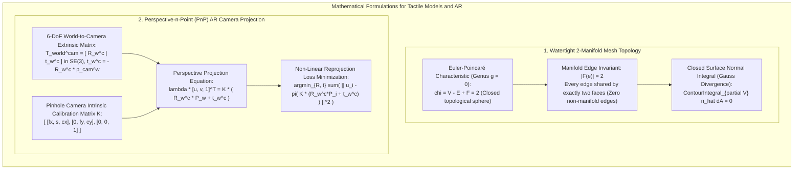

# Chapter 35: Accessibility, Physical/Tactile Terrain Models, and Field Augmented Reality (AR)

*Bringing elevation data off the 2D monitor: inclusive design, 3D-printed/CNC solid terrain, and in-situ augmented reality.*

---

## 35.5 Mathematical Foundations of Manifold Mesh Topology and AR Projection

Fabricating physical terrain models and projecting digital elevation models into real-time camera viewports requires rigorous mathematical foundations in differential topology and projective geometry. This section derives the **Euler-Poincaré 2-manifold condition** and **closed normal integral** for watertight 3D printing, and formulates the **Perspective-n-Point (PnP) camera projection** that locks virtual elevation models to the physical world in field augmented reality.

---

### 35.5.1 Watertight Manifold Topology for Physical Fabrication

In additive manufacturing (3D printing) and subtractive CNC toolpath generation, a slicing engine computes horizontal planar cross-sections through the model. If the input triangular mesh contains holes, self-intersections, inverted normals, or non-manifold edges, the interior volume is mathematically undefined.

#### 1. The Euler-Poincaré Characteristic
Let a closed, orientable polyhedral mesh representing a solid physical terrain model have $V$ vertices, $E$ edges, and $F$ triangular facets. For any closed topological surface of genus $g$ (where $g = 0$ corresponds to a simple solid sphere with zero holes/handles):

$$\chi = V - E + F = 2 - 2g$$

For a standard, unperforated terrain model ($g = 0$):

$$\chi = V - E + F = 2$$

#### 2. The Local Manifold Invariants
A triangular mesh is a **watertight 2-manifold** if and only if every point on the surface has an open neighborhood homeomorphic to an open disk in $\mathbb{R}^2$:
1. **The Edge Manifold Condition:** Every edge $e \in E$ must be bounded by **exactly two triangular faces**:
   $$|\mathcal{F}(e)| = 2, \quad \forall e \in E$$
   * If $|\mathcal{F}(e)| = 1$: The edge is a **boundary edge** (the mesh is open, creating a hole).
   * If $|\mathcal{F}(e)| \ge 3$: The edge is a **non-manifold T-junction**, creating intersecting internal walls that crash slicing engines.
2. **The Vertex Manifold Condition:** For every vertex $v \in V$, the set of incident faces must form a single, contiguous, non-self-intersecting umbrella fan.
3. **Face-Edge Ratio in Closed Triangular Meshes (General Genus $g$ and Solid Blocks $g=0$):**
   Because each triangle has 3 directed half-edges and each manifold edge is shared by 2 adjacent triangles:
   $$2 E = 3 F \implies E = \frac{3}{2} F$$
   Substituting into the Euler–Poincaré characteristic $\chi = V - E + F = 2(1 - g)$ gives the general closed-manifold identities:
   $$F = 2V - 4 + 4g, \qquad E = 3V - 6 + 6g$$
   For a simply connected ($g = 0$) terrain block with no through-holes or alignment tunnels:
   $$F = 2V - 4, \qquad E = 3V - 6$$
   *(Adding $g$ physical through-holes—such as alignment dowel bores passing all the way through a puzzle tile—increases the required facet count by $4g$.)*

#### 3. Closed Surface Normal Integral and Signed Volume (Gauss's Divergence Theorem)
For a solid volume $\mathcal{V} \subset \mathbb{R}^3$ bounded by closed surface $\partial\mathcal{V}$, let $\hat{\mathbf{n}}$ be the outward-pointing unit normal vector.

Under Gauss's Divergence Theorem, for any constant vector field $\mathbf{c} \in \mathbb{R}^3$:
$$\iiint_{\mathcal{V}} \big( \nabla \cdot \mathbf{c} \big) \, dV = \oint_{\partial \mathcal{V}} (\mathbf{c} \cdot \hat{\mathbf{n}}) \, dA$$

Since $\mathbf{c}$ is constant, $\nabla \cdot \mathbf{c} \equiv 0$, yielding the **Closed Surface Normal Conservation Law**:
$$\oint_{\partial \mathcal{V}} \hat{\mathbf{n}} \, dA = \mathbf{0}$$

On a discrete triangular mesh of $F$ facets, each with area $A_j = \frac{1}{2}\|(\mathbf{v}_{j,1} - \mathbf{v}_{j,0}) \times (\mathbf{v}_{j,2} - \mathbf{v}_{j,0})\|_2$ and outward unit normal $\hat{\mathbf{n}}_j$:
$$\sum_{j=1}^F A_j \hat{\mathbf{n}}_j = \mathbf{0}$$
* **Scale-Invariant Mesh Integrity Metric:** Because $A_j$ carries units of area ($\text{mm}^2$ or $\text{m}^2$), normalizing by total surface area $\sum_{j=1}^F A_j$ produces a dimensionless diagnostic:
  $$\epsilon_{\text{closure}} = \frac{\left\| \sum_{j=1}^F A_j \hat{\mathbf{n}}_j \right\|_2}{\sum_{j=1}^F A_j} \le 10^{-6}$$
  If $\epsilon_{\text{closure}} > 10^{-6}$, the mesh contains inverted facet normals (pointing inward) or unclosed boundary holes.
* **Signed Solid Volume & Material Mass Estimation:** Setting $\mathbf{F}(\mathbf{x}) = \mathbf{x}$ ($\nabla \cdot \mathbf{x} = 3$) in the Divergence Theorem gives the exact signed volume of the closed solid:
  $$V_{\text{solid}} = \frac{1}{3} \oint_{\partial \mathcal{V}} (\mathbf{x} \cdot \hat{\mathbf{n}}) \, dA = \frac{1}{6} \sum_{j=1}^F \mathbf{v}_{j,0} \cdot (\mathbf{v}_{j,1} \times \mathbf{v}_{j,2})$$
  A positive value $V_{\text{solid}} > 0$ verifies globally consistent outward-pointing winding order and directly predicts filament or resin consumption ($m_{\text{print}} = \rho_{\text{mat}} V_{\text{solid}} \cdot f_{\text{infill}}$).

#### 4. Worked Topology & Print-Volume Check ($100 \times 100$ DEM Extrusion)
Consider extruding a $100 \times 100$-pixel metric DEM ($n_x = 100, n_y = 100$) into a flat-bottomed tactile block ($g = 0$):
* **Vertices:** Top surface ($10{,}000$) + Bottom baseplate ($10{,}000$) $\implies V = 20{,}000$.
* **Facets:** Top ($2 \times 99 \times 99 = 19{,}602$) + Bottom ($19{,}602$) + Four Perimeter Skirt Walls ($4 \times 2 \times 99 = 792$) $\implies F = 39{,}996 = 2(20{,}000) - 4$.
* **Edges:** $E = \frac{3}{2} F = 59{,}994 = 3(20{,}000) - 6$.
* **Euler–Poincaré Verification:** $V - E + F = 20{,}000 - 59{,}994 + 39{,}996 = 2$ (exact watertight 2-manifold!).
* **Why Naive 2-Triangle Baseplates Fail (The Collinear T-Junction Trap):** If an extruder instead closes the bottom of the $100 \times 100$ model with just 2 large corner-to-corner triangles while the 4 vertical skirt walls contain $4 \times 99 = 396$ bottom perimeter segments, the $392$ intermediate bottom perimeter vertices sit as unshared **T-junctions** along the 4 long baseplate edges ($|\mathcal{F}(e)| \ne 2$), causing 3D-printer slicers to flag open/non-manifold boundaries! To avoid duplicating all $98 \times 98 = 9{,}604$ interior bottom vertices while remaining strictly 2-manifold, production extruders (`TouchTerrain`) connect the $396$ bottom perimeter edges to a single central base vertex $v_{\text{center}}$ (a 396-triangle boundary fan, yielding $V = 10{,}397, F = 20{,}790, E = 31{,}185$, and $V - E + F = 2$).

---

### 35.5.2 The Perspective-n-Point (PnP) Projection for Field AR

In field augmented reality, a virtual 3D elevation point $\mathbf{P}_w = (X_w, Y_w, Z_w)^T$ defined in a georeferenced metric frame (e.g., local ENU tangent plane anchored to NAD83(2011) UTM + NAVD88) must be projected onto a 2D camera sensor pixel $\mathbf{u} = (u, v)^T$ at 60 fps.

#### 1. Camera Pose vs. World-to-Camera Extrinsic Matrix
Following the coordinate frame notation in `notation-and-symbols.md`, let the camera's physical pose in the world frame be $\mathbf{T}_{\text{cam}}^{\text{world}} \in \text{SE}(3)$ with rotation $\mathbf{R}_c^w \in \text{SO}(3)$ and camera optical center $\mathbf{p}_c^w$ in world coordinates. Transforming a world point $\mathbf{P}_w$ into the camera optical frame ($\mathbf{P}_c$) uses the inverse **world-to-camera extrinsic matrix** $\mathbf{T}_{\text{world}}^{\text{cam}} = (\mathbf{T}_{\text{cam}}^{\text{world}})^{-1}$:

$$\mathbf{P}_c = \begin{pmatrix} X_c \\ Y_c \\ Z_c \end{pmatrix} = \mathbf{R}_w^c \mathbf{P}_w + \mathbf{t}_w^c, \qquad \text{where } \mathbf{R}_w^c = (\mathbf{R}_c^w)^T \text{ and } \mathbf{t}_w^c = -\mathbf{R}_w^c \mathbf{p}_c^w$$

#### 2. Intrinsic Pinhole Projection Matrix
The camera's internal optical geometry is modeled by the upper-triangular **intrinsic matrix $\mathbf{K} \in \mathbb{R}^{3 \times 3}$**:

$$\mathbf{K} = \begin{pmatrix} f_x & s & c_x \\ 0 & f_y & c_y \\ 0 & 0 & 1 \end{pmatrix}$$
where $f_x, f_y$ are focal lengths in pixel units, $(c_x, c_y)$ is the principal point, and $s$ is optical skew ($s \approx 0$).

The perspective projection equation relating a 3D world terrain point to a homogeneous 2D screen coordinate is:

$$\lambda \begin{pmatrix} u \\ v \\ 1 \end{pmatrix} = \mathbf{K} \big( \mathbf{R}_w^c \mathbf{P}_w + \mathbf{t}_w^c \big) = \mathbf{K} \begin{pmatrix} X_c \\ Y_c \\ Z_c \end{pmatrix}$$
where $\lambda = Z_c > 0$ is the optical depth along the camera optical axis.

Expanding and dividing by depth $Z_c$ (after lens distortion correction) yields the non-linear projection function $\pi(\mathbf{P}_w)$:

$$u = f_x \frac{X_c}{Z_c} + c_x = f_x \left( \frac{R_{11} X_w + R_{12} Y_w + R_{13} Z_w + t_{w,x}^c}{R_{31} X_w + R_{32} Y_w + R_{33} Z_w + t_{w,z}^c} \right) + c_x$$

$$v = f_y \frac{Y_c}{Z_c} + c_y = f_y \left( \frac{R_{21} X_w + R_{22} Y_w + R_{23} Z_w + t_{w,y}^c}{R_{31} X_w + R_{32} Y_w + R_{33} Z_w + t_{w,z}^c} \right) + c_y$$

#### 3. Solving Camera Pose: The Perspective-n-Point (PnP) Optimization
In Visual Positioning Systems (VPS), the system detects $N$ visual keypoints in the camera image $\mathbf{u}_i = (u_i, v_i)^T$ and matches them to known 3D terrain or facade coordinates $\mathbf{P}_{w, i}$ extracted from an airborne or terrestrial LiDAR point cloud.

The optimal world-to-camera extrinsic parameters $(\mathbf{R}_w^c, \mathbf{t}_w^c)$ are solved by minimizing the **robust non-linear reprojection error**:

$$\big(\hat{\mathbf{R}}_w^c, \, \hat{\mathbf{t}}_w^c\big) = \arg\min_{\mathbf{R} \in \text{SO}(3), \, \mathbf{t} \in \mathbb{R}^3} \sum_{i=1}^N \rho_{\text{Huber}}\left( \left\| \mathbf{u}_i - \pi\big( \mathbf{K}(\mathbf{R}\mathbf{P}_{w, i} + \mathbf{t}) \big) \right\|_2^2 \right)$$
where $\rho_{\text{Huber}}$ is a robust loss function that downweights outlier keypoint matches from moving vehicles or foliage.

#### 4. Worked AR Pixel Alignment Error Sensitivity
Consider a $1920 \times 1080$ tablet camera ($f_x = 1400\text{ px}$) viewing a buried gas valve $Z_c = 25\text{ m}$ ahead:
* **Angular Heading Sensitivity:** An azimuth error $\delta\psi$ produces an apparent horizontal screen drift $\Delta u \approx f_x\,\delta\psi$ (independent of range!). A smartphone compass error of $\delta\psi = 8^\circ = 0.1396\text{ rad}$ shifts the overlay by $\Delta u = 1400 \times 0.1396 \approx 195\text{ pixels}$ ($3.5\text{ m}$ sideways on the street), whereas VIO/VPS heading accuracy of $\delta\psi = 0.05^\circ = 8.73\times 10^{-4}\text{ rad}$ holds drift to $\Delta u \approx 1.2\text{ pixels}$ ($2.2\text{ cm}$).
* **Translational GNSS Sensitivity:** Consumer GPS horizontal error $\delta X = 3.0\text{ m}$ induces $\Delta u = f_x \frac{\delta X}{Z_c} = 1400 \times \frac{3.0}{25} = 168\text{ pixels}$, while RTK GNSS ($\delta X = 0.015\text{ m}$) reduces translational screen error to just $0.84\text{ pixels}$.
