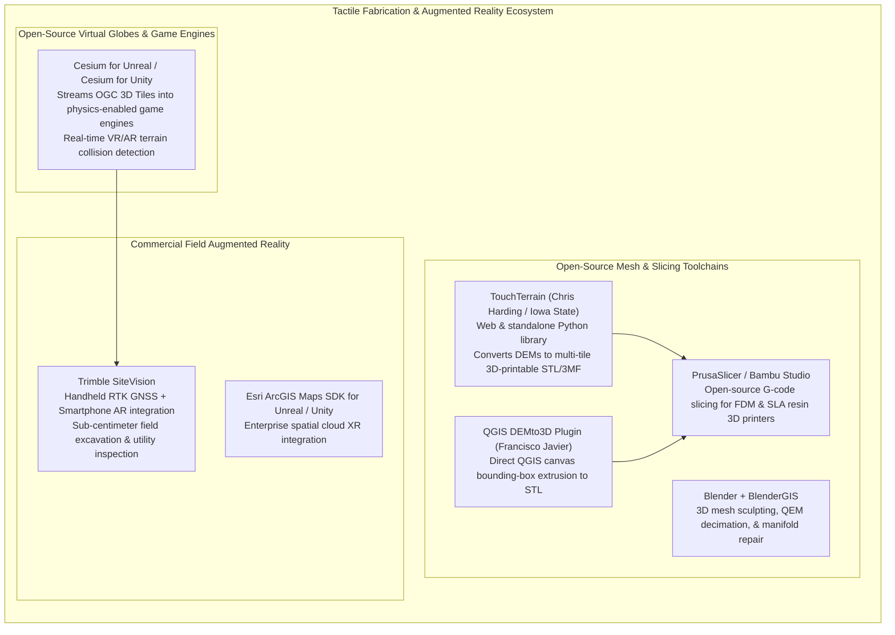

# Chapter 35: Accessibility, Physical/Tactile Terrain Models, and Field Augmented Reality (AR)

*Bringing elevation data off the 2D monitor: inclusive design, 3D-printed/CNC solid terrain, and in-situ augmented reality.*

---

## 35.6 Software Ecosystem

Building physical tactile terrain models and deploying field augmented reality systems requires software capable of converting 2.5D raster matrices into watertight 3D geometry, slicing solid meshes for 3D printers, and streaming massive geospatial tiles into real-time game engines. This section reviews the open-source tools and enterprise AR platforms that bridge digital elevation models with physical reality.



---

### 35.6.1 Open-Source Tactile Fabrication Tools

#### 1. `TouchTerrain`
Developed by Franek Hasiuk, Chris Harding, Alex Renner, and Eliot Winer at Iowa State University (Hasiuk et al., 2017; Harding, Hasiuk, & Wood, 2021), **`TouchTerrain`** is the standard open-source Python library and Google Earth Engine-backed web application for fabricating 3D terrain models:
* Queries AWS Terrain Tiles, USGS 3DEP, ETOPO, or user-uploaded GeoTIFFs, automatically reprojecting to metric coordinates before extrusion.
* Applies user-specified **Vertical Exaggeration ($VE$)**, baseplate thickness, and adaptive contour smoothing.
* Automatically tiles large geographic regions into interlocking multi-piece blocks sized to fit standard printer beds ($20\text{ cm} \times 20\text{ cm}$) with alignment notches/dowels, exporting watertight `.stl` or `.3mf` files.

#### 2. QGIS `DEMto3D`, `Blender`, `MeshLab`, and Slicers (`PrusaSlicer` / `Cura`)
* **QGIS `DEMto3D` Plugin (Francisco Javier Venceslá):** Operates natively inside QGIS; users select an active DEM layer, set physical model width/length in millimeters, map scale denominator (e.g., $1:50{,}000$), vertical exaggeration, and base height, exporting watertight `.stl` files directly from the map canvas.
* **Blender + `BlenderGIS`:** Imports georeferenced DEMs and vector footprints for tactile Boolean subtraction (engraving concave stream grooves or raised Braille labels), QEM mesh simplification, and watertight checks via the *3D-Print Toolbox* add-on.
* **`MeshLab`:** Open-source mesh processing engine used to audit non-manifold edges, run Quadric Edge Collapse Decimation (Garland & Heckbert, 1997), execute Screened Poisson surface reconstruction on 3D point clouds (TLS/cave scans), and reorient inverted normals before slicing.
* **`PrusaSlicer` and `UltiMaker Cura`:** Open-source G-code slicers converting `.3mf`/`.stl` solids into printer toolpaths. For tactile models, practitioners configure **adaptive layer height** ($0.08\text{–}0.12\text{ mm}$ near gentle valley floors to minimize FDM contour stair-stepping), **$15\%\text{–}20\%$ gyroid infill** for warp resistance, and **Ironing** on flat waterbody planes to distinguish smooth water from rough terrain by touch (Rase, 2012).

#### 3. Standalone Python Mesh Extrusion & Manifold Verification Script
The script below converts a metric 2.5D elevation array (terrestrial or topo-bathymetric) into a physical-millimeter watertight 3D manifold mesh (Wavefront `.obj`) and programmatically verifies the Euler–Poincaré ($V - E + F = 2$) and Divergence-Theorem closure invariants before slicing:

```python
"""
Convert a metric 2.5D elevation raster into a watertight 3D solid manifold mesh (OBJ)
scaled to physical printer millimeters, then verify Euler-Poincaré (V - E + F = 2)
and Divergence-Theorem closure invariants prior to 3D slicing.
"""

from collections import Counter
import numpy as np

def dem_to_watertight_obj(
    dem: np.ndarray,
    dx: float,
    dy: float,
    output_obj_path: str,
    scale_denom: float = 50_000.0,
    base_margin_mm: float = 4.0,
    vertical_exaggeration: float = 3.0,
) -> dict:
    """
    Extrudes a projected metric elevation grid into a watertight 3D solid OBJ file.

    Args:
        dem: 2D array of finite elevation values (meters, positive-up; e.g., TBDEM).
        dx, dy: Horizontal pixel spacing in meters (must be projected metric CRS).
        output_obj_path: Destination path for .obj file (coordinates in millimeters).
        scale_denom: Map scale denominator (e.g., 50000.0 for 1:50,000).
        base_margin_mm: Solid plastic base thickness below min(dem) in millimeters.
        vertical_exaggeration: Vertical exaggeration multiplier (VE).
    """
    if not np.all(np.isfinite(dem)):
        raise ValueError("DEM contains NaN/Inf; fill voids before solid extrusion.")
    ny, nx = dem.shape
    mm_per_m = 1000.0 / scale_denom
    z_min_m = float(np.min(dem))

    # 1. Generate Top Surface Vertices (1-based OBJ index 1 .. nx*ny) in mm
    vertices = []
    for j in range(ny):
        y_mm = (ny - 1 - j) * dy * mm_per_m
        for i in range(nx):
            x_mm = i * dx * mm_per_m
            z_mm = base_margin_mm + vertical_exaggeration * (float(dem[j, i]) - z_min_m) * mm_per_m
            vertices.append((x_mm, y_mm, z_mm))

    # 2. Generate Bottom Baseplate Vertices at z = 0.0 mm
    base_offset = nx * ny
    for j in range(ny):
        y_mm = (ny - 1 - j) * dy * mm_per_m
        for i in range(nx):
            vertices.append((i * dx * mm_per_m, y_mm, 0.0))

    faces = []
    def v_top(i, j): return j * nx + i + 1
    def v_bot(i, j): return base_offset + j * nx + i + 1

    # 3. Top (+Z outward) and Bottom (-Z outward) Surface Triangles
    for j in range(ny - 1):
        for i in range(nx - 1):
            faces.append((v_top(i, j), v_top(i, j + 1), v_top(i + 1, j)))
            faces.append((v_top(i + 1, j), v_top(i, j + 1), v_top(i + 1, j + 1)))
            faces.append((v_bot(i, j), v_bot(i + 1, j), v_bot(i, j + 1)))
            faces.append((v_bot(i + 1, j), v_bot(i + 1, j + 1), v_bot(i, j + 1)))

    # 4. Four Vertical Skirt Walls (outward-pointing right-hand-rule winding)
    for i in range(nx - 1):
        faces.append((v_top(i, 0), v_top(i + 1, 0), v_bot(i, 0)))                       # North (+Y)
        faces.append((v_top(i + 1, 0), v_bot(i + 1, 0), v_bot(i, 0)))
        faces.append((v_top(i, ny - 1), v_bot(i, ny - 1), v_top(i + 1, ny - 1)))         # South (-Y)
        faces.append((v_top(i + 1, ny - 1), v_bot(i, ny - 1), v_bot(i + 1, ny - 1)))
    for j in range(ny - 1):
        faces.append((v_top(0, j), v_bot(0, j), v_top(0, j + 1)))                       # West (-X)
        faces.append((v_top(0, j + 1), v_bot(0, j), v_bot(0, j + 1)))
        faces.append((v_top(nx - 1, j), v_top(nx - 1, j + 1), v_bot(nx - 1, j)))         # East (+X)
        faces.append((v_top(nx - 1, j + 1), v_bot(nx - 1, j + 1), v_bot(nx - 1, j)))

    # 5. Verify Watertight 2-Manifold Topology (V - E + F = 2) and Divergence Closure
    edge_counts = Counter()
    for a, b, c in faces:
        for u, v in ((a, b), (b, c), (c, a)):
            edge_counts[(min(u, v), max(u, v))] += 1
    assert all(cnt == 2 for cnt in edge_counts.values()), "Non-manifold edge detected!"
    euler = len(vertices) - len(edge_counts) + len(faces)
    assert euler == 2, f"Mesh not watertight genus-0 sphere: chi = {euler}"

    verts_arr = np.asarray(vertices, dtype=np.float64)
    idx = np.asarray(faces, dtype=np.int64) - 1
    v0, v1, v2 = verts_arr[idx[:, 0]], verts_arr[idx[:, 1]], verts_arr[idx[:, 2]]
    cross = np.cross(v1 - v0, v2 - v0)
    area_vec = 0.5 * cross
    closure_err = np.linalg.norm(np.sum(area_vec, axis=0)) / np.sum(np.linalg.norm(area_vec, axis=1))
    volume_mm3 = float(np.sum(np.einsum("ij,ij->i", v0, cross)) / 6.0)
    assert closure_err < 1e-9 and volume_mm3 > 0.0

    with open(output_obj_path, "w", encoding="utf-8") as f:
        f.write(f"# Watertight Manifold 3D Terrain Solid (units: mm, scale 1:{scale_denom:.0f}, VE={vertical_exaggeration}x)\n")
        for v in vertices:
            f.write(f"v {v[0]:.4f} {v[1]:.4f} {v[2]:.4f}\n")
        for face in faces:
            f.write(f"f {face[0]} {face[1]} {face[2]}\n")
    return {"V": len(vertices), "E": len(edge_counts), "F": len(faces), "chi": euler, "volume_mm3": volume_mm3}
```

---

### 35.6.2 Augmented Reality, `OpenXR`, and Virtual Globe Engines

#### 1. `OpenXR`, `Cesium for Unreal`, and `Cesium for Unity`
Open-source standards and plug-ins connecting game engines and spatial headsets with global elevation data:
* **`OpenXR` (Khronos Group):** Royalty-free cross-platform API standardizing 6-DoF headset tracking, spatial anchors, and passthrough depth buffers across HoloLens, Meta Quest, Magic Leap, and mobile AR devices—preventing vendor lock-in for field engineering apps.
* **Cesium for Unreal / Cesium for Unity:** Streams **OGC 3D Tiles** and high-resolution Quantized-Mesh terrain/bathymetry directly into Unreal Engine 5 and Unity with automatic **Relative-to-Center (`RTC_CENTER`)** double-precision origin rebasing (eliminating GPU `float32` jitter), physical mesh colliders for flood/rover simulation, and dynamic WGS84 georeferencing.

#### 2. Commercial Field AR & Enterprise XR Platforms
* **Trimble SiteVision:** Integrates a handheld geodetic Catalyst RTK/RTX GNSS receiver with a mobile device running Google ARCore, delivering $<2\text{ cm}$ 3D alignment for buried utility strike prevention, civil cut-and-fill grading, and storm-surge visualization.
* **Esri ArcGIS Maps SDK for Unity / Unreal:** Commercial enterprise SDK streaming ArcGIS Online elevation layers, Scene Layers (I3S), and hydrographic features directly into XR/game engines with native vertical-datum and VIO/ARKit alignment hooks for digital twins and coastal resilience visualization.

---

### 35.6.3 Tactile Fabrication and Field AR Software Comparison Matrix

| Tool / Platform | License | Core Role | Input / Output Formats | Datum & Geometry Guardrails |
| :--- | :--- | :--- | :--- | :--- |
| **`TouchTerrain`** | MIT (Open) | Multi-tile 3D-printable terrain extrusion | GeoTIFF / 3DEP / ETOPO $\to$ STL, `.3mf`, OBJ | Auto-reprojects to metric UTM before extrusion; adds baseplate & tile interlocks |
| **QGIS `DEMto3D`** | GPL-3.0 | Desktop GIS STL/print scaling plugin | Any QGIS raster layer $\to$ STL | Enforces map scale denominator & vertical exaggeration in millimeters |
| **`Blender` + `BlenderGIS` / `MeshLab`** | GPL-3.0 | Mesh sculpting, QEM decimation & manifold repair | GeoTIFF, OBJ, STL, `.3mf`, PLY | Checks non-manifold edges, inverted normals, Boolean Braille embossing |
| **`PrusaSlicer` / `Cura`** | AGPL-3.0 / LGPL-3.0 | Additive manufacturing G-code slicing | `.3mf`, STL, OBJ $\to$ G-code / SLA | Adaptive layer height ($0.08\text{ mm}$), top-surface ironing for water basins |
| **`Cesium for Unreal / Unity` + `OpenXR`** | Apache-2.0 / Khronos | Planetary virtual globes & XR simulation | OGC 3D Tiles, Quantized-Mesh, glTF | Double-precision `RTC_CENTER` origin rebasing removes GPU `float32` jitter |
| **`Trimble SiteVision` / `ArcGIS XR SDK`** | Commercial | Survey-grade field AR & enterprise XR twins | LandXML, IFC, I3S, ArcGIS layers | RTK GNSS + VIO/VPS alignment; applies `GEOID18` / `VDatum` vertical separation |

For rapid reproducible CLI production of coastal or alpine tactile tiles, practitioners combine GDAL metric projection with `TouchTerrain`'s standalone Python runner (`python TouchTerrain_standalone.py config.json`), guaranteeing repeatable scale, vertical exaggeration (`zscale`), base thickness (`basethick`), and watertight STL/OBJ/3MF output without manual GUI steps.
