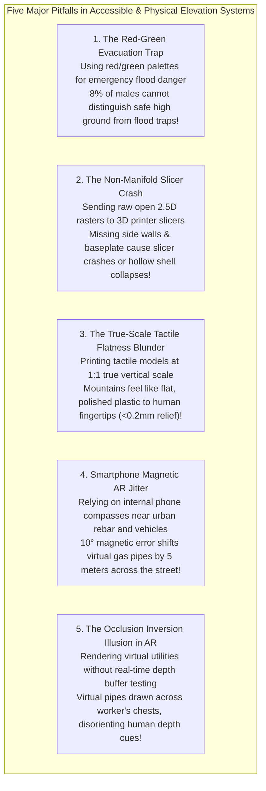

# Chapter 35: Accessibility, Physical/Tactile Terrain Models, and Field Augmented Reality (AR)

*Bringing elevation data off the 2D monitor: inclusive design, 3D-printed/CNC solid terrain, and in-situ augmented reality.*

---

## 35.7 Common Pitfalls and Key Takeaways

Extending digital elevation models into physical tactile matter and augmented reality viewports introduces physical and physiological failure modes unknown to traditional 2D GIS. When systems ignore color vision deficiencies, non-manifold geometry, or magnetic compass drift, the consequences range from civil construction utility strikes to life-threatening evacuation failures.

---

### 35.7.1 Common Pitfalls in Accessibility, Tactile Fabrication, and Field AR

#### 1. The Red-Green Evacuation Hazard Trap
* **The Failure Mode:** An emergency management agency releases a high-resolution coastal storm surge map, color-coding safe high-ground elevations in **Green** and dangerous flood inundation zones in **Red**.
* **Physiological Reality:** Approximately **$8\%$ of men and $0.5\%$ of women** have red-green color vision deficiency (deuteranomaly or protanomaly).
* **Forensic Consequence:** Under deuteranopic vision, both the red hazard zones and the green safe zones collapse into an identical, muddy brownish-yellow hue. Residents attempting to navigate evacuation routes in the dark cannot distinguish safe highland corridors from submerged, lethal lowlands.
* **Remedy:** Ban unassisted red-green color scales. Enforce **WCAG 2.2 dual-encoding**: pair colorblind-safe monotonic palettes (`viridis`, `batlow`, `cividis`) with clear vector hatching, labeled elevation contours, and explicit textual warnings.

#### 2. The Non-Manifold Slicer Crash and Unprojected Degree-Unit Spikes
* **The Failure Mode:** A GIS technician exports an elevation grid as an open surface mesh directly to a 3D printer slicing engine (`PrusaSlicer`, `Cura`) without extruding boundary walls, OR extrudes an unprojected `EPSG:4326` raster where $x,y$ are in decimal degrees ($\approx 0.0001^\circ$) while $z$ is in meters.
* **Geometric Reality:** A 2.5D raster is an open surface (zero thickness), whereas slicing engines compute planar intersections through closed solid volumes; meanwhile, mixing degrees with meters stretches vertical relief by $>100{,}000\times$.
* **Forensic Consequence:** Non-manifold boundary edges ($|\mathcal{F}(e)| = 1$) trigger slicer failures or fragile hollow prints, while unprojected degree grids produce unrecognizable needle-like plastic spikes.
* **Remedy:** Always reproject to a metric CRS first, then pass elevation rasters through automated **watertight manifold extrusion scripts** (`TouchTerrain`, `DEMto3D`), verifying $V - E + F = 2$ and scale-invariant normal closure $\epsilon_{\text{closure}} \le 10^{-6}$.

#### 3. The True-Scale Tactile Flatness Blunder (and Over-Smoothing)
* **The Failure Mode:** A well-meaning educator 3D-prints a physical tactile map of a region at $1:1$ vertical scale without exaggeration, OR applies heavy Gaussian smoothing to suppress printer noise.
* **Somatosensory Reality:** The human fingertip requires a vertical relief step of at least **$0.2\text{ to }0.5\text{ millimeters}$** to perceive topographic variation.
* **Forensic Consequence:** On a $20\text{-cm}$ wide model of a $100\text{-km}$ mountainous region ($1:500{,}000$ scale), a $1{,}000\text{-meter}$ mountain ridge corresponds to a physical bump of only **$2.0\text{ millimeters}$**, while rolling hills and river valleys drop below $0.1\text{ mm}$—feeling completely flat to blind users, while excessive smoothing erases the sharp stream channels and ridge crests needed for finger navigation.
* **Remedy:** Apply BANA-guided **Vertical Exaggeration ($VE = 2\times\text{ to }10\times$)** while preserving crisp valley thalwegs and ridgelines.

#### 4. The Smartphone Compass Jitter, Ellipsoid Height, and `float32` ECEF AR Traps
* **The Failure Mode:** A field utility inspection team uses a consumer smartphone AR application relying on internal magnetic compasses, raw GNSS ellipsoidal heights $h$, or raw `float32` ECEF GPU coordinates.
* **Physical Reality:** Electronic compasses near rebar and steel vehicles suffer **$\pm 5^\circ\text{ to }\pm 15^\circ$** heading drift; omitting the geoid/VDatum separation ($h - N$ or $h - \text{SEP}$) shifts virtual floodwater or buried pipes vertically by **$20\text{–}40\text{ m}$**; and 32-bit GPU floats at $6.378 \times 10^6\text{ m}$ ECEF quantize vertices in $0.5\text{ m}$ jitter steps.
* **Forensic Consequence:** At a viewing distance of only $20\text{ meters}$, an uncorrected $12^\circ$ heading error shifts a virtual buried gas main horizontally by:
  $$\Delta x = 20\text{ m} \times \tan(12^\circ) \approx \mathbf{4.25\text{ meters}}$$
  The holographic gas pipe appears safely beneath the sidewalk while running beneath the street excavation zone.
* **Remedy:** Mandate **RTK GNSS + VIO/VPS**, explicit vertical datum separation ($H = h - N$ / $z_{\text{CD}} = h - \text{SEP}$), and double-precision `RTC_CENTER` local ENU GPU rebasing.

#### 5. The Occlusion Inversion Illusion in AR
* **The Failure Mode:** An augmented reality engine projects a virtual flood inundation surface or proposed highway embankment into a tablet camera feed without reading the device's hardware depth sensor.
* **Perceptual Reality:** The human brain reconstructs depth hierarchy using occlusion cues: an object that obscures another is perceived as closer.
* **Forensic Consequence:** If a construction surveyor walks in front of the camera, the virtual CAD model is rendered directly on top of the real human. The observer's brain perceives an impossible optical contradiction: the person's feet touch the real ground in the foreground, but the virtual hill appears painted across their torso, collapsing depth perception.
* **Remedy:** Enforce **real-time depth buffer occlusion testing** using mobile LiDAR, Time-of-Flight (ToF), or neural depth densification, dynamically masking out virtual geometries behind physical foreground obstacles.

---

### 35.7.2 Key Takeaways for Practitioners

1. **Design for Color Vision Deficiency:** Never use color as the sole conveyor of elevation, bathymetry, or hazard. Guarantee monotonic luminance ($L^*$), linearize sRGB before Machado CVD testing, and apply dual-encoding (contours, hatching, text) under WCAG 2.2 rules.
2. **Watertight Metric Manifold Topology Is Mandatory:** Project to metric coordinates before extrusion and verify closed volumes ($V - E + F = 2$ and $\oint \hat{\mathbf{n}} dA = \mathbf{0}$) prior to slicing.
3. **Tactile Models Require Vertical Exaggeration & Crisp Thalwegs:** Apply $VE = 2\times\text{ to }10\times$ without over-smoothing streams/ridges, and integrate BANA-compliant $0.48\text{-mm}$ Braille annotations.
4. **Field AR Requires Centimeter Georeferencing & Datum Alignment:** Never rely on smartphone magnetic compasses or raw ellipsoidal heights; combine RTK GNSS + VIO/VPS with geoid/VDatum separation and `RTC_CENTER` ENU GPU coordinates.
5. **Enforce Dynamic Depth Occlusion:** Use mobile LiDAR or densified depth buffers to mask virtual terrain layers behind real-world physical foreground obstacles.
